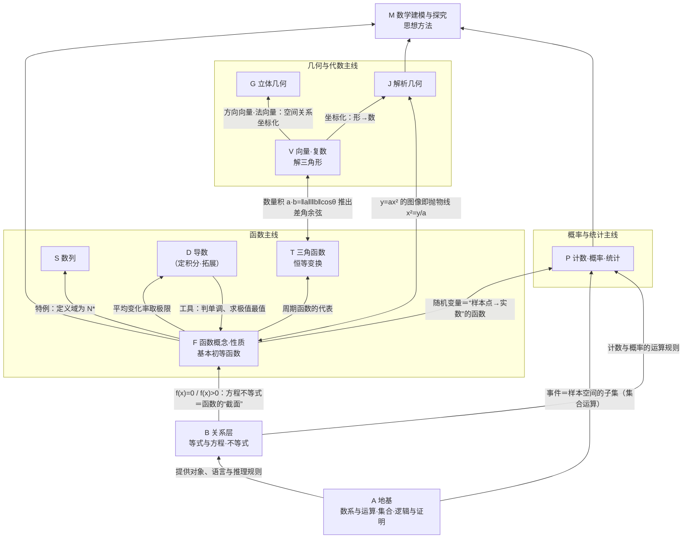

# 高中数学知识大厦 · L0 总图与导航

> 依据：人教B版教材（必修一至四、选择性必修一至三）＋《普通高中数学课程标准（2017年版2020年修订）》＋旧版教材中仍有价值的内容＋本项目16张速查表。
> 原则：**知识不删减**——高中数学（含旧教材）的知识点都挂到大厦里；新课标已删去的内容保留并标注为拓展；常见错误写成易错提醒。

---

## 一、数学研究什么：大厦的“地质勘探”

数学研究**数量关系**与**空间形式**。高中阶段把“世界”分成三类来研究，各用一套核心工具：

| 研究的世界 | 核心问题 | 核心对象 | 核心工具 | 主线 |
|---|---|---|---|---|
| 确定的**变化** | 一个量变，另一个量怎样跟着变？ | 函数 | 图像、性质、导数 | 函数主线 |
| 确定的**形状与位置** | 图形的大小、位置、形状怎样刻画与计算？ | 点线面体、曲线 | 公理推理、向量、坐标 | 几何与代数主线 |
| **不确定**的现象 | 结果不确定时，规律在哪里？ | 随机事件、随机变量、数据 | 计数、概率、统计推断 | 概率与统计主线 |

三条主线共用同一地基（数、集合、逻辑），通过同一个“关系层”（相等与不等）互相沟通，最终在屋顶（数学建模）回到现实世界。

---

## 二、L0 总图：大厦的整体结构

```
                 ┌───────────────────── 屋顶 ─────────────────────┐
                 │  M  数学建模与探究：现实问题 → 模型 → 求解 → 检验 → 修正  │
                 │      （物理运动、人口增长、周期现象、优化决策、质量控制…）    │
                 └──────────────▲──────────────▲──────────────▲──────┘
                                │              │              │
     ┌──────────────────────────┴───┐ ┌────────┴─────────────┐ ┌──┴──────────────────┐
     │ 函数主线（研究“变化”）           │ │ 几何与代数主线（“形与位”）  │ │ 概率与统计主线（“随机”）  │
     │ F 函数概念·性质·基本初等函数     │ │ G 立体几何（公理→推理）     │ │ P 计数原理·二项式定理    │
     │ T 三角函数（周期变化）           │ │ V 向量·复数·解三角形        │ │ P 概率→随机变量→分布    │
     │ S 数列（离散的函数）             │ │   （把“形”变成可运算的量）  │ │ P 统计：样本估计总体     │
     │ D 导数（变化的快慢）·定积分〔拓〕│ │ J 解析几何（坐标：形↔数）   │ │                         │
     └──────────────▲──────────────┘ └────────▲─────────────┘ └──▲──────────────────┘
                    └────────────────┬─────────┴───────────────────┘
          ┌──────────────────────────┴─────────────────────────────┐
          │ B 关系层：相等与不等 —— 方程（求未知）／不等式（比大小、求范围、求最值）│
          └──────────────────────────▲─────────────────────────────┘
          ┌──────────────────────────┴─────────────────────────────┐
          │ A 地基：数系与运算（N→Z→Q→R→C）｜集合（对象的语言）｜逻辑与推理证明 │
          └────────────────────────────────────────────────────────┘
   钢筋（贯穿各层）：函数与方程｜数形结合｜分类讨论｜转化与化归｜特殊与一般｜有限与无限｜或然与必然
```



> 读图方式：自下而上是**由基础到应用**（先有地基才能盖楼）；箭头上的字说明这条联系是什么性质（推出、特例、工具、等价转化），不是简单的“相关”。

---

## 三、L1 各层要点（每一层回答一个根本问题）

### A 地基：数学用什么“材料”和“规则”？ → `01-地基-数系集合逻辑推理.md`
- **数系扩充**：N →(引入负数，使减法封闭) Z →(引入分数，使除法封闭) Q →(引入无理数，使开方/极限封闭) R →(引入虚数，使 x²=−1 有解) C。每次扩充的动机都是“让某种运算封闭”，同时保留原有运算律（复数失去了大小顺序）。
- **式与运算**：整式、分式、根式、指数式、对数式的恒等变形——一切代数推理的“砖块”。
- **集合**：数学对象的统一语言（数集、点集、解集、事件、样本空间）。
- **逻辑**：命题、充要条件、量词与否定——推理的“语法”；充要条件 ⇔ 集合包含。
- **推理与证明**：归纳、类比（发现）→ 演绎（证明）；综合法、分析法、反证法、数学归纳法。
- **算法**【旧教材·拓展】：把推理写成可机械执行的步骤。

### B 关系层：量与量之间怎样比较？ → `02-关系层-等式与不等式.md`
- 相等关系 → 等式性质 → 方程（组）求未知。
- 不等关系 → 不等式性质（由“a>b ⇔ a−b>0”与实数运算推出）→ 解不等式、证不等式、求最值。
- 枢纽结论：**平方非负** ⇒ 基本不等式 ⇒ 最值。
- 与函数的关系：方程 f(x)=0 的根＝函数零点；不等式 f(x)>0 的解集＝图像在 x 轴上方的部分（“三个二次”是典型）。

### F 函数：一个量怎样随另一个量变化？ → `03-函数-概念性质与基本初等函数.md`
- 概念（对应关系）→ 三要素 → 性质（单调、奇偶、周期、对称、最值）→ 图像（作图、识图、用图）。
- 基本初等函数族：一次、二次、反比例、幂、指数、对数（指对互为反函数）。
- 函数与方程：零点、二分法；函数模型（线性增长 / 指数爆炸 / 对数增长）。

### T 三角函数：周期现象怎样刻画？ → `04-函数-三角函数与恒等变换.md`
- 任意角与弧度（把角变成实数）→ 单位圆定义 → 诱导公式（单位圆的对称性）→ 图像性质 → y=Asin(ωx+φ)（振幅、周期、相位）→ 恒等变换 → 最值与模型。

### S 数列：离散的变化有什么规律？ → `05-函数-数列.md`
- 数列＝定义域为 N*（或其有限子集）的函数；等差数列 ↔ 一次函数，等比数列 ↔ 指数型函数；通项、求和、递推、数学归纳法。

### D 导数：变化有多快？ → `06-函数-导数与定积分.md`
- 平均变化率 → 瞬时变化率（极限）→ 导数 → 几何意义（切线斜率）→ 求导法则 → 单调性、极值、最值、优化 → 定积分与微积分基本定理【旧教材·拓展】（导数的逆运算，面积与路程）。

### V 向量·复数·解三角形：怎样让“形”参与运算？ → `07-几何与代数-向量复数与解三角形.md`
- 向量：既有大小又有方向的量 → 线性运算 → 基本定理（基底）→ 坐标 → 数量积（长度、角度、垂直）。
- 复数：数系的最后一次扩充；复数 ↔ 点 ↔ 向量一一对应。
- 解三角形：正弦定理、余弦定理（余弦定理可由向量数量积推出）。
- 矩阵与变换【旧教材·拓展】。

### G 立体几何：空间图形怎样推理与度量？ → `08-几何与代数-立体几何.md`
- 几何体的结构 → 表面积体积 → 基本事实（公理）→ 平行、垂直的判定与性质 → 空间角与距离 → 空间向量与坐标法。
- 平面几何证明【旧教材·拓展（选修4-1）】作为初中衔接。

### J 解析几何：怎样用方程研究曲线？ → `09-几何与代数-解析几何.md`
- 坐标法思想 → 直线（倾斜角、斜率、五种方程、位置关系、距离）→ 圆 → 椭圆、双曲线、抛物线 → 直线与圆锥曲线（联立、韦达、弦长、中点弦）→ 曲线与方程（轨迹）→ 极坐标与参数方程【旧教材·拓展】。

### P 计数·概率·统计：不确定性怎样量化？ → `10-概率与统计-计数概率统计.md`
- 计数原理（分类加法、分步乘法）→ 排列组合 → 二项式定理。
- 随机事件（集合语言）→ 概率性质 → 古典概型 → 独立、条件概率 → 随机变量与分布（两点、二项、超几何、正态）→ 期望方差。
- 统计：抽样 → 用样本估计总体 → 成对数据（相关、回归、独立性检验）。

### M 屋顶与钢筋：数学怎样回到世界？怎样思考？ → `11-屋顶与钢筋-建模探究与思想方法.md`
- 数学建模流程、各主线的典型模型；七大思想方法与通用方法索引；高考考点导航。

---

## 四、跨层的“桥”（大厦为什么是一个整体）

| 编号 | 从 | 到 | 关系类型 | 内容 | 详见 |
|---|---|---|---|---|---|
| 桥1 | 集合 | 逻辑 | 等价转化 | A={x\|p}⊆B={x\|q} ⇔ p 是 q 的充分条件 | A3↔A4 |
| 桥2 | 集合 | 概率 | 同构 | 事件＝样本空间的子集；事件的和、积、对立＝并、交、补 | A3↔P2 |
| 桥3 | 函数 | 方程/不等式 | 等价转化 | f(x)=0 的根＝零点＝图像与 x 轴交点横坐标；f(x)=g(x) 的根＝两图像交点横坐标 | B↔F |
| 桥4 | 二次函数 | 一元二次方程、不等式 | 同一对象三种视角 | “三个二次”：Δ 决定根的个数，开口与根决定解集 | B3↔F4 |
| 桥5 | 函数 | 数列 | 特例 | 数列是定义域为 N* 的函数；等差↔一次函数，等比↔指数型函数 | F↔S |
| 桥6 | 函数 | 导数 | 推导＋工具 | 由平均变化率取极限定义导数；导数反过来判断单调性、求极值最值 | F↔D |
| 桥7 | 三角 | 向量 | 推导 | a·b=\|a\|\|b\|cosθ；用数量积推出 cos(α−β)（人教B版路线） | T↔V |
| 桥8 | 向量 | 解三角形 | 推导 | 由向量 a=b−c 两边平方得余弦定理 | V |
| 桥9 | 向量 | 立体几何 | 坐标化 | 方向向量、法向量把平行、垂直、角、距离化为数量积运算 | V↔G |
| 桥10 | 向量 | 解析几何 | 坐标化 | 点的坐标＝位置向量；直线方向向量 (1,k)、法向量 (A,B) | V↔J |
| 桥11 | 复数 | 向量 | 一一对应 | z=a+bi ↔ 点 Z(a,b) ↔ 向量 OZ；加减＝向量加减；\|z\|＝向量长度 | V |
| 桥12 | 二次函数 | 抛物线 | 同一对象 | y=ax²+bx+c 由 y=ax² 平移；y=ax² 即 x²=(1/a)y，焦点 (0,1/(4a)) | F↔J |
| 桥13 | 三角 | 解析几何 | 工具 | 倾斜角 k=tanα；圆、椭圆参数方程 x=a cosθ, y=b sinθ | T↔J |
| 桥14 | 计数 | 概率 | 工具 | 古典概型 P(A)=m/n 的 m、n 靠计数；二项式定理第 k+1 项＝二项分布概率 | P |
| 桥15 | 函数 | 统计 | 模型 | 回归方程是用数据拟合的函数；非线性回归靠换元化为线性 | F↔P |
| 桥16 | 推理 | 数列 | 方法 | 数学归纳法证明与正整数有关的命题；归纳—猜想—证明 | A5↔S |
| 桥17 | 不等式 | 函数最值 | 工具 | 基本不等式（一正二定三相等）、单调性、导数三条求最值路径 | B↔F↔D |
| 桥18 | 导数 | 定积分〔拓〕 | 互逆 | F′(x)=f(x) ⇒ ∫ₐᵇf(x)dx=F(b)−F(a) | D |

---

## 五、全系列统一约定（所有模块文件遵守）

### 1. 节点编号
- 模块字母：A 地基｜B 关系层｜F 函数｜T 三角｜S 数列｜D 导数｜V 向量复数解三角形｜G 立体几何｜J 解析几何｜P 计数概率统计｜M 建模与思想方法。
- 层级：`F` 模块（L1）→ `F2` 分支（L2）→ `F2.3` 知识单元（L3）→ 其下列表为知识点（L4 及以下，不再编号）。

### 2. 标签
| 标签 | 含义 |
|---|---|
| 〔B版·必修一·Ch2〕 | 对应人教B版教材位置 |
| 〔速查NN〕 | 对应本项目速查表 `数学-速查-NN-*.md` |
| 【旧教材·拓展】 | 2017版新课标已删除或不作要求，**保留**作拓展 |
| 【新教材补充】 | 人教B版新教材新增或改写的内容 |
| 【易错】 | 常见错误写法或误解，写明正确结论与理由 |
| 【初中衔接】 | 初中已学、高中直接使用的基础 |
| ★ | 核心结论（越多越重要） |

### 3. 关系符号
⇒ 推出｜⇔ 等价｜→ 应用于/导向｜⊂ 特例｜⇄ 互逆或一一对应｜⋯ 配合使用（不是推导）。

### 4. 每个知识单元的写法
- 结论写全三件套：**条件**、**结论**、**取等/边界/例外**。
- 方法、题型、易错点挂在对应知识单元的「方法」「易错」子分支下。
- 文件中的 Markdown 嵌套列表可直接导入 XMind、MindNode、幕布等工具生成可视化脑图。

---

## 六、人教B版教材 → 大厦位置

| 教材 | 章 | 大厦位置 |
|---|---|---|
| 必修一 | Ch1 集合与常用逻辑用语 | A3、A4 |
| 必修一 | Ch2 等式与不等式 | B |
| 必修一 | Ch3 函数 | F1、F2、F5 |
| 必修二 | Ch4 指数函数、对数函数与幂函数 | F3、F5 |
| 必修二 | Ch5 统计与概率 | P2、P4 |
| 必修二 | Ch6 平面向量初步 | V1、V2 |
| 必修三 | Ch7 三角函数 | T1–T4、T6 |
| 必修三 | Ch8 向量的数量积与三角恒等变换 | V2、T5（桥7） |
| 必修四 | Ch9 解三角形 | V4 |
| 必修四 | Ch10 复数 | A1、V3 |
| 必修四 | Ch11 立体几何初步 | G1–G6 |
| 选必一 | Ch1 空间向量与立体几何 | G7、G8 |
| 选必一 | Ch2 平面解析几何 | J1–J8 |
| 选必二 | Ch3 排列、组合与二项式定理 | P1 |
| 选必二 | Ch4 概率与统计 | P2、P3、P5 |
| 选必三 | Ch5 数列 | S（含数学归纳法） |
| 选必三 | Ch6 导数及其应用 | D1–D3 |

## 七、与本项目速查表的对应

| 速查表 | 大厦位置 |
|---|---|
| 00 数学思维总纲与集合逻辑 | A、M |
| 01 函数概念与性质体系 | F1、F2、F5 |
| 02 基本初等函数族谱 | F3 |
| 03 三角函数从圆到波 | T1–T4 |
| 04 三角恒等变换与解三角形 | T5、V4 |
| 05 导数微积分与函数深度分析 | D |
| 06 不等式与最值策略 | B |
| 07 数列模式递推与归纳 | S |
| 08 平面向量几何与代数的桥 | V1、V2 |
| 09 立体几何空间推理 | G |
| 10 直线与圆 | J1–J3 |
| 11 圆锥曲线定义性质方程 | J4–J6 |
| 12 直线与圆锥曲线联立策略 | J7 |
| 13 计数原理与二项式定理 | P1 |
| 14 概率分布与统计推断 | P2–P5 |
| 15 复数参数方程与极坐标 | V3、J9 |

---

## 八、怎样使用这座大厦（学习路径）

1. **先看本图**：知道自己学的东西在哪一层、哪条主线，和谁相连。
2. **进入模块**：先读模块开头的“核心问题”和 L1 骨架，再按 L2→L3 往下展开。
3. **双向走**：正推（由定义推出结论，顺着箭头读）；反推（拿到题，从“方法/题型”分支找到要用的结论，再回溯它的条件）。
4. **检验是否学会**：合上文件，能否独立画出模块的 L1 骨架、说清每条桥的依据、举出每个条件被去掉时的反例。
