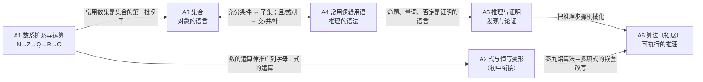

# 模块 A · 地基：数系与运算｜集合｜逻辑｜推理与证明｜算法

> 约定见 `00-总图与导航.md` 第五节。标签：〔B版·…〕教材位置｜〔速查NN〕项目速查表｜【旧教材·拓展】｜【新教材补充】｜【易错】｜【初中衔接】｜★核心。

## 本模块在大厦中的位置

- **下接**：无——这是大厦最底层。只承认少数原始约定：数的四则运算律、“对象属于/不属于某个整体”、命题非真即假。
- **上接**：
  - B 关系层：用实数运算和逻辑推出不等式性质。
  - F 函数：函数是两个非空数集之间的对应。
  - P 概率：事件是集合。
  - S 数列：数学归纳法。
  - 其余所有模块：每一步推导都要用逻辑语言和证明方法。
- **核心问题**：数学用什么“材料”（数、式）、什么“语言”（集合）、什么“规则”（逻辑与推理）来构建结论？
- **中心模型**：材料—语言—规则三角。
  - 数系每扩充一次，就让一种运算封闭。
  - 集合把“对象”统一起来。
  - 逻辑把“推出”规范起来。
  - 三者相通：充要条件 ⇔ 集合包含；“且/或/非” ⇔ 交/并/补。

## L1 骨架

---

## A1 数系扩充与运算〔B版·必修四·Ch10〕〔速查15〕

- **A1.1 扩充链：每一步都为了让某种运算封闭** ★
  - N（自然数，含 0）→ 引入负数 → Z（整数）：减法封闭。
  - Z → 引入分数 → Q（有理数）：除数非零时除法封闭。
  - Q → 引入无理数 → R（实数）：开方、取极限有结果（如 √2、π），数轴被填满。
  - R → 引入虚数单位 i（i²=−1）→ C（复数）：方程 x²+1=0 有解。
  - 扩充的两条规律：
    - 新数系包含旧数系，原有运算律（交换律、结合律、分配律）保持不变。
    - 有得有失：从 R 到 C 时，复数失去了大小顺序——两个不全为实数的复数不能比较大小。
- **A1.2 常用数集记号**
  - N 自然数集（含 0）；N\* 或 N₊ 正整数集；Z 整数集；Q 有理数集；R 实数集；C 复数集。
  - 包含关系：N\* ⫋ N ⫋ Z ⫋ Q ⫋ R ⫋ C。
- **A1.3 实数的结构** 【初中衔接】【新教材补充】
  - 有理数 ⇔ 有限小数或无限循环小数；无理数 ⇔ 无限不循环小数。
  - 实数与数轴上的点一一对应。
  - 绝对值的几何意义：|a| 是点 a 到原点的距离；|a−b| 是两点间的距离 → 接 B3。
  - 实数大小的定义：a>b ⇔ a−b>0 → 是 B2 不等式性质的起点。
  - √2 是无理数：用反证法证明 → 方法见 A5.3。
- **A1.4 复数接口**
  - 复数的概念、运算、几何意义 → 见 V3。
  - 地基只保留一个事实：复数 a+bi（a、b∈R）是数系的最后一次扩充，C 中所有一元 n 次方程都有根。
    - 后半句是代数基本定理【旧教材·拓展】，高中只需知道“实系数一元二次方程在 C 中总有根”。

## A2 式与恒等变形 【初中衔接】

- **A2.1 乘法公式**
  - (a±b)² = a² ± 2ab + b²
  - (a+b)(a−b) = a² − b²
  - (a±b)³ = a³ ± 3a²b + 3ab² ± b³
  - a³ ± b³ = (a±b)(a² ∓ ab + b²)
  - (a+b+c)² = a² + b² + c² + 2ab + 2bc + 2ca
  - 一般 (a+b)ⁿ 的展开 → 二项式定理 P1。
- **A2.2 因式分解**
  - 方法：提公因式、公式法、十字相乘、分组分解、配方。
  - 二次三项式：Δ≥0 时 ax²+bx+c = a(x−x₁)(x−x₂) → 接 B1。
- **A2.3 分式与根式**
  - 分式：分母 ≠ 0 是“运算有意义”的条件，不是结论成立的条件。
  - 根式：
    - √(a²) = |a|。
    - 偶次根号下被开方数 ≥ 0。
    - 分母有理化，如 1/(√(n+1)+√n) = √(n+1) − √n → 用于 S4 裂项。
  - 指数式、对数式的运算 → F3。
- **A2.4 配方法与待定系数法**（贯穿全书的两种变形）
  - 配方：ax²+bx+c = a(x + b/(2a))² + (4ac−b²)/(4a)（a≠0）→ 是 B1 求根公式、F4 二次函数顶点式的共同来源。
  - 待定系数：已知形式，比较对应系数列方程。
    - 恒等式两边同类项系数相等。
    - 用于求解析式、因式分解、裂项。
- **A2.5 多项式的余式定理与因式定理** 【旧教材·拓展】
  - 余式定理：多项式 f(x) 除以 (x−a)，余式为 f(a)。
  - 因式定理：(x−a) 是 f(x) 的因式 ⇔ f(a)=0。
  - 用途：高次多项式分解，如试根后用综合除法降次 → 接 B3.4 穿根法；与秦九韶算法（A6.3）同构。

## A3 集合〔B版·必修一·Ch1〕〔速查00〕

- **A3.1 概念与表示**
  - 定义：研究对象统称**元素**，元素组成的总体叫**集合**。
    - 旧教材说“某些指定的对象集在一起就构成集合”，意思相同。
  - 元素与集合：属于 ∈ / 不属于 ∉，二者必居其一。
  - 元素三特性：
    - 确定性：给定集合，任一对象是否属于它是确定的。
    - 互异性：同一元素不重复出现。含参集合求出参数后必须回代检验 → 易错。
    - 无序性：与元素排列顺序无关。数列、有序数对与此不同 → 桥到 S1。
  - 表示法：
    - 列举法：逐一列出。
    - 描述法：{x∈A | p(x)}，写出元素的共同特征。
    - 图示法：Venn 图，用封闭曲线表示。
    - 区间【新教材补充】：[a,b]、(a,b)、[a,b)、(a,+∞) 等。数轴上端点取到画实心点，取不到画空心点。
  - 分类：有限集、无限集、空集 ∅（不含任何元素）。
- **A3.2 集合间的关系**
  - 子集 A⊆B：任意 x∈A 都有 x∈B。
  - 真子集 A⫋B：A⊆B，且存在 x₀∈B 但 x₀∉A。
  - 相等：A=B ⇔ A⊆B 且 B⊆A——证明集合相等的标准路线。
  - 空集：∅⊆A 对任何 A 成立；A 非空时 ∅⫋A。
  - 全集 U：含所研究问题的全部元素的集合，因问题而定。
  - ★子集个数：含 n 个元素的集合有 2ⁿ 个子集。
    - 依据：每个元素“选或不选”两种可能，用分步乘法计数（桥到 P1）。
    - 真子集有 2ⁿ−1 个，非空真子集有 2ⁿ−2 个。
- **A3.3 基本运算**
  - 交集 A∩B={x | x∈A 且 x∈B}：A∩A=A，A∩∅=∅，A∩B=B∩A。
  - 并集 A∪B={x | x∈A 或 x∈B}：A∪A=A，A∪∅=A，A∪B=B∪A。
  - 补集 ∁_U A={x | x∈U 且 x∉A}：∁_U(∁_U A)=A，A∩∁_U A=∅，A∪∁_U A=U。
    - 记号：补集写作 ∁_U A，不写成 C_U A。
  - 运算律：
    - 交换律、结合律。
    - 分配律：A∩(B∪C)=(A∩B)∪(A∩C)，A∪(B∩C)=(A∪B)∩(A∪C)。
    - 德·摩根律：∁_U(A∩B)=∁_U A ∪ ∁_U B；∁_U(A∪B)=∁_U A ∩ ∁_U B。
  - 容斥原理：card(A∪B)=card(A)+card(B)−card(A∩B)。
    - 三个集合时：card(A∪B∪C)=ΣcardA − Σcard(A∩B) + card(A∩B∩C)。
  - ★两个重要关系：A⊆B ⇔ A∩B=A ⇔ A∪B=B。
- **A3.4 方法**
  - 抓元素：元素是解决集合问题的核心。
    - 先认清元素是什么（数、点、函数值……），再化简元素，再做等价转换。
    - 化简元素：遇到绝对值、根号、平方，先解出元素的范围再运算。
  - 选工具：
    - 数集运算用数轴，注意端点虚实。
    - 点集运算用图形：点集的几何意义是函数或方程的曲线 → 桥到 J8。
    - 一般集合用 Venn 图。
  - 元素较复杂时，先化简再运算。
  - 题型：
    - 语言转换：集合语言 ↔ 自然语言、不等式、图形。
    - 含参问题：由已知运算关系求参数。依互异性和端点分类讨论，结合数轴。
    - 新定义集合或运算的创新题：严格按定义翻译。
  - 补集思想：正面情况多时先求补集，再取补 → 对应 P2 中的对立事件。
- **A3.5 易错**
  - 空集：
    - 误以为 ∅={0}。正：∅ 不含元素，{0} 含一个元素 0，{∅} 含一个元素 ∅。
    - 写子集时漏写 ∅。
    - 已知 A⊆B 求参数时，漏掉 A=∅ 的情形。
  - 分不清元素：
    - {x | y=x²+1, x∈R} = R，元素是自变量 x。
    - {y | y=x²+1, x∈R} = [1,+∞)，元素是函数值 y。
    - {(x,y) | y=x²+1} 是点集，即一条抛物线。
  - 端点：数轴上取等与否决定实心或空心，求参数时端点能否取等要单独检验。

## A4 常用逻辑用语〔B版·必修一·Ch1〕〔速查00〕

- **A4.1 命题**
  - 可以判断真假的陈述句叫命题。
  - 命题形式“若 p，则 q”，p 叫条件，q 叫结论。
- **A4.2 充分条件与必要条件** ★
  - 定义：
    - p⇒q：p 是 q 的充分条件，q 是 p 的必要条件。
    - p⇔q：p 与 q 互为充要条件。
  - 四种结论：
    - 充分不必要：p⇒q 且 q⇏p。
    - 必要不充分：q⇒p 且 p⇏q。
    - 充要：p⇔q。
    - 既不充分也不必要：两个方向都推不出。
  - 集合观点（桥1）：设 A={x | p(x)}，B={x | q(x)}。
    - A⊆B ⇔ p 是 q 的充分条件。
    - A⫋B ⇔ p 是 q 的充分不必要条件。
    - A⊇B ⇔ p 是 q 的必要条件。
    - A=B ⇔ p 是 q 的充要条件。
    - 口诀：小范围 ⇒ 大范围。
    - 例：x>5 ⇒ x>3，反之不成立。所以“x>5”是“x>3”的充分不必要条件，“x>3”是“x>5”的必要不充分条件。
  - 判定方法：
    - 定义法：分别检验两个方向的推出关系。
    - 转化法：某个方向不好判断时，改判它的逆否命题（逆否命题与原命题同真同假）。
    - 集合法：比较两个解集的包含关系。
  - 证明与求解：
    - 证明充要条件：先分清哪一部分证充分性、哪一部分证必要性，两个方向都要证。
    - 求充要条件：每一步变形都必须是等价变形。
  - 应用：由“p 是 q 的××条件”化为集合包含关系，求参数范围。端点要单独检验。
- **A4.3 全称量词与存在量词**
  - 全称量词命题：∀x∈M, p(x)。
    - 旧称“全称命题”，常用词有“任意”“所有”“每一个”。
  - 存在量词命题：∃x∈M, p(x)。
    - 旧称“特称命题”，常用词有“存在”“有一个”“至少有一个”。
    - 新教材已改称存在量词命题。
  - ★否定规则：改量词，否结论，范围 M 不变。
    - ¬(∀x∈M, p(x)) ⇔ ∃x∈M, ¬p(x)
    - ¬(∃x∈M, p(x)) ⇔ ∀x∈M, ¬p(x)
  - 真假判断：
    - 全称命题为真要证明；为假只需举一个反例。
    - 存在命题为真只需举一个例子；为假要证明。
    - 直接判断困难时，改判它的否定。
  - 同一个量词命题可以有多种自然语言表述，判断前先改写成规范形式。
- **A4.4 常用正面词语与否定**（“否定”指命题的否定）
  | 原词 | 否定 |
  |---|---|
  | 等于 | 不等于 |
  | 大于 | 不大于（即 ≤） |
  | 小于 | 不小于（即 ≥） |
  | 是 | 不是 |
  | 都是 | 不都是（至少有一个不是） |
  | 都不是 | 至少有一个是 |
  | 至多有一个 | 至少有两个 |
  | 至少有一个 | 一个也没有 |
  | 任意 x 都满足 p | 存在某个 x 不满足 p |
  | 所有的 x 都满足 p | 某些 x 不满足 p |
  | 一定 | 不一定 |
  | 唯一（恰有一个） | 没有或至少有两个 |
  - 【易错】否定时结论也要取反：“任意 x 都满足 p”的否定是“存在某个 x **不**满足 p”，不是“存在某个 x 满足 p”。只换量词不否结论是常见错误。
  - 【易错】“唯一（恰有一个）”的否定是“一个也没有或至少有两个”，只写“至少有两个”会漏掉一种情况。
- **A4.5 逻辑联结词与四种命题** 【旧教材·拓展】（2019版教材已删除，作为理解工具保留）
  - 联结词：且 p∧q，或 p∨q，非 ¬p。
    - 不含联结词的叫简单命题，含联结词的叫复合命题。
  - 真值表（1 真 0 假）：
    | p | q | p∧q | p∨q | ¬p |
    |---|---|---|---|---|
    | 1 | 1 | 1 | 1 | 0 |
    | 1 | 0 | 0 | 1 | 0 |
    | 0 | 1 | 0 | 1 | 1 |
    | 0 | 0 | 0 | 0 | 1 |
    - 口诀：且——全真才真；或——全假才假；非——取反。
  - 与集合的对应：且↔交，或↔并，非↔补。
    - ¬(p∧q) ⇔ ¬p∨¬q，¬(p∨q) ⇔ ¬p∧¬q，与德·摩根律同构。
  - 复合命题判断真假的步骤：分清结构 → 判断 p、q 的真假 → 查真值表。
  - 应用：由复合命题的真假求参数范围。
    - 例：“p∨q 真且 p∧q 假” ⇔ p、q 一真一假，分两种情况再取并集。
  - 四种命题：
    - 原命题：若 p 则 q。
    - 逆命题：若 q 则 p。
    - 否命题：若 ¬p 则 ¬q。
    - 逆否命题：若 ¬q 则 ¬p。
    - 关系：原命题与逆命题互逆，原命题与否命题互否，原命题与逆否命题互为逆否；逆命题与否命题互为逆否。
    - ★互为逆否的两个命题同真同假。这是“转化法”判断充要条件的依据。
  - 否命题与命题的否定的区别：
    - 否命题：若 ¬p 则 ¬q，条件和结论都否定。
    - 命题的否定：若 p 则 ¬q，只否定结论。对含量词的命题，即“∃x, p(x) 且 ¬q(x)”。
  - 【易错】反证法不等于证明逆否命题：反证法是“假设结论的否定成立，推出矛盾”。矛盾可以是与已知、定义定理、或假设本身矛盾，不等同于证明逆否命题。只有当矛盾恰好是“¬p”时，才与逆否证法一致。
- **A4.6 易错**
  - 写其他命题时分不清原命题的条件和结论：先改写成“若…则…”。
  - 不会利用“互为逆否同真同假”来转换判断。
  - 一个结论可以有多个充分条件，也可以有多个必要条件，不要只找一个。
  - 证明充要条件时，推理方向把握不准。
  - 写否定时不完整：只换量词不否结论；“或”“且”没有互换。

## A5 推理与证明〔B版：不单列，分散于各章；数学归纳法见选必三·Ch5〕〔速查00、07〕

- **A5.1 合情推理（用来发现）** 【旧教材·拓展】（不再单设章节，思想保留）
  - 归纳推理：由部分对象具有某性质，推出全体具有该性质；或由个别事实概括出一般结论。
    - 特点：
      - 结论超出前提的范围。
      - 结论只是猜想，必须经过证明或检验。
      - 富有创造性，是提出问题、作出猜想的起点。
    - 步骤：观察、分析有限的材料 → 提出带规律性的猜想 → 检验猜想。
    - 分类：完全归纳（逐一验证全部情形，结论可靠）；不完全归纳（结论不一定可靠）。
  - 类比推理：两类对象在某些方面相似，由一类的已知性质推测另一类的类似性质。
    - 特点：由特殊到特殊；以旧知识为基础；结论是猜测，但有发现的功能。
    - 步骤：找出两类对象确切的相似特征 → 用一类的已知性质推测另一类 → 检验猜想。
    - 关键：找到合适的类比对象，并找准两类事物之间的相似性。
    - 常见题型：
      - 平面 → 空间：升维类比。
      - 椭圆 ↔ 双曲线：同级类比。
      - 等差 ↔ 等比：运算类比，和↔积、差↔商、倍数↔乘方 → 桥到 S2/S3。
    - 平面与空间元素的对应（习惯对应，不是定律）：
      - 点 → 线（例如“点到直线的距离”对应“点到平面的距离”时，直线升为平面；对象本身的常见对应也可写成点→点、线→面）。
      - 线 → 面；圆 → 球；三角形 → 三棱锥；角 → 二面角；面积 → 体积；周长 → 表面积。
  - 合情推理的一般思路：具体问题 → 观察、比较、联想 → 归纳或类比 → 提出猜想 → 证明，或举反例否定。
- **A5.2 演绎推理（用来证明）** ★
  - 定义：由一般性的真命题或逻辑规则推出特殊情形为真，即从一般到特殊。
  - 特征：前提为真且推理形式正确时，结论必定为真。
  - 三段论：大前提（一般原理）、小前提（特殊情形）、结论。
    - 集合依据：M 的所有元素具有性质 P，S⊆M，所以 S 的所有元素都具有性质 P。
  - 复杂证明由多个三段论串联而成。大前提、小前提、推理形式任一出错，结论就不可靠。
- **A5.3 合情推理与演绎推理的关系**
  - 区别：
    - 思维方向：归纳从个别到一般，类比从个别到个别，演绎从一般到个别。
    - 可靠性：前提为真时，演绎推理的结论必真，合情推理的结论不一定真。
  - 联系：合情推理负责发现和猜想，演绎推理负责验证和证明。演绎推理分析条件、图形时，也离不开合情推理。
  - 易错：把不完全归纳或类比当作证明；归纳得到的结论不一定正确。
- **A5.4 直接证明**
  - 综合法（由因导果）：
    - 从已知条件和定义、公理、定理出发，逐步推出结论：P ⇒ Q₁ ⇒ Q₂ ⇒ … ⇒ Q。
    - 每一步得到的是前一步的必然结果，也就是前一步成立的必要条件。
  - 分析法（执果索因）：
    - 从结论出发，逐步寻找使它成立的**充分条件**，直到归结为明显成立的条件：Q ⇐ P₁ ⇐ P₂ ⇐ … ⇐ P。
    - 书写格式：“要证 A，只需证 B”，其中 B ⇒ A。
  - 比较：
    - 分析法从“未知”看“需知”，便于找思路。
    - 综合法从“已知”看“可知”，便于书写。
    - 联合使用：先用分析法找到突破口，再用综合法书写；或两头推、在中间汇合（P⇒…⇒P′，Q⇐…⇐Q′，P′⇒Q′）。
  - 分析法的适用场合：已知与结论之间的联系不明显，不清楚要用哪些知识时。
  - 【易错】分析法只要求每一步找到的是充分条件，即后一步 ⇒ 前一步，不要求每一步可逆。要求可逆的是“求充要条件”或“同解变形”。
- **A5.5 间接证明：反证法**
  - 步骤：
    - 否定结论：准确写出结论的反面（见 A4.4 否定词表）。
    - 推理：把“结论的反面”当作条件参与推理，必须用到这个假设。
    - 导出矛盾：与已知、假设、定义定理公理或事实之一矛盾，要说清和什么矛盾。
    - 下结论：假设不成立，原结论成立。
  - 逻辑实质：肯定条件 P、否定结论 Q 后推出矛盾，说明“P 且 ¬Q”为假，所以“若 P 则 Q”为真。
  - 适用场合：
    - 结论是否定形式（“不是”“不存在”）。
    - 结论含“至多”“至少”。
    - 唯一性、存在性命题。
    - 结论的反面比原结论更具体、更容易研究。
  - 典例：√2 是无理数；素数有无穷多个。
- **A5.6 数学归纳法（方法本体）** → 接口 S6（数列中的应用）
  - 适用：与正整数 n 有关的命题 P(n)，n≥n₀，n₀∈N\*。
  - 两步缺一不可：
    - 奠基：验证 P(n₀) 成立。n₀ 是使命题有意义的最小正整数，不一定是 1。
    - 递推：假设 P(k) 成立（k≥n₀，k∈N\*），**用这个假设**推出 P(k+1) 成立。
  - 结论：P(n) 对一切 n≥n₀ 的正整数成立。
  - 原理：奠基提供起点，递推提供“传递性”。两步合在一起，像多米诺骨牌一样覆盖所有 n≥n₀。
  - 题型与要领：
    - 证明恒等式：从 k 到 k+1 时，看左边增加了哪几项，先凑出归纳假设的形式再代入。
    - 证明不等式：常配合放缩、比较法、分析法（→ B6）。
    - 证明整除：关键是“凑项”，用增项、减项、拆项、因式分解凑出 n=k 时的式子。
    - 平面几何问题【旧教材·拓展】：关键是“找项”。
      - 弄清几何元素从 k 个变为 k+1 个时，所求的量增加了多少。
      - 分析不出时，可以把 n=k、n=k+1 代入式子作差。
    - 归纳—猜想—证明：先计算前几项、观察、猜想通项或规律，再用数学归纳法证明 → S6。
  - 易错：
    - 设而不用：递推一步没有用到归纳假设，就不是数学归纳法。
    - 机械套用两个步骤，奠基的 n₀ 取错。
    - 没有搞清从 k 到 k+1 的“跨度”：增加的项数不一定是 1。例如 1+1/2+…+1/2ⁿ 从 k 到 k+1 增加了 2ᵏ 项。
  - 第二数学归纳法【旧教材·拓展】：递推一步改为“假设 n≤k 时都成立，推出 n=k+1 成立”。适用于需要前面多项的递推，例如斐波那契型数列。

## A6 算法 【旧教材·拓展】（2017版课标已删除整章，算法思想保留）

- **A6.1 算法的概念与特征**
  - 算法：按一定规则解决某一类问题的、明确且有限的步骤。
  - 特征：
    - 有穷性：步骤有限，在有限步内结束。
    - 确定性：每一步含义明确、没有歧义，执行结果唯一确定。
    - 逻辑性：步骤有先后顺序。
    - 不唯一性：同一问题可以有多种算法。
    - 普遍性：解决的是一类问题，可以重复使用。
    - 【易错】不要把确定性与普遍性混淆：“解决一类问题、可以重复使用”是普遍性（通用性）；确定性指每一步无歧义。
  - 设计要求：
    - 能解决一类问题、可以重复使用。
    - 尽量简单、步骤少。
    - 正确，计算机能执行。
    - 有限步后得到结果。
- **A6.2 程序框图与三种基本结构**
  - 框图符号：
    | 符号 | 名称 | 功能 |
    |---|---|---|
    | 圆角矩形 | 终端框（起止框） | 算法的开始与结束 |
    | 平行四边形 | 输入、输出框 | 输入和输出信息 |
    | 矩形 | 处理框（执行框） | 赋值、计算 |
    | 菱形 | 判断框 | 判断条件是否成立，出口标“是/Y”“否/N” |
    | 带箭头的线 | 流程线 | 连接各框 |
    | 小圆 | 连接点 | 连接框图的两部分 |
    | 虚线框 | 注释框 | 帮助理解 |
    - 部分教辅还画“循环框”，不是标准符号。
  - 画图规则：
    - 使用标准符号，从上到下、从左到右画。
    - 除判断框外，一般只有一个入口和一个出口。
    - 判断框是“是/否”两分支；多分支判断用条件结构嵌套实现。
    - 框内文字简练。
  - 三种结构：
    - 顺序结构：步骤依次执行。不需要分情况时用。
    - 条件结构：判断后选择分支。需要分情况讨论时用。
    - 循环结构：有规律地重复执行，必须引入计数变量和累加（累乘）变量。
      - 当型：先判断后执行，条件满足时执行循环体。
      - 直到型：先执行后判断，条件满足时终止循环。
      - 同一问题用两种循环写时，判断条件恰好相反。
  - 读框图要“知头、知尾、知规律”：写出变量的初值，列出前几次循环中变量的变化，判断何时退出。
  - 易错：计数变量“递增在前还是在后”，即 i=i+1 写在累加语句之前还是之后，会让循环次数或结果差一项。要逐步列表核对。
- **A6.3 基本算法语句**（BASIC 风格）
  - 输入语句 INPUT“提示内容”；变量，例如 INPUT“x=”；x。
  - 输出语句 PRINT“提示内容”；表达式，例如 PRINT“S=”；S。
  - 赋值语句“变量 = 表达式”：把右边的值赋给左边的变量。
    - 左边只能是变量名。2=x、A+B=C 都是错的。
    - 不能用来做代数演算，y=(x+1)(x−1)=x²−1 是错的。
    - 赋值号与数学中的等号不同：N=N+1 表示把 N 的当前值加 1 后再赋给 N。
  - 条件语句：IF 条件 THEN 语句体1 ELSE 语句体2 END IF；或单分支 IF…THEN…END IF。
  - 循环语句：
    - 当型：WHILE 条件 … WEND。
    - 直到型：DO … LOOP UNTIL 条件。
  - 语句与结构的对应：顺序结构对应输入、输出、赋值语句；条件结构对应条件语句；循环结构对应循环语句。
  - 任何循环结构都可以用当型（WHILE）语句实现。
  - 易错：有两个以上条件分支时，分支顺序混乱。
- **A6.4 算法案例**
  - 辗转相除法（求两正整数的最大公约数）：
    - 依据：gcd(m,n)=gcd(n, m mod n)。
    - 步骤：
      - 输入 m>n。
      - 令 r 为 m 除以 n 的余数。
      - 若 r≠0，令 m=n、n=r，返回上一步；否则输出 n。
    - 框图版本先执行 m=n、n=r 再判断，退出时输出 m。两种写法变量时序不同，结果相同。
    - 例：gcd(8251, 6105)。
      - 8251=1×6105+2146；6105=2×2146+1813；2146=1×1813+333；1813=5×333+148；333=2×148+37；148=4×37。
      - 所以最大公约数为 37。
  - 更相减损术（《九章算术》）：
    - 原文大意是“可半者半之……以少减多，更相减损，求其等也，以等数约之”。
    - 步骤：
      - 两数都是偶数时，先用 2 约简，可以连续约简。
      - 以大数减小数，用差与较小的数继续比较、相减，直到两数相等。
      - 这个等数，乘上先前约去的 2 的幂，就是最大公约数。
    - 学法版程序（只做减法）：r=m−n；若 n>r，则 m=n、n=r，否则 m=r；重复到 m=n，输出 n。省略“先用 2 约简”结果仍然正确。
    - 与辗转相除法比较：
      - 一个以除法为主，一个以减法为主；辗转相除法的步数一般更少。
      - 辗转相除法在余数为 0 时结束，更相减损术在减数与差相等时结束。
  - 秦九韶算法（多项式求值）：
    - 嵌套改写：f(x)=(…((aₙx+aₙ₋₁)x+aₙ₋₂)x+…+a₁)x+a₀。
    - 递推：v₀=aₙ，vₖ=vₖ₋₁·x+aₙ₋ₖ（k=1,2,…,n），vₙ=f(x)。
    - 只需 n 次乘法和 n 次加法，用循环结构实现。
    - 易错：改写多项式时漏掉系数为 0 的项。
  - 进位制：
    - k 进制（k>1，k∈Z）有 k 个数字 0,1,…,k−1，逢 k 进一。
    - 写法 aₙaₙ₋₁…a₁a₀₍ₖ₎，其中 0<aₙ<k，0≤aᵢ<k（i<n）。
    - k 进制化十进制：aₙkⁿ+aₙ₋₁kⁿ⁻¹+…+a₁k+a₀，可以用秦九韶算法计算。
    - 十进制化 k 进制：除 k 取余，直到商为 0，余数倒序排列。
    - 两个非十进制之间：以十进制为中转。

---

## 与其他模块的桥

| 桥 | 本模块节点 | 对方节点 | 关系 |
|---|---|---|---|
| 桥1 | A3.2 子集 | A4.2 充分条件 | 等价转化：A⊆B ⇔ p 是 q 的充分条件 |
| 桥2 | A3.3 交并补 | P2 事件运算 | 同构：事件的积、和、对立 ↔ 集合的交、并、补；补集思想 ↔ 对立事件 |
| 桥16 | A5.6 数学归纳法 | S6 | 方法 → 应用：归纳—猜想—证明数列通项、数列不等式 |
| — | A1.3 a>b ⇔ a−b>0 | B2 | 定义 → 推出全部不等式性质 |
| — | A1.4 复数接口 | V3 | 数系扩充的最后一步，细节在 V3 |
| — | A2.4 配方 | B1 求根公式、F4 顶点式 | 同一变形的两种用途 |
| — | A3.4 点集 | J8 曲线与方程 | 曲线 ＝ 满足方程的点的集合 |
| — | A3.2 子集个数 2ⁿ | P1 分步乘法计数 | 推导依据 |
| — | A5.4 综合法、分析法 | B6 不等式证明 | 证明方法的主要用武之地 |
| — | A5.1 类比 | S2↔S3、J4↔J5、平面↔空间（G） | 类比的典型素材 |
| — | A6.4 秦九韶算法 | A2.5 余式定理 | 嵌套求值 ＝ 综合除法 |
