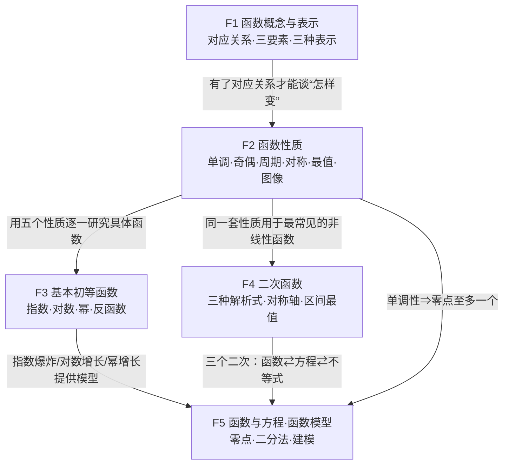

# F 函数：概念·性质·基本初等函数·函数与方程

> 所属：函数主线（研究“变化”）。约定见 `00-总图与导航.md` 第五节。
> 依据：人教B版必修一 Ch3、必修二 Ch4＋〔速查01、02〕。

---

## 〇、本模块在大厦中的位置

- **下接**：A 地基（集合给出定义域、值域的语言；实数运算给出解析式的变形规则）；B 关系层（等式、不等式性质是比较函数值的依据）。
- **上接**：T 三角函数（周期函数的代表）、S 数列（定义域为 N* 的函数）、D 导数（研究变化快慢的工具）、J 解析几何（二次函数图像即抛物线）、P 概率统计（随机变量、回归方程都是函数）、M 建模（函数模型）。

**核心问题**：一个量变化时，另一个量怎样随之变化？怎样从“对应关系”读出变化的规律（增减、对称、重复、最值），并用它解方程、不等式和实际问题？

**中心模型：“一个对象，三种表示，五个性质，一张族谱”**

```
            对应关系 f（核心）
   定义域 A ────────────────→ 值域 f(A)
       │  三种表示：解析式 ⇄ 图像 ⇄ 表格（数形结合）
       ▼
   五个性质：单调性（增减）｜奇偶性（关于轴/原点对称）｜周期性（重复）｜对称性（一般轴/中心）｜最值（上下界能否取到）
       ▼
   族谱：一次·二次·反比例 → 幂函数 x^α ；指数 aˣ ⇄（反函数，关于 y=x 对称）⇄ 对数 logₐx
       ▼
   函数与方程：f(x)=0 的根 ＝ 零点 ＝ 图像与 x 轴交点横坐标 → 二分法、函数模型
```

---

## 一、L1 骨架



> 读法：F1 定义“是什么”，F2 给出研究任何函数的通用“检查清单”，F3、F4 是把清单用在具体函数族上，F5 把函数反过来用于解方程、建模型。

---

## 二、L2/L3 展开

### F1 函数概念与表示〔B版·必修一·Ch3〕〔速查01〕

- **F1.1 函数的定义**
  - 【新教材补充】对应关系定义（B版）：A、B 是非空**实数集**，按对应关系 f，A 中**任意**一个 x 在 B 中都有**唯一确定**的 y=f(x) 与之对应，称 f:A→B 为从 A 到 B 的函数；x 为自变量，A 为定义域，{f(x)|x∈A}⊆B 为值域。
  - 【旧教材·拓展】映射定义：A、B 为非空集合，A 中每个元素在 B 中有唯一元素对应，称 f:A→B 为映射；函数＝A、B 都是非空数集的映射（函数是特殊的映射）。例如 A={a,b,c}→B={1,2,3}：a→1、b→2、c→3 是一对一；a、b、c 都→2 是多对一，二者都是映射。
    - 允许：一对一、多对一；不允许：一对多（一个 x 对应两个 y）；A 中不能有元素“没有对应”。
  - 核心：**对应关系**是核心；定义域与对应关系一旦确定，值域随之确定 ⇒ 判断两个函数相同只看定义域与对应关系。
  - 易错：把 f(x) 与 f(x+1) 当成同一个函数（对应关系“作用在括号里的整体”，自变量不同）；函数定义理解不到位（如把“一对多”的关系当函数）。
- **F1.2 三要素与三种表示**
  - 三要素：定义域（自变量取值范围）、对应关系（常用解析式表达）、值域（函数值的取值范围）。
  - 三种表示：解析法（等式）、列表法（表格）、图象法（图像）；三者可互相转化，图像是“数形结合”的载体。
  - 分段函数：自变量在不同范围内对应关系不同的**一个**函数；定义域＝各段定义域的并集，值域＝各段值域的并集，图像＝各段图像合起来。
- **F1.3 定义域的求法**
  - 具体函数（取各部分有意义范围的交集）
    - 整式、奇次根式：R。
    - 分式 g(x)/h(x)：h(x)≠0。
    - 偶次根式 ²ⁿ√g(x)（n∈N*）：g(x)≥0。
    - 零次幂 [f(x)]⁰：f(x)≠0。
    - 对数 logₐg(x)：g(x)>0；指数、对数的底数 a>0 且 a≠1（底数含 x 时同样要求）。
    - y=tan x：{x | x≠kπ+π/2，k∈Z}。
    - 实际问题：还要符合实际意义（长度为正、件数为整数等）。
  - 抽象函数（“括号里的整体取值范围相同”）
    - 已知 f(x) 定义域 [a,b]，求 f[g(x)]：解 a≤g(x)≤b。
    - 已知 f[g(x)] 定义域 [a,b]，求 f(x)：由 a≤x≤b 求 g(x) 的取值范围。
    - 已知 f[g(x)] 定义域，求 f[h(x)]：先求 f(x) 的定义域，再解 h(x) 属于该范围。
  - 含参数：如“定义域为 R 求参数”，转化为不等式恒成立；二次项系数含参时先讨论系数是否为 0；方法：二次函数图像法、分离变量法、导数法。〔接口：F4.5、B3〕
- **F1.4 解析式的求法**
  - 代入法：已知 f(x) 求 f[g(x)]，用 g(x) 替换 x。
  - 待定系数法：已知函数类型（一次、二次、指数型…）先设式再定系数。
  - 配凑法：在 f[g(x)] 的表达式中凑出 g(x)，再整体换成 x。
  - 换元法：令 t=g(x)，反解 x 代回，**注意 t 的取值范围**就是新函数的定义域。
  - 方程组法：已知 f(x) 与 f[g(x)]（如 f(1/x)、f(−x)）的关系式，用 g(x) 替换 x 再得一式，联立消去。
  - 特殊值法：赋值使问题具体化（抽象函数常用）。
  - 由图像求解析式（读点、读对称轴、读渐近线等）。
  - 要求：求出解析式后**必须写明定义域**。
- **F1.5 值域与最值的求法**
  - 关系：定义域与对应关系确定后值域确定；值域有端点且能取到时，端点即最值，所以求值域与求最值相通。
  - 方法
    - 基本函数法：直接用一次、二次、反比例、指对幂、三角函数的图像性质。
    - 单调性法：先定单调性，再代端点。
    - 配方法：二次（型）函数。〔接口 F4.4〕
    - 换元法：代数换元（如 t=√(…)、t=2ˣ）或三角换元；换元后新变量的范围必须先求。
    - 不等式法：基本不等式（一正二定三相等）。〔接口 B4〕
    - 数形结合法：几何意义（斜率、距离）或函数图像。
    - 导数法：求极值并与端点值比较。〔接口 D3.3〕
    - 【旧教材·拓展】判别式法：把 y=f(x) 化为关于 x 的二次方程 F(x,y)=0，由“有实根”得 Δ≥0；二次项系数含 y 时为 0 的情形单独判断，求出的 y 要回代检验对应的 x 是否在定义域内。〔详见二次函数大厦 R12〕
    - 【旧教材·拓展】反函数法：原函数的值域＝反函数的定义域。
- **F1.6 方法·易错（总结升华）**
  - 恒成立分离变量：a>f(x) 恒成立 ⇔ a>f(x)ₘₐₓ；a<f(x) 恒成立 ⇔ a<f(x)ₘᵢₙ（前提：f 在该范围上**能取到**最值）。
    - 边界：若 f 有上界 L 但取不到（如 f(x)=x 在 (0,1) 上），则 a≥f(x) 恒成立 ⇔ a≥L，a>f(x) 恒成立 ⇔ a≥L（因为 f(x)<L≤a）。〔与 B3 恒成立、F2.6 同源〕

### F2 函数的基本性质〔B版·必修一·Ch3〕〔速查01〕

- **F2.1 单调性**
  - 定义：设区间 I⊆定义域，若对 I 内**任意** x₁<x₂，都有 f(x₁)<f(x₂)，则 f 在 I 上单调递增（增函数）；都有 f(x₁)>f(x₂)，则单调递减。I 叫单调区间。
    - 【易错】定义中的“任意”不能少（只验证几个点不能说明单调）；单调性是对**定义域的子区间**而言，不一定是整个定义域。
  - 等价形式：对 I 内任意 x₁≠x₂，[f(x₁)−f(x₂)]/(x₁−x₂)>0 ⇔ (x₁−x₂)[f(x₁)−f(x₂)]>0 ⇔ 递增；<0 ⇔ 递减。
    - 【易错】乘积里是函数值之差 f(x₁)−f(x₂)，不是 f(x₁−x₂)。
  - 【新教材补充】平均变化率视角（B版）：Δy/Δx=[f(x₂)−f(x₁)]/(x₂−x₁) 在 I 上恒正 ⇔ 递增，恒负 ⇔ 递减——与导数判单调同源。〔桥6 → D3.1〕
  - 图像特征：增函数图像从左到右上升，减函数下降。
  - 判定与求单调区间
    - 定义法证明四步：任取 x₁<x₂ → 作差 f(x₁)−f(x₂) 并变形（因式分解、配方、通分）→ 判号 → 下结论。
    - 导数法：f′(x)>0 的区间上递增，f′(x)<0 的区间上递减（充分条件）。〔D3.1〕
    - 复合函数法：y=f(g(x))，内外层单调性“同增异减”（在内层的值落在外层单调区间内的范围上讨论）。
    - 图像法。
  - 应用链：比较大小 → 解不等式（“脱 f”，并保证自变量在定义域内）→ 求参数范围。
  - 易错：求单调区间忘记定义域；单调区间不能随意用“∪”连接（例 y=1/x 在 (−∞,0) 与 (0,+∞) 上分别递减，但在并集上不递减：f(−1)=−1<f(1)=1——不能把反比例函数看成在整个定义域上单调）。
- **F2.2 奇偶性**
  - 前提：定义域 D 关于原点对称（不对称 ⇒ 直接判非奇非偶）。
  - 定义：∀x∈D，f(−x)=−f(x) ⇔ 奇函数；f(−x)=f(x) ⇔ 偶函数；两者都不满足为非奇非偶；f(x)=0（D 对称）既奇又偶。
  - 图像：奇函数 ⇔ 图像关于原点中心对称；偶函数 ⇔ 图像关于 y 轴对称。
  - 性质
    - 奇函数在关于原点对称的区间上单调性相同；偶函数相反。
    - 奇函数若在 x=0 处有定义，则 f(0)=0。
    - 运算（在公共定义域上，且公共定义域非空）：偶±偶=偶，偶×偶=偶，偶÷偶=偶（分母≠0）；奇±奇=奇；奇×奇=偶；奇×偶=奇；奇数个奇函数之积为奇，偶数个奇函数之积为偶。
  - 判断方法：定义法；图像法；验证法 f(−x)±f(x)=0 或 f(−x)/f(x)=±1（f(x)≠0 时）。步骤：先化简 → 求定义域 → 不对称直接下结论 → 否则用定义。
  - 应用：判断或证明奇偶性；求参数；由对称性求另一半区间的解析式、函数值、解不等式。
  - 易错：判断奇偶性时忽视定义域是否对称。
- **F2.3 周期性**
  - 定义：若存在常数 T≠0，使对定义域内**任意** x，都有 x+T 在定义域内且 f(x+T)=f(x)，则 f 为周期函数，T 为它的一个周期；所有周期中的最小正数叫最小正周期（不一定存在，如常数函数）。
    - 【易错】“任意 x”不能少：个别 x 满足 f(x+T)=f(x) 不能说明周期性。
  - 图像特征：图像每隔 T 重复一次。
  - 常用结论（都需式子有意义，如 f(x)≠0、±1）
    - f(x+T)=f(x) ⇒ T 是周期。
    - f(x+T)=−f(x)、f(x+T)=1/f(x)、f(x+T)=−1/f(x)、f(x+T)=f(x−T)、f(x+T)=[f(x)+1]/[f(x)−1]、f(x+T)=[1−f(x)]/[1+f(x)] ⇒ 2T 是周期（已逐条验证：连用两次即回到 f(x)）。
    - f(x+a)=f(x+b)（a≠b）⇒ |a−b| 是周期。
  - 综合：奇偶性与周期性常一起考——用周期把自变量移到已知区间，用奇偶性把负区间转到正区间。
- **F2.4 对称性**
  - 轴对称：图像关于 x=a 对称 ⇔ f(a+x)=f(a−x) ⇔ f(2a−x)=f(x) ⇔ f(2a+x)=f(−x)。
    - 一般式：f(x+a)=f(b−x) ⇒ 对称轴 x=(a+b)/2（两个自变量之和为常数 a+b）。
  - 中心对称：图像关于 (a,0) 对称 ⇔ f(a+x)=−f(a−x) ⇔ f(2a−x)=−f(x) ⇔ f(2a+x)=−f(−x)。
    - f(x+a)=−f(b−x) ⇒ 对称中心 ((a+b)/2, 0)。
    - f(a+x)+f(a−x)=2b（即 f(x+a)=2b−f(a−x)）⇒ 对称中心 (a,b)。
  - 对称 ⇒ 周期（拓展结论）：图像有两条对称轴 x=a、x=b（a≠b）⇒ 2|a−b| 是周期；有两个对称中心 (a,0)、(b,0) ⇒ 2|a−b| 是周期；一条轴 x=a 与一个中心 (b,0) ⇒ 4|a−b| 是周期。
- **F2.5 最值**
  - 定义（最大值）：若 ∃M∈R，使 ∀x∈D 都有 f(x)≤M，并且 ∃x₀∈D 使 f(x₀)=M，则 M 为最大值；最小值同理（≥）。
    - 【易错】量词顺序是“∃M，∀x”（先有同一个 M，再对所有 x 成立）；若写成“∀x，∃M 使 f(x)≤M”，取 M=f(x) 即可满足，任何函数都“有上界”，条件失去意义。
  - 两个条件缺一不可：只有“f(x)≤M 恒成立”是“有上界”，还要“能取到”才是最大值。
  - 易错：用单调性求最值时忽视定义域端点能否取到；误用基本不等式（等号取不到）。
- **F2.6 恒成立与性质的综合（总结升华）**
  - f(x)>0 恒成立 ⇔ f(x)ₘᵢₙ>0；f(x)<0 恒成立 ⇔ f(x)ₘₐₓ<0（f 有最值时；无最值时看下/上确界，见 F1.6）。
- **F2.7 函数图像：作图·识图·用图**
  - 作图
    - 描点法：列表、描点、连线；关键是描出零点、最值点、与 y 轴交点、对称轴、渐近线。
    - 变换作图
      - 平移：y=f(x±a)（a>0）左加右减；y=f(x)±b 上加下减。
      - 伸缩：y=Af(x) 纵坐标变为 A 倍；y=f(ωx)（ω>0）横坐标变为 1/ω 倍。
      - 对称：y=−f(x) 关于 x 轴；y=f(−x) 关于 y 轴；y=−f(−x) 关于原点；y=|f(x)| 把 x 轴下方翻上去；y=f(|x|) 保留 y 轴右侧再关于 y 轴对称。
      - 【旧教材·拓展】旋转变换（高中函数图像变换不作要求）。
  - 识图：读出定义域、值域、单调性、奇偶性、对称性、周期性、最值、零点、与坐标轴交点。
  - 用图：用图像求单调区间、判断奇偶性、求最值、求零点个数、解不等式（看图像在谁上方）。

### F3 基本初等函数〔B版·必修二·Ch4〕〔速查02〕

- **F3.1 指数的扩充：从正整数指数到实数指数**
  - 根式：若 xⁿ=a（n>1，n∈N*），x 叫 a 的 n 次方根，记 ⁿ√a（n 为根指数，a 为被开方数）。
    - (ⁿ√a)ⁿ=a（式子有意义时）；ⁿ√(aⁿ)=a（n 为奇数），=|a|（n 为偶数）。
    - n 为偶数时负数没有偶次方根；正数的偶次方根有两个，互为相反数。
  - 整数指数幂：aⁿ=a·a·…·a（n 个）；a⁰=1（a≠0）；a⁻ⁿ=1/aⁿ（a≠0）。
  - 分数指数幂：a^(m/n)=ⁿ√(aᵐ)；a^(−m/n)=1/ⁿ√(aᵐ)（a>0，m、n∈N*，n>1）；0 的正分数指数幂为 0，0 的负分数指数幂无意义。
    - 说明：分数指数幂的定义要求 a>0，0 的情形另行规定；“m、n 互质”是旧教材的附加条件，新教材不要求（a>0 时值与是否约分无关）。
  - 无理指数幂：a^p（a>0，p 为无理数）是一个确定的实数（用有理数指数幂逼近）。
  - 运算性质（a>0，b>0，r、s∈R）：aʳ·aˢ=aʳ⁺ˢ；(aʳ)ˢ=aʳˢ；(ab)ʳ=aʳbʳ。
  - 方法：先算括号，再算指数；有附加条件的求值要整体代入（如已知 a^(1/2)+a^(−1/2)=3，平方得 a+a⁻¹=7）。
- **F3.2 指数函数 y=aˣ（a>0 且 a≠1）**
  - 定义域 R，值域 (0,+∞)；图像过定点 (0,1)；x 轴为渐近线。
  - a>1：在 R 上递增；x>0 时 y>1，x<0 时 0<y<1。
  - 0<a<1：在 R 上递减；x>0 时 0<y<1，x<0 时 y>1。
  - 底数与图像：在 y 轴右侧，底数越大图像越高（“底大图高”）；y=aˣ 与 y=(1/a)ˣ 关于 y 轴对称。
  - 【易错】识图时先看单调性定底数范围：递减的指数曲线对应 0<a<1，递增的对应 a>1。
  - 易错：忽视 aˣ>0 恒成立（换元 t=aˣ 时 t>0）。
- **F3.3 对数与对数运算**
  - 定义：aˣ=N ⇔ x=logₐN（a>0，a≠1，N>0）；a 为底数，N 为真数。
  - 基本性质：零和负数没有对数；logₐa=1；logₐ1=0；对数恒等式 a^(logₐN)=N（N>0）；logₐaˣ=x（x∈R）。
  - 运算法则（a>0，a≠1，M>0，N>0）：logₐ(MN)=logₐM+logₐN；logₐ(M/N)=logₐM−logₐN；logₐMⁿ=n·logₐM（n∈R）。
  - 换底公式：log_b N=logₐN/logₐb（a、b>0 且 ≠1，N>0）；推论：logₐb·log_b a=1，log_{aᵐ}bⁿ=(n/m)logₐb。
  - 常用对数 lg N（底 10）；自然对数 ln N（底 e≈2.718）。
  - 方法：化简时可以“真数的积商幂方根 ⇄ 对数的和差倍”双向转化。
  - 易错：忽视真数大于 0；把 logₐ(M+N) 误拆成 logₐM+logₐN。
- **F3.4 对数函数 y=logₐx（a>0 且 a≠1）**
  - 定义域 (0,+∞)，值域 R；过定点 (1,0)；y 轴为渐近线。
  - a>1：在 (0,+∞) 上递增；0<x<1 时 y<0，x>1 时 y>0。
  - 0<a<1：递减；0<x<1 时 y>0，x>1 时 y<0。
  - 底数与图像：在直线 x=1 右侧，a>1 时底数越大图像越低（“底大图低”，越靠近 x 轴）。
- **F3.5 指数函数与对数函数的关系（反函数）**
  - y=aˣ 与 y=logₐx 互为反函数：定义域与值域互换；图像关于直线 y=x 对称。〔速查02〕
  - 【旧教材·拓展】反函数一般定义：函数 y=f(x) 是一一对应时，由 y 反解出 x=g(y)，再交换 x、y 记号得 y=f⁻¹(x)；原函数与反函数图像关于 y=x 对称，定义域与值域互换。
- **F3.6 幂函数 y=x^α（α∈R 为常数）**
  - 【新教材补充】必学五个：α=1、2、3、1/2、−1（y=x、x²、x³、√x、1/x），要求画图并说出定义域、值域、奇偶性、单调性。
  - α>0：图像都过 (0,0)、(1,1)；在 [0,+∞) 上递增；α>1 时在 (0,1) 内图像在 y=x 下方、在 (1,+∞) 上“陡”（靠近 y 轴）；0<α<1 时相反（在 (1,+∞) 上平缓，靠近 x 轴）。
    - 【易错】“α>1 时图像靠近 y 轴”只对 x>1 的部分成立，在 (0,1) 内正好相反。
  - α<0：图像都过 (1,1)；在 (0,+∞) 上递减；向上无限接近 y 轴，向右无限接近 x 轴（两轴为渐近线）。
  - 【旧教材·拓展】y=x^(n/m)（m∈N*，n∈Z，m、n 互质）的奇偶性：n 为偶数 ⇒ 偶函数；m、n 都为奇数 ⇒ 奇函数；m 偶 n 奇 ⇒ 非奇非偶（定义域 [0,+∞) 或 (0,+∞)，图像只在第一象限）。
  - 【新教材补充】增长速度比较（B版 4.5）：a>1、α>0 时，x 足够大后总有 aˣ>x^α>logₐx——指数爆炸 > 幂增长 > 对数增长。〔接口 F5.3〕
- **F3.7 抽象函数与它的“具体原型”**（学法指导＋总结升华）
  | 抽象关系 | 典型原型 |
  |---|---|
  | f(x+y)=f(x)+f(y) | y=kx（正比例） |
  | f(x+y)=f(x)f(y) | y=aˣ（指数型） |
  | f(xy)=f(x)f(y) | y=x^α（幂函数型，如 x²） |
  | f(xy)=f(x)+f(y) | y=logₐx（对数型） |
  | f(x+y)=[f(x)+f(y)]/[1−f(x)f(y)] | y=tan x |
  | f′(x)=f(x) | y=ceˣ（如 eˣ） |
  - 用法：选择、填空可用原型试探；解答题必须由题设条件推导（赋值 x=y=0、y=−x 等），不能直接代入具体函数。
- **F3.8 方法·易错（本单元学法指导与总结升华）**
  - 学习主线：定义 → 解析式 → 图像 → 性质。
  - 比较大小：同底用单调性；同指数用幂函数单调性或图像；都不同找中间量（0、1）；本质是化归转化。
  - 复合函数（与指、对、幂组成）：求定义域、值域、单调性（同增异减）。
  - 底数含参数：按 a>1 与 0<a<1 分类讨论。
  - 解初等函数问题的起手式：先求定义域、化简解析式、作图像。
  - 易错：忽视 aˣ>0；忽视真数范围；把反比例函数误认为在整个定义域上单调。

### F4 二次函数（最常见的非线性函数）〔接口：二次函数大厦-节点清单〕〔速查01、06〕

- **F4.1 定义与三种解析式**
  - 定义：y=ax²+bx+c（a≠0）；系数含参时 a=0 退化为一次或常数函数，需单独讨论。
  - 一般式 y=ax²+bx+c；顶点式 y=a(x−h)²+k，顶点 (h,k)；交点式 y=a(x−x₁)(x−x₂)（Δ≥0 时）。
  - 一般式 → 顶点式（配方）：y=a(x+b/(2a))²+(4ac−b²)/(4a)，顶点 (−b/(2a), (4ac−b²)/(4a))。
  - 待定系数选式：给三点 → 一般式；给顶点或对称轴、最值 → 顶点式；给两个零点 → 交点式。
- **F4.2 图像与性质**
  - 开口：a>0 向上，a<0 向下；|a| 越大开口越小。
  - 对称轴 x=h=−b/(2a)：f(h+t)=f(h−t)；推论 f(x₁)=f(x₂)，x₁≠x₂ ⇒ 对称轴 x=(x₁+x₂)/2。
  - 单调：a>0 时 (−∞,h] 递减、[h,+∞) 递增；a<0 相反。
  - 最值（x∈R）：a>0 时最小值 (4ac−b²)/(4a)，无最大值；a<0 时最大值 (4ac−b²)/(4a)，无最小值。
  - 远近规律：a>0 时离对称轴越远函数值越大（a<0 时越小）。
  - 奇偶：b=0 ⇔ 偶函数；二次函数不可能是奇函数。
- **F4.3 系数的几何意义**：a 定开口；c 是与 y 轴交点纵坐标；a、b 同号对称轴在 y 轴左侧，异号在右侧（“左同右异”）；Δ=b²−4ac 决定与 x 轴交点个数。
- **F4.4 闭区间上的最值（含参讨论）**（以 a>0、区间 [m,n] 为例）
  - 轴定区间动／轴动区间定：比较对称轴 h 与区间的位置，三种情况
    - h≤m（区间在轴右侧）：递增，最小值 f(m)，最大值 f(n)。
    - m<h<n（区间包含对称轴）：最小值 f(h)；最大值看 h 与区间中点 (m+n)/2：h≤(m+n)/2 时取 f(n)，否则取 f(m)。
    - h≥n（区间在轴左侧）：递减，最小值 f(n)，最大值 f(m)。
  - 示意：画开口向上的抛物线，标出对称轴 x=h、区间端点 m、n 与中点 (m+n)/2，按 h 的位置分别读出最值。
  - a<0 时把“最大”“最小”互换。
- **F4.5 接口**
  - 三个二次（函数⇄方程⇄不等式）、恒成立、根的分布 → B3（关系层）。
  - 抛物线的几何定义 y=ax² ⇔ x²=(1/a)y，焦点 (0, 1/(4a)) → J6（桥12）。
  - 三次函数求导得二次函数，单调区间由二次导函数的符号决定 → D3。

### F5 函数与方程·函数模型〔B版·必修一·Ch3、必修二·Ch4〕〔速查01〕

- **F5.1 函数的零点**
  - 定义：使 f(x)=0 的**实数** x 叫零点（零点是数，不是点）。
  - 三个等价：方程 f(x)=0 有实数根 ⇔ 函数 y=f(x) 有零点 ⇔ 图像与 x 轴有交点。〔桥3〕
  - 求法：代数法（解方程 f(x)=0）；几何法（看图像与 x 轴交点；或把 f(x)=0 改写为 g(x)=h(x)，看两个易画函数图像的交点）。
  - 变号零点与不变号零点（教辅用语）：图像穿过 x 轴处为变号零点；与 x 轴相切（如 y=x² 在 0 处）为不变号零点。
    - 【易错】不能说“图像经过零点时函数值一定变号”：只有**变号零点**两侧函数值异号；不变号零点两侧同号。
  - 一般性质
    - 连续函数相邻两个零点之间函数值保持同号（缺“连续”时不成立）。
    - 在区间上连续且单调的函数，在该区间内至多有一个零点。
- **F5.2 零点存在定理与二分法**
  - 零点存在定理：若 f 在 [a,b] 上**图像连续不断**，且 f(a)·f(b)<0，则 f 在 (a,b) 内至少有一个零点。
    - 【易错】“连续”不能少：f(x)=1/x 在 [−1,1] 上 f(−1)f(1)<0，但无零点（在 0 处不连续）。
    - 边界：定理只保证“至少一个”，不能断定个数（加单调性才“恰有一个”）；逆命题不成立——有零点不一定 f(a)f(b)<0（如 y=x² 在 [−1,1]）。
  - 二分法（求变号零点的近似值，给定精确度 ε）
    1. 确定区间 [a,b]，验证 f 连续且 f(a)f(b)<0。
    2. 取中点 x₁=(a+b)/2，计算 f(x₁)。
    3. 若 f(x₁)=0，x₁ 即零点；若 f(a)f(x₁)<0，令 b=x₁（零点在 (a,x₁)）；若 f(x₁)f(b)<0，令 a=x₁（零点在 (x₁,b)）。
    4. 若 |a−b|<ε，区间内任一点（如 a 或 b）即为近似值；否则重复 2–4。
    - 【旧教材·拓展】说法：旧教材“精确到”，新教材“精确度 ε”。
  - 求方程近似解的策略：先用单调性确定根的个数 → 再找根所在的小区间（一般在两个相邻整数之间）→ 最后二分法逼近。
- **F5.3 函数模型及其应用**
  - 解应用题四步：审题 → 建模 → 求解 → 还原（回到实际问题并检验）。〔M〕
  - 常见模型与增长特点
    - 一次（直线）模型 y=kx+b（k>0）：匀速增长。
    - 指数型模型 y=c·aˣ（a>1）：增长越来越快，“指数爆炸”（如复利、细胞分裂）。
    - 对数型模型 y=logₐx（a>1）：增长越来越慢。
    - 幂函数型模型：最常见的是二次函数（面积、利润）；还有反比例型。
  - 增长速度比较（a>1，α>0）：x 足够大后 aˣ>x^α>logₐx。〔F3.6〕
- **F5.4 函数与方程思想**（总结升华）
  - 方程思想：把问题化为方程（组），通过解方程或讨论方程（根的个数、范围）解决。
  - 函数思想：用变化的观点把数量关系写成函数，用函数的图像与性质研究。
  - 两者互相转化：y=f(x) 令 y=0 即方程；方程 f(x)=0 的根是图像与 x 轴交点横坐标；移项为 g(x)=h(x) 后是两图像交点横坐标——这里同时用到数形结合与分类讨论；关键是构造恰当的函数或方程。
  - 构造函数解方程、不等式：一元二次方程根的分布由二次函数图像得出 → 接口 B3（关系层·根的分布）。
    - 根的分布条件（详见 B3，统一用 a·f(端点) 免去讨论 a 的符号）：
      - 一根大于 k、一根小于 k ⇔ a·f(k)<0。
      - 两根都大于 k ⇔ Δ≥0，−b/(2a)>k，a·f(k)>0。
      - 两根都在 (m,n) 内 ⇔ Δ≥0，m<−b/(2a)<n，a·f(m)>0，a·f(n)>0。
        - 【易错】只用 f(m)f(n)>0 不充分：a>0 时 f(m)<0、f(n)<0 也满足，但此时两根都在区间外。
      - 在 (m,n) 内恰有一根 ⇔ f(m)f(n)<0，或 Δ=0 且 m<−b/(2a)<n，或端点为根时另一根落在区间内（f(m)=0 且 m<−b/(2a)<(m+n)/2；f(n)=0 且 (m+n)/2<−b/(2a)<n）。
- **F5.5 易错（总结升华）**
  - 变形不等价（平方、去分母、换元范围改变）导致增根或失根。
  - 构造的函数图像难画 → 换一种分拆方式，使两边都是熟悉函数。
  - 根据图像列式时把“交点个数”“端点能否取到”弄错。

---

## 三、与其他模块的桥

| 桥 | 本模块节点 | 对方节点 | 关系 |
|---|---|---|---|
| 桥3 | F5.1 零点 | B 方程与不等式 | 等价转化：根＝零点＝交点横坐标 |
| 桥4 | F4 二次函数 | B3 三个二次、根的分布、恒成立 | 同一对象三种视角 |
| 桥5 | F1 函数定义 | S1 数列 | 特例：定义域为 N* |
| 桥6 | F2.1 单调性（平均变化率） | D1、D3.1 | 平均变化率取极限 → 导数；导数判单调 |
| 桥12 | F4.5 | J6 抛物线 | y=ax² ⇔ x²=(1/a)y |
| 桥15 | F5.3 函数模型 | P5 回归分析 | 回归方程是拟合函数 |
| 桥17 | F1.5、F2.5 最值 | B4 基本不等式、D3.3 | 求最值三路径 |
| — | F2.3 周期 | T3 三角函数 | 周期函数的代表 |
| — | F3.2 指数函数 | S3 等比数列 | aₙ=a₁qⁿ⁻¹ 是指数型函数 |
| — | F2.2、F3 | A3 集合 | 定义域、值域、解集用集合表示 |
