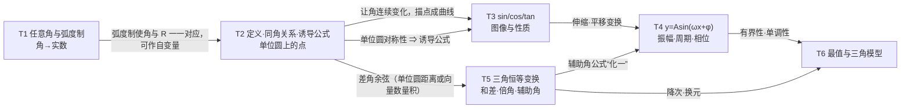

# T 三角函数与恒等变换（函数主线 · 周期变化）

> 约定见 `00-总图与导航.md` 第五节。教材依据：人教B版必修三 Ch7、Ch8；〔速查03〕〔速查04〕。

## 本模块在大厦中的位置

- **下接**：A 地基（实数、集合、角的初中定义【初中衔接】：锐角三角函数 sin=对边/斜边等）；F 函数（函数概念、周期性、奇偶性、图像变换）。
- **上接**：V 向量（数量积 a·b=|a||b|cosθ）、V4 解三角形、J 解析几何（倾斜角 k=tanα、参数方程）、D 导数（(sin x)′=cos x）、M 建模（一切周期现象）。
- **核心问题**：周期现象（旋转、振动、波、季节）怎样用函数刻画？三角函数之间有哪些恒等关系？
- **中心模型**：**单位圆上的旋转点 P(cosα, sinα)**。角 → 点 → 坐标 → 函数；单位圆的对称性 → 诱导公式；半径为 1 → 平方关系；转一圈回到原处 → 周期性；把圆周运动“展开”在时间轴上 → 正弦曲线。

## L1 骨架



---

## T1 任意角与弧度制〔B版·必修三·Ch7.1〕

### T1.1 任意角
- 定义：平面内一条射线绕端点旋转形成的图形；起始位置为**始边**，终止位置为**终边**，端点为**顶点**。
- 分类（由旋转方向决定）：逆时针 → **正角**；顺时针 → **负角**；不旋转 → **零角**。
- 在坐标系中：顶点在原点、始边在 x 轴非负半轴，此时只有终边位置不同。
  - **象限角**：终边在第几象限就是第几象限角。
  - **轴线角**：终边落在坐标轴上的角（不属于任何象限）。
- **终边相同的角** ★：S={β | β=α+k·360°, k∈Z}（弧度制 β=α+2kπ）。
  - α 可以是任意角；k·360°−α 看作 k·360°+(−α)。
  - 终边相同的角不一定相等；相等的角终边一定相同。
  - 终边相同的角有无数个，彼此相差 360° 的整数倍。

### T1.2 象限角、轴线角、特殊角的集合（方法）
- 象限角（k∈Z）：
  - 第一象限 {α | k·360°<α<k·360°+90°}
  - 第二象限 {α | k·360°+90°<α<k·360°+180°}
  - 第三象限 {α | k·360°+180°<α<k·360°+270°}
  - 第四象限 {α | k·360°+270°<α<k·360°+360°}
- 轴线角（k∈Z）：
  - x 轴非负半轴 α=k·360°；非正半轴 α=k·360°+180°；x 轴上 α=k·180°。
  - y 轴非负半轴 α=k·360°+90°；非正半轴 α=k·360°+270°；y 轴上 α=k·180°+90°。
  - 坐标轴上 α=k·90°，即 {α | α=kπ/2}。
- 特殊角集合：α=kπ+π/4 → 终边在第一、三象限角平分线上；α=kπ−π/4 → 第二、四象限角平分线上。
- 辨析：“小于 90° 的角”α<90°（含负角、零角）；“锐角”0°<α<90°；“第一象限角”k·360°<α<k·360°+90°。三者范围不同，锐角 ⊂ 第一象限角。

### T1.3 弧度制 ★
- 1° 的角：周角的 1/360（角度制，六十进制：度、分、秒）。
- **1 弧度**：长度等于半径的弧所对的圆心角，单位 rad。
- 弧度数：正角为正、负角为负、零角为 0；半径 r 的圆中，圆心角 α 所对弧长 l，则 **|α|=l/r**（与半径无关，只与角有关）。
- 换算：360°=2π rad，180°=π rad。
  - 1°=π/180 rad ≈ 0.017 453 rad（π/180=0.017 453 29…）。
  - 1 rad=(180/π)° ≈ 57.30° ≈ 57°18′。
- 意义：角的集合与实数集 R 一一对应 ⇒ 角可以作为函数的自变量（三角函数成为“实数→实数”的函数）。用弧度表示角时常写成 π 的倍数。
- 弧度制与角度制的异同：
  - 相同：都是度量角的制度；都与圆的半径无关；都能使角与 R 一一对应。
  - 不同：定义不同；单位不同（rad 在不混淆时可省略，“°”不可省略）；进位不同（角度制六十进制，弧度制十进制）。

### T1.4 弧长与扇形面积
- 弧长 **l=|α|r**；扇形面积 **S=½lr=½|α|r²**（α 为弧度数）。
- 角度制下对照：l=nπr/180，S=nπr²/360【初中衔接】。

### T1 易错
- 角度与弧度单位混用导致计算错误（同一式子中必须统一）。
- 混淆象限角、轴线角、区间角；混淆锐角与第一象限角。

---

## T2 三角函数定义·同角关系·诱导公式〔B版·必修三·Ch7.2〕〔速查03〕

### T2.1 定义 ★
- 【新教材补充】**单位圆定义**：角 α 终边与单位圆交于 P(x,y)，则 sinα=y，cosα=x，tanα=y/x（x≠0）。
- **终边上任一点定义**：终边上异于原点的点 P(x,y)，r=|OP|=√(x²+y²)>0，则 sinα=y/r，cosα=x/r，tanα=y/x。
  - 由相似三角形，比值与 P 在终边上的位置无关 ⇒ 只由角决定，所以是函数。
  - 用法：求特殊角的值时，取终边上一个方便的点，把三角函数值化为线段比。
- 【旧教材·拓展】余切 cotα=x/y，正割 secα=r/x，余割 cscα=r/y。

### T2.2 符号与定义域
- 符号（看 P 的坐标符号）：sin 看 y → 一、二象限正；cos 看 x → 一、四象限正；tan 看 xy → 一、三象限正。
  - 口诀“一全正、二正弦、三正切、四余弦”。
  - 【旧教材·拓展】csc 与 sin 同号，sec 与 cos 同号，cot 与 tan 同号。
- 定义域：sinα、cosα 为 R；tanα：α≠kπ+π/2（k∈Z）。
  - 【旧教材·拓展】cotα、cscα：α≠kπ；secα：α≠kπ+π/2。

### T2.3 三角函数线【旧教材·拓展】（新教材弱化为探究）
- 单位圆中，P 为终边与圆交点，M 为 P 在 x 轴上的垂足，A(1,0) 处切线交终边（或其反向延长线）于 T：
  - sinα=MP（正弦线），cosα=OM（余弦线），tanα=AT（正切线），均为有向线段。
- 注意：
  - 字母顺序不能颠倒（有向线段的方向即符号）。
  - 方向与坐标轴同向为正，反向为负。
  - 终边在 x 轴上：正弦线为一个点，正切线为一个点；终边在 y 轴上：余弦线为一个点，正切线不存在。
- 推论：0<α<π/2 时，**sinα<α<tanα**（比较单位圆中三角形、扇形、三角形的面积得到）；sinα+cosα>1（因 sinα+cosα=√2·sin(α+π/4)>1）。
- 用途：判断三角式符号、判断角所在象限、估值、证明三角不等式、比较大小、解简单三角不等式。

### T2.4 同角三角函数基本关系 ★
- **平方关系**：sin²α+cos²α=1（来源：单位圆 x²+y²=1）。
- **商数关系**：tanα=sinα/cosα（α≠kπ+π/2）。
- 【旧教材·拓展】倒数关系：sinα·cscα=1，cosα·secα=1，tanα·cotα=1；商数关系 cotα=cosα/sinα；平方关系 1+tan²α=sec²α，1+cot²α=csc²α。
- 【旧教材·拓展】六边形记忆图：六个顶点放 sin、cos、tan、cot、sec、csc，中心为 1。
  - 对角线上两函数之积为 1（倒数关系）。
  - 任一顶点函数等于相邻两顶点函数之积（商数关系）。
  - 三个倒三角形中，上面两个顶点函数的平方和等于下面顶点函数的平方（平方关系）。
- 应用：知一求二（已知一个三角函数值求另两个）；化简三角式；证明恒等式。

### T2.5 诱导公式 ★
- 本质：单位圆的对称性。
  - α 与 2kπ+α：终边相同；α 与 −α：关于 x 轴对称；α 与 π±α：关于原点或 y 轴对称；α 与 π/2−α：关于直线 y=x 对称。
- 两组公式：
  - 2kπ±α、−α、π±α：函数值等于 α 的**同名**函数值，前面加上“把 α 看作锐角时原函数值的符号”。
  - π/2±α、3π/2±α：函数值等于 α 的**余名**函数值（正弦↔余弦），符号同上规则。
- 统一口诀（对 kπ/2±α，k∈Z）：**“奇变偶不变，符号看象限”**。
  - 奇偶指 k；“变”指正弦与余弦互变（拓展：正切与余切互变）；符号指把 α 看作锐角时原函数在 kπ/2±α 所在象限的符号。
  - α 看作锐角时：−α 在第四象限，π−α 在第二象限，π+α 在第三象限。
- 用途：负角化正角 → 大角化小角（0~2π）→ 化为锐角求值。

### T2.6 方法与题型
- **三种基本题型**：
  - 求值：已知一个角的某个三角函数值求其他值。
    - 象限（终边）已确定 → 一解；需要判断象限 → 可能一解或两解（分类讨论）；值含字母或用另一角表示 → 按符号讨论。
    - 一般顺序：先用平方关系求出另一个弦，再用商数关系；开方时注意 ± 的取舍。【旧教材·拓展】含六个三角函数时，求值顺序口诀为“倒、平、倒、商、倒”。
  - 化简：项数尽量少、次数尽量低、尽量不含分母和根号、能求值就求出数值。
  - 证明恒等式（见 T2.7 知能）。
- **变形技巧**：
  - 负角化正、大角化小、化异为同（用诱导公式）。
  - 切化弦（或弦切互化）。
  - “1”的代换：1=sin²α+cos²α=tan(π/4)（后者只是数值代换）；【旧教材·拓展】1=sec²α−tan²α=csc²α−cot²α。
  - 消元与降次。
  - **sinα±cosα 与 sinαcosα 知一求二**：(sinα±cosα)²=1±2sinαcosα（隐含条件 sin²α+cos²α=1）。
- **齐次式求值**【新教材补充】：已知 tanα，求 (a sinα+b cosα)/(c sinα+d cosα) 时，分子分母同除以 cosα 化为 tanα 的式子；sin²α 等二次式可除以 1=sin²α+cos²α 后再同除 cos²α。

### T2.7 易错与知能
- 易错：
  - 忽视定义域：除了式子本身有意义，还要注意 tan（拓展：sec、csc）自身的定义域。
  - 给值求角漏解：角 → 值唯一；值 → 角有无穷多个（终边相同、对称位置都要考虑）。
- 知能（证明三角恒等式）：实质是消除两边的差异，有目的地化简。
  - 从一边证到另一边（一般由繁到简）。
  - 左右归一：证两边等于同一个式子。
  - 凑合法：针对差异化异为同。
  - 比较法：证“左−右=0”或“左÷右=1”（后者需右≠0）。
  - 分析法：从结论出发逐步找成立的充分条件，直到已知或明显事实（接口 A5）。

---

## T3 三角函数的图像与性质〔B版·必修三·Ch7.3〕〔速查03〕

### T3.1 画法
- 描点法：列表、描点、连线。
- 几何法【旧教材·拓展】：用三角函数线平移得到点。
- **五点法** ★：一个周期内取 5 个关键点（零点、最高点、零点、最低点、零点），用光滑曲线连接；精度要求不高时常用。
- 由 y=sin x 的图像经诱导公式 cos x=sin(x+π/2) 向左平移 π/2 得 y=cos x 的图像。

### T3.2 正弦、余弦、正切的性质（k∈Z）★

| 性质 | y=sin x | y=cos x | y=tan x |
|---|---|---|---|
| 定义域 | R | R | {x \| x≠kπ+π/2} |
| 值域 | [−1,1] | [−1,1] | R |
| 最值 | x=2kπ+π/2 时最大 1；x=2kπ−π/2 时最小 −1 | x=2kπ 时最大 1；x=2kπ+π 时最小 −1 | 无 |
| 最小正周期 | 2π | 2π | π |
| 奇偶性 | 奇函数 | 偶函数 | 奇函数 |
| 增区间 | [2kπ−π/2, 2kπ+π/2] | [2kπ−π, 2kπ] | (kπ−π/2, kπ+π/2) |
| 减区间 | [2kπ+π/2, 2kπ+3π/2] | [2kπ, 2kπ+π] | 无 |
| 对称中心 | (kπ, 0) | (kπ+π/2, 0) | (kπ/2, 0) |
| 对称轴 | x=kπ+π/2 | x=kπ | 无 |

- 规律：正弦、余弦的对称轴过最值点，对称中心是零点；正切的对称中心既有零点 (kπ,0)，也有渐近线与 x 轴的交点 (kπ+π/2, 0)，合写为 (kπ/2, 0)。

### T3.3 周期性
- 定义（接口 F2）：存在非零常数 T，使对定义域内**任意** x 都有 x+T∈D 且 f(x+T)=f(x)，T 叫一个周期。
- 若 T 是周期，则 kT（k∈N*）也是周期；当定义域向两边无限延伸（如 R）时，−T 也是周期，从而 kT（k∈Z，k≠0）都是周期。
  - 【易错】周期要求对定义域内任意 x 都有 x+T∈D。例：y=sin x（x≥1）以 2π 为周期，但 −2π 不是它的周期（1−2π∉D），它只有正周期 2π, 4π, …。
- 最小正周期：并非所有周期函数都有（例如常数函数）；无特别说明时“周期”一般指最小正周期。
- 求法：
  - 公式法：y=Asin(ωx+φ)、Acos(ωx+φ) 的周期 T=2π/|ω|；y=Atan(ωx+φ) 的周期 T=π/|ω|（拓展：余切同）。
  - 图像法：作图观察。
  - 定义验证法：验证 f(x+T)=f(x)。

### T3.4 奇偶性的判断
- 方法：定义法（比较 f(−x) 与 f(x)）；图像法（看对称性）；验证法（f(−x)±f(x)=0，或 f(x)≠0 时 f(−x)/f(x)=±1）。
- 步骤：先化简 → 求定义域 → 定义域不关于原点对称则直接判非奇非偶 → 否则用定义法。

### T3.5 单调性与比较大小
- 判断三角函数值大小的程序：
  1. 判定各角所在象限；
  2. 估计各值的大致范围（正负、与 ±1/2、±√2/2 等比较）；
  3. 范围相同的，把不同名的化为同名（诱导公式）；
  4. 同名但不在同一单调区间的，用诱导公式化到同一单调区间；
  5. 用单调性比较。

### T3.6 已知三角函数值求角
- 实质：解最简单的三角方程。
- 角限定在某个单调区间内时解唯一；在 R 上则先在一个周期内找出所有解，再加周期。
- 【新教材补充】人教B版必修三设“已知三角函数值求角”一节，用 arcsin、arccos、arctan 记号表示主值区间内的角（例如 x=arcsin a 表示 [−π/2, π/2] 内正弦为 a 的角，|a|≤1）。（已核对：人教B版必修三§7.3.5“已知三角函数值求角”正文引入 arcsin 等记号）

### T3 易错
- 单调性：三角函数在整个定义域内不单调，只在局部区间单调（如不能说“tan x 在定义域上递增”）。
- 对称性：正切的对称中心还包括渐近线与 x 轴的交点。
- 建模解实际问题时忽略自变量的取值范围。

---

## T4 函数 y=Asin(ωx+φ)〔B版·必修三·Ch7.3〕〔速查03〕

### T4.1 参数含义（A>0，ω>0 时）
- 振幅 A；周期 T=2π/ω；频率 f=1/T=ω/(2π)；相位 ωx+φ；初相 φ（x=0 时的相位）。

### T4.2 变换作图（从 y=sin x 出发）★
- 三种基本变换：
  - 相位变换（平移）：y=sin x → y=sin(x+φ)，向左（φ>0）或向右（φ<0）平移 |φ| 个单位。
  - 周期变换（横向伸缩）：y=sin x → y=sin ωx，横坐标变为原来的 1/ω 倍（ω>0）。
  - 振幅变换（纵向伸缩）：y=sin x → y=Asin x，纵坐标变为原来的 A 倍（A>0）。
- 路线一（先伸缩后平移）：y=sin x → 横坐标变为 1/ω 倍 → y=sin ωx → 向左（φ>0）或向右（φ<0）平移 **|φ|/ω** 个单位 → y=sin(ωx+φ)。
  - 【易错】平移方向看 φ 的符号（φ>0 向左、φ<0 向右）；平移量是 |φ|/ω 而不是 |φ|，因为 sin(ωx+φ)=sin ω(x+φ/ω)。
- 路线二（先平移后伸缩）：y=sin x → 平移 |φ| 个单位 → y=sin(x+φ) → 横坐标变为 1/ω 倍 → y=sin(ωx+φ)。
- 最后纵坐标变为 A 倍 → y=Asin(ωx+φ)。
- 若 ω<0，先用诱导公式把 x 的系数化为正数再变换。
- 思想：由简单到复杂、由特殊到一般。

### T4.3 性质（把 ωx+φ 看作整体 u，借用 sin u 的性质）
- 最值：A>0 时最大值 A、最小值 −A（一般为 ±|A|）；再加常数 k 时为 ±|A|+k。
- 对称轴过最值点（ωx+φ=kπ+π/2），对称中心是零点（ωx+φ=kπ）。
- 奇偶性（A≠0，ω≠0）：φ=kπ 时为奇函数；φ=kπ+π/2 时为偶函数。
- 单调性：令 ωx+φ 落在 sin 的增（减）区间内解出 x；ω<0 时注意“同增异减”（复合函数，接口 F2）。
- 周期 T=2π/|ω|。

### T4.4 由图像求解析式（“五点法”反用）
- A：由最高点、最低点确定 |A|（最大值与最小值之差的一半）；若有上下平移 k，k 为两者的平均。
- ω：先求周期 T，再 ω=2π/T。
  - 相邻最高点与最低点的**水平距离**为 T/2；相邻两个最高点（或最低点）的水平距离为 T；相邻两零点的水平距离为 T/2。
  - 【易错】这里的“距离”指横坐标之差（水平距离），不是两点间的直线距离。
- φ：以“五点法”第一个零点（上升零点）(−φ/ω, 0) 为突破口（前提 A>0，ω>0），也可代入最高点 ωx+φ=π/2+2kπ；从图像升降情况判断第一零点位置，并注意题设对 φ 的范围限制。

### T4.5 推广
- 理解 A、ω、φ 在变换中的作用后，可推广到一般函数：y=f(x) → y=Af(x)（纵向伸缩）、y=f(ωx)（横向伸缩）、y=f(x+φ)（平移）、y=Af(ωx+φ)（接口 F2 图像变换）。

### T4 易错
- 平移由 φ 决定、伸缩由 ω 决定，但先伸缩后平移时平移量是 |φ|/ω，最易出错。
- 忽略 φ 的范围限制导致多解或错解。

---

## T5 三角恒等变换〔B版·必修三·Ch8.2〕〔速查04〕

### T5.1 公式的推导链 ★
```
差角余弦 cos(α−β)  ← 单位圆两点距离公式，或向量数量积（桥7）
   │ β 换成 −β
   ├→ 和角余弦 cos(α+β)
   │ 诱导公式 sinθ=cos(π/2−θ)
   ├→ 和差角正弦 sin(α±β)
   │ 相除（切＝弦/弦）
   ├→ 和差角正切 tan(α±β)
   │ 令 β=α
   └→ 二倍角公式 sin2α、cos2α、tan2α
          │ cos2α 的两种变形
          ├→ 降幂（升幂）公式
          │ α 换成 α/2
          └→ 半角公式
   和角正弦逆用 ⇒ 辅助角公式 a sinx+b cosx=√(a²+b²)sin(x+φ)
```
- 【新教材补充】人教B版路线（桥7，接口 V2）：在单位圆上取 a=(cosα, sinα)，b=(cosβ, sinβ)，|a|=|b|=1。由数量积的坐标式与定义式：a·b=cosαcosβ+sinαsinβ=|a||b|cos θ（θ 为两向量夹角，且 cosθ=cos(α−β)，因余弦是偶函数、以 2π 为周期），得 **cos(α−β)=cosαcosβ+sinαsinβ**。

### T5.2 和差角公式 ★
- sin(α±β)=sinαcosβ ± cosαsinβ。
- cos(α±β)=cosαcosβ ∓ sinαsinβ。
- tan(α±β)=(tanα ± tanβ)/(1 ∓ tanαtanβ)（条件：α、β、α±β 都不等于 kπ+π/2）。
- 口诀：余弦“余余正正，符号相反”；正弦“正余余正，符号相同”。
- 变形：tanα±tanβ=tan(α±β)(1∓tanαtanβ)。

### T5.3 二倍角公式 ★
- sin2α=2sinαcosα。
- cos2α=cos²α−sin²α=2cos²α−1=1−2sin²α。
- tan2α=2tanα/(1−tan²α)（α≠kπ/2+π/4 且 α≠kπ+π/2）。

### T5.4 升幂、降幂与半角
- 升幂（化简根式常用）：1+cos2α=2cos²α；1−cos2α=2sin²α。
- 降幂（次数高时常用）：cos²α=(1+cos2α)/2；sin²α=(1−cos2α)/2；tan²α=(1−cos2α)/(1+cos2α)（cos2α≠−1）。
- 规律：倍角公式（从左到右）升角降次；半角公式升次。
- **半角公式**（由降幂公式把 α 换成 α/2 得到）：
  - sin(α/2)=±√[(1−cosα)/2]；cos(α/2)=±√[(1+cosα)/2]；tan(α/2)=±√[(1−cosα)/(1+cosα)]（α≠(2k+1)π）。
  - 有理形式：tan(α/2)=sinα/(1+cosα)=(1−cosα)/sinα（避免开方，正负号自动确定）。
  - 正负号：由 α/2 的终边位置确定；位置不明确时保留“±”。
  - 半角是相对的：α 是 2α 的半角，α/2 是 α 的半角。
  - cosα 用 sin(α/2)、cos(α/2)、tan(α/2) 表示时，可看作倍角公式的变形。

### T5.5 辅助角公式（“化一”）★
- a sinx+b cosx=√(a²+b²)·sin(x+φ)（a、b 不全为 0），其中 cosφ=a/√(a²+b²)，sinφ=b/√(a²+b²)。
  - 【易错】只写 tanφ=b/a 不能确定 φ：还要由点 (a,b) 所在象限确定 φ 的象限；a=0 时 tanφ 无意义，此时 b>0 取 φ=π/2，b<0 取 φ=−π/2。同时写出 sinφ、cosφ 最稳妥。
- “化一”题型：用倍角、降幂、辅助角把函数化为 y=Asin(ωx+φ)+b，再研究性质（接口 T4、T6）。

### T5.6 积化和差与和差化积（人教B版正文）· 万能公式
- 万能公式【旧教材·拓展】（人教B版正文未出现）（t=tan(α/2)，α≠(2k+1)π）：sinα=2t/(1+t²)；cosα=(1−t²)/(1+t²)；tanα=2t/(1−t²)（另需 t≠±1）。
  - 来源：二倍角公式中把分母“1”换成 sin²(α/2)+cos²(α/2)，再同除 cos²(α/2)。
  - 意义：把三角式化为 t 的有理式，实现三角与代数的转换。
- 积化和差（由和差角的正弦、余弦公式相加减得到；人教B版必修三§8.2.4正文推导并命名，配例题用于求周期、最值）：
  - sinαcosβ=½[sin(α+β)+sin(α−β)]
  - cosαsinβ=½[sin(α+β)−sin(α−β)]
  - cosαcosβ=½[cos(α+β)+cos(α−β)]
  - sinαsinβ=−½[cos(α+β)−cos(α−β)]
- 和差化积（逆用积化和差，令 θ=α+β，φ=α−β）：
  - sinα+sinβ=2sin[(α+β)/2]cos[(α−β)/2]
  - sinα−sinβ=2cos[(α+β)/2]sin[(α−β)/2]
  - cosα+cosβ=2cos[(α+β)/2]cos[(α−β)/2]
  - cosα−cosβ=−2sin[(α+β)/2]sin[(α−β)/2]
- 可借助口诀记忆；更可靠的记法是记住推导来源（和差角公式相加减），需要时现推。
- 已核对人教B版必修三§8.2.4原文：积化和差、和差化积在正文中由和差角公式推出并命名；万能公式未出现。

### T5.7 方法与题型
- **化简**：
  - 原则：无理式化有理式、分式化整式；次数尽量低、项数尽量少；分母不含三角函数；能求值就求出。
  - 三个方向：减少角的种类、减少函数的种类、改变运算结构。
  - 方法：化弦法、化切法、异角化同角、复角化单角、异次化同次、特殊值与特殊角的三角函数互化。
- **求值**：
  - 给角求值（不查表）：用二倍角与平方关系、逆用和角公式、拆角与并角；角成等差（等比）数列时构造可消项的结构（如连乘 cos 时乘以 sin 用倍角公式逐步合并）。目标是把非特殊角化为特殊角，或把非特殊角的值消去。
  - 给值求值：用和角、二倍角公式，注意“倍与半”的相对性；齐次式求值；（拓展）万能公式求值。
  - 给值求角：“欲求角，先求值”；关键两点——先讨论角的范围，再选择在该范围内单调的函数名（如角在 (0,π) 内宜求余弦）。
  - 给值求和、综合求值：综合运用以上方法。
- **证明**：
  - 实质：把一种结构形式转化为另一种。基本思路：观察 → 分析 → 变换 → 证明。
  - 条件等式：一是把条件代入求证式化为恒等式证明；二是从条件出发，以求证式为目标逐步变形推出。
- **角的代换** ★：用已知角表示未知角。
  - α=(α+β)−β；α=β−(β−α)；α=½[(α+β)+(α−β)]；α=½[(β+α)−(β−α)]；2α=(α+β)+(α−β)。
- **综合题思路**：遇切割想化弦；遇多元想消元；遇差异想联系；遇高次想降次。
- 转化思想：和差化积与积化和差实现和与积的互化；万能公式实现三角与代数的互化。

### T5.8 易错
- 公式变形用错（特别是升幂公式的系数 2、正切公式的条件）。
- 半角理解：sin(α/2)、cos(α/2) 中 α 为任意角；tan(α/2) 中 α≠(2k+1)π。
- 开方时正负号未按角的范围确定。

---

## T6 三角最值与三角模型〔B版·必修三·Ch7.4〕

### T6.1 常见最值类型 ★
1. **y=a sinx+b（或 a cosx+b）型**：用有界性 |sinx|≤1，按 a 的正负讨论最大、最小值。
2. **y=a sinx+b cosx+c 型**：辅助角化为 y=√(a²+b²)sin(x+φ)+c，值域 [c−√(a²+b²), c+√(a²+b²)]（x∈R 时）。
3. **y=a sin²x+b sinx+c 型**：令 t=sinx，t∈[−1,1]，化为二次函数在闭区间上的最值（接口 F4 轴与区间的关系）。
4. **y=(a sinx+b)/(c sinx+d) 型**：反解出 sinx=g(y)，由 |g(y)|≤1 求 y 的范围；或分离常数化为部分分式再用有界性（注意分母不为 0）。
5. **y=a(sinx±cosx)+b sinx cosx+c 型**：换元 t=sinx±cosx=√2 sin(x±π/4)，t∈[−√2, √2]；由 (sinx±cosx)²=1±2sinxcosx 得 sinxcosx=±(t²−1)/2，化为 t 的二次函数在闭区间上的最值。**注意换元后新变量的范围**。

### T6.2 求最值的方法（对应上面的类型）
- 配方法：只含正弦（或余弦）且最高次为 2 时，配方或换元化为二次函数。
- 引入辅助角法：y=a sin²x+b sinx cosx+c cos²x 先降次化为 y=A sin2x+B cos2x+C（自变量为 2x），再化一（注意化一后角是 2x）。
- 有界性法：分子分母同名同角的分式型，先化为部分分式再用有界性。
- 换元法（引入参数）：同时含 sinx±cosx 与 sinxcosx 时。
- 数形结合：点 (cosx, sinx) 在单位圆上，含正弦与余弦的分式（如 (sinx−b)/(cosx−a)）可看作单位圆上的点与定点连线的斜率（接口 J3）。

### T6.3 三角函数模型的应用
- 四类问题：由解析式作图并研究性质；由图像求解析式（见 T4.4）；用三角模型解决最值问题；建立三角模型求临界值。
- 实际问题：先把实际问题转化为三角函数问题（确定周期、振幅、初相），再用三角知识求解，最后回到实际意义（接口 M）。
- 三角函数是周期现象的基本模型（简谐运动、交流电、潮汐、昼夜长短等）。
- 综合：与其他函数、向量、数列等综合；与向量、复数结合（工具性）。

### T6.4 综合技巧与方法
- 技巧：
  - 变角：利用和差倍半、互余、互补等关系，化异角为同角、化复角为单角，沟通已知角与所求角。
  - 升降幂：次数高时降幂；化简根式时升幂（如 √(1+cos2α)=√2|cosα|）。
  - 常数巧变：把常数写成三角函数值（如 1=sin²α+cos²α，√3/2=sin(π/3)）。
  - 变名称：化为同名函数，通常是切化弦或弦化切。
- 方法：
  - 平方：已知两单角式求两角和差时，两式平方后相加减（如已知 sinα+sinβ、cosα+cosβ 求 cos(α−β)）。
  - 消元：题设中的角在结论中不出现时，考虑消去。
  - 配方：平方项较多时配方。

### T6.5 易错
- 用基本不等式求最值不注意等号成立条件（接口 B4）。
  - 例：y=sinx+a/sinx，sinx∈(0,1]，a>1。若用基本不等式得 y≥2√a，等号需 sinx=√a>1，取不到。正确做法：t+a/t 在 (0,√a] 上递减，故在 t=1 处取最小值 1+a。
- 换元后忽略新变量的取值范围。

---

## 与其他模块的桥

| 桥 | 对方模块 | 关系 | 内容 |
|---|---|---|---|
| 桥7 | V2 向量数量积 | 推导 | 单位向量数量积推出 cos(α−β) |
| — | V4 解三角形 | 应用 | 正弦定理、余弦定理、射影定理、面积公式在 V4；三角形中常用 A+B+C=π ⇒ sin(A+B)=sinC、cos(A+B)=−cosC；三角形中的等式处理（纯角式用积化和差与平方关系；边角式边化角或角化边）见 V4 |
| — | V3 复数 | 拓展 | 复数三角形式 r(cosθ+isinθ)；乘法＝模相乘、辐角相加 |
| 桥13 | J 解析几何 | 工具 | 倾斜角 k=tanα；圆、椭圆参数方程；单位圆上的点 (cosθ, sinθ) |
| — | F2 函数性质 | 特例 | 周期函数、奇偶函数、图像变换的典型例子 |
| — | F4 二次函数 | 工具 | sin²x、sinx±cosx 换元后化为二次函数在闭区间上的最值 |
| — | B4 基本不等式 | 配合 | 三角最值中慎用，注意取等条件 |
| — | D 导数 | 工具 | (sinx)′=cosx，(cosx)′=−sinx；复杂三角函数可用导数求单调性与最值 |
| — | M 建模 | 应用 | 周期现象的模型 |
