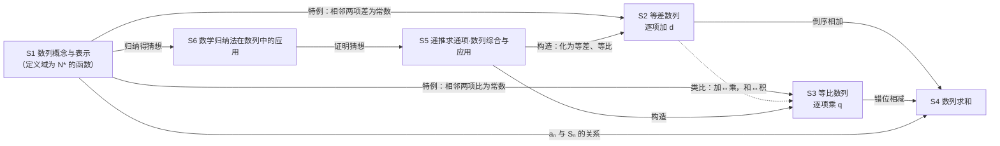

# S 数列（函数主线 · 离散的变化）

> 约定见 `00-总图与导航.md` 第五节。教材依据：人教B版选择性必修三 Ch5；〔速查07〕。

## 本模块在大厦中的位置

- **下接**：F 函数（数列是特殊函数；一次函数、二次函数、指数函数）；A5 推理与证明（归纳、数学归纳法）；B 不等式（放缩）。
- **上接**：P 计数（二项式定理用于数列不等式）；D 导数（构造函数研究数列最值、证明不等式）；M 建模（储蓄、贷款、增长）。
- **核心问题**：按顺序排列的一列数，有什么规律？怎样由规律写出通项、求出和？
- **中心模型**：**“递推关系 → 通项 → 求和”三连环**，以等差（逐项加同一个数）和等比（逐项乘同一个数）为两块“标准砖”。
  - 等差数列 aₙ=a₁+(n−1)d：一次函数在正整数点上的取值（直线上孤立的点）。
  - 等比数列 aₙ=a₁qⁿ⁻¹：指数型函数在正整数点上的取值。
  - 复杂数列 → 拆分、变形、构造，化归为这两块标准砖。

## L1 骨架

---

## S1 数列的概念与表示〔B版·选必三·Ch5.1〕

### S1.1 定义与本质 ★
- 定义：按一定顺序排列的一列数叫数列，每个数叫项；第 n 项记 aₙ，数列记 {aₙ}。
- 本质：数列是定义域为**正整数集 N\***（或其有限子集 {1,2,…,n}）的函数 aₙ=f(n)。
  - 【易错】定义域是正整数集 N\*（或 {1,2,…,n}），不是自然数集 N（N 含 0）。
- 图像：一群孤立的点（有限个或无限个），不连成曲线。

### S1.2 分类
- 按项数：有穷数列、无穷数列。
- 按增减性（对一切 n∈N\*）：
  - 递增数列：aₙ₊₁>aₙ；递减数列：aₙ₊₁<aₙ；常数列：各项相等。
  - 摆动数列：从第 2 项起，有些项大于前一项，有些项小于前一项。
    - 【易错】“既有……也有……”缺一不可；若只说“有小于前一项或不小于前一项的项”，任何数列都满足，失去意义。
  - 摆动数列与常数列都不具有单调性。
- 【旧教材·拓展】按是否有界：有界数列（存在 M>0 使 |aₙ|≤M 对一切 n 成立）、无界数列。

### S1.3 表示方法
- 列举法：a₁, a₂, …, aₙ, …（简记 {aₙ}）。
- 图像法：坐标平面上的孤立点 (n, aₙ)。
- 解析法：**通项公式** aₙ=f(n)。
- 递推法：**递推公式**——已知首项（或前几项），并给出 aₙ 与前一项（或前几项）的关系式。
- 前 n 项和：Sₙ=a₁+a₂+…+aₙ。
- **aₙ 与 Sₙ 的关系** ★：aₙ = S₁（n=1）；aₙ = Sₙ−Sₙ₋₁（n≥2）。

### S1.4 方法
- **最大项、最小项**：
  - 求最大项 aₙ：解 aₙ≥aₙ₋₁ 且 aₙ≥aₙ₊₁；求最小项 aₙ：解 aₙ≤aₙ₋₁ 且 aₙ≤aₙ₊₁。
  - 注：这只保证 aₙ 不小于（不大于）相邻两项；对“先增后减”（或先减后增）的数列可直接用，否则要结合单调性检验。
- **单调性的判断**（四种方法灵活用）：
  - 作差法：比较 aₙ₊₁−aₙ 与 0；
  - 作商法：各项为正时，比较 aₙ₊₁/aₙ 与 1；
  - 函数图像法；函数单调性法（注意只在正整数点上取值）。
  - 数列的最大项、最小项、有界性都可借助单调性解决。
- **写通项公式**：
  - 由 Sₙ 求 aₙ：分 n=1 与 n≥2 两种情况，最后检验 n=1 是否适合 n≥2 的式子，不适合就写成分段形式。
  - 由前几项归纳通项（观察 → 比较 → 归纳 → 转化）：
    - 分式数列：分子、分母分别找规律，并找分子与分母的关系；
    - 符号交替：用 (−1)ⁿ 或 (−1)ⁿ⁺¹ 调节；
    - 较复杂的：与等差、等比或常见数列（n²、2ⁿ、n(n+1) 等）比较、转化。
  - 由递推公式求通项：见 S5.1。
- 复杂数列一般由简单数列组成，所以先把等差、等比数列掌握牢。

### S1 易错
- aₙ 与 {aₙ} 不同：aₙ 是第 n 项，{aₙ} 是整个数列。
- 数列有顺序：相同的几个数排列顺序不同就是不同的数列；数列与数集有本质区别。
- 不是所有数列都有通项公式；有通项公式的，表达式也不唯一。
- 项与项数不同：项是某个确定的数 f(n)，项数 n 是它的位置序号。
- 数列单调性只需比较相邻两项（与函数单调性的“任取两点”不同）；但不能直接套用连续函数的单调区间（例如 aₙ=(n−2.4)² 的最小项在 n=2 而不是 n=2.4）。

---

## S2 等差数列〔B版·选必三·Ch5.2〕〔速查07〕

### S2.1 定义 ★
- aₙ₊₁−aₙ=d（n∈N\*），或 aₙ−aₙ₋₁=d（n≥2）；d 为公差（常数）。
- 文字：从第 2 项起，每一项与前一项的差都等于同一个常数。

### S2.2 通项公式 ★
- aₙ=a₁+(n−1)d（推导：累加法，或不完全归纳后用数学归纳法证明）。
- 推广：aₙ=aₘ+(n−m)d；d=(aₙ−aₘ)/(n−m)（m≠n）。
- 函数视角：aₙ=dn+(a₁−d)=pn+q，是关于 n 的一次函数（d≠0）或常数（d=0）；点 (n, aₙ) 在斜率为 d 的直线上。

### S2.3 等差中项
- a、A、b 成等差数列 ⇔ A=(a+b)/2（即 2A=a+b）。

### S2.4 单调性
- d>0 递增；d<0 递减；d=0 常数列。

### S2.5 前 n 项和 ★
- 推导：倒序相加法。
- Sₙ=n(a₁+aₙ)/2=na₁+n(n−1)d/2。
- 函数视角【新教材补充】：Sₙ=(d/2)n²+(a₁−d/2)n，是不含常数项的二次式（d≠0 时为二次函数在正整数点上的取值）。
- 最值【新教材补充】：
  - a₁>0，d<0：Sₙ 有最大值，在最后一个非负项处取到（解 aₙ≥0 且 aₙ₊₁≤0）；
  - a₁<0，d>0：Sₙ 有最小值，在最后一个非正项处取到；
  - 也可配方，取离对称轴 n=(1/2)−a₁/d 最近的正整数。
- 基本量：a₁、d、n、aₙ、Sₙ 五个量，一般“知三求二”。

### S2.6 判定方法 ★
- 定义法：aₙ−aₙ₋₁=d（n≥2，d 为常数）。
- 等差中项法：2aₙ=aₙ₋₁+aₙ₊₁（n≥2）。
- 通项公式法：aₙ=An+B（A、B 为常数）。
- 前 n 项和法：Sₙ=An²+Bn（A、B 为常数，**不含常数项**；若有常数项，则从第 2 项起成等差，首项不符合）。
- 证明（解答题）要用定义法或等差中项法；后两种多用于判断。

### S2.7 性质 ★
- 若 m+n=p+q（m、n、p、q∈N\*），则 aₘ+aₙ=aₚ+a_q；特别地，m+n=2p 时 aₘ+aₙ=2aₚ。
- {aₙ}、{bₙ} 是等差数列 ⇒ {maₙ+kbₙ}（m、k 为常数）也是等差数列。
- {Sₙ/n} 也是等差数列：Sₙ/n=a₁+(n−1)·d/2，公差 d/2。
- 依次 k 项的和 **Sₖ, S₂ₖ−Sₖ, S₃ₖ−S₂ₖ, …** 成等差数列，公差 k²d。
  - 验证：(S₂ₖ−Sₖ)−Sₖ=Σᵢ₌₁ᵏ(aₖ₊ᵢ−aᵢ)=k·kd=k²d。
- 项数为奇数 2n−1：S₂ₙ₋₁=(2n−1)aₙ（aₙ 为中间项）；S奇−S偶=aₙ；S奇/S偶=n/(n−1)（aₙ≠0）。
  - 推导：奇数项共 n 项、平均值为 aₙ，S奇=naₙ；偶数项共 n−1 项、平均值也为 aₙ，S偶=(n−1)aₙ。
- 项数为偶数 2n：S₂ₙ=n(a₁+a₂ₙ)=n(a₂+a₂ₙ₋₁)=…=n(aₙ+aₙ₊₁)；S偶−S奇=nd；**S偶/S奇=aₙ₊₁/aₙ**（aₙ≠0）。
  - 推导：奇数项 a₁, a₃, …, a₂ₙ₋₁ 共 n 项，平均值 (a₁+a₂ₙ₋₁)/2=aₙ，S奇=naₙ；偶数项 a₂, …, a₂ₙ 共 n 项，平均值 (a₂+a₂ₙ)/2=aₙ₊₁，S偶=naₙ₊₁。
- 两等差数列 {aₙ}、{bₙ} 的前 n 项和 Sₙ、Tₙ：aₙ/bₙ=S₂ₙ₋₁/T₂ₙ₋₁（bₙ≠0）。
  - 推导：S₂ₙ₋₁=(2n−1)aₙ，T₂ₙ₋₁=(2n−1)bₙ。

### S2.8 方法
- 对称设项：三个数成等差设为 a−d, a, a+d；四个数设为 a−3d, a−d, a+d, a+3d（公差为 2d）。
- 累加法求通项（推导通项公式的方法，推广见 S5.1）。

### S2 易错
- 用 aₙ=Sₙ−Sₙ₋₁ 时忘了 n≥2，求出 aₙ 后要检验 n=1，不满足时写成分段形式。
- aₙ=g(n)、Sₙ=f(n) 的图像都是相应函数图像上的孤立点，不能当连续函数处理（求最值要取正整数）。

---

## S3 等比数列〔B版·选必三·Ch5.3〕〔速查07〕

### S3.1 定义 ★
- aₙ₊₁/aₙ=q（q 为非零常数，n∈N\*），或 aₙ/aₙ₋₁=q（n≥2）；q 为公比。
- 隐含条件：**各项都不为 0**，q≠0。
- 文字：从第 2 项起，每一项与前一项的比都等于同一个常数。

### S3.2 通项公式 ★
- aₙ=a₁qⁿ⁻¹（推导：累乘法；或不完全归纳后用数学归纳法证明）。
  - 累乘或不完全归纳用来得到公式；数学归纳法用来严格证明（接口 S6）。
- 推广：aₙ=aₘqⁿ⁻ᵐ。
- 函数视角：aₙ=(a₁/q)·qⁿ，是指数型函数在正整数点上的取值。
- 单调性【新教材补充】：
  - a₁>0 且 q>1，或 a₁<0 且 0<q<1 → 递增；
  - a₁>0 且 0<q<1，或 a₁<0 且 q>1 → 递减；
  - q=1 → 常数列；q<0 → 摆动数列。

### S3.3 等比中项
- G 是 a 与 b 的等比中项 ⇒ G²=ab；反之，G²=ab 且 G≠0（从而 a、b 同号、ab>0）时，a、G、b 成等比数列。
- G=±√(ab)（ab>0），两个值都可以；注意结合数列中项的符号关系取舍（等比数列中奇数项同号、偶数项同号）。
- 【易错】“G 是等比中项 ⇒ G²=ab”不能反推：a=G=b=0 时 G²=ab 成立，却不成等比数列。

### S3.4 前 n 项和 ★
- 推导：**错位相减法**：Sₙ−qSₙ=a₁−a₁qⁿ（也可写成 Sₙ₊₁=a₁+qSₙ，即 Sₙ₊₁−qSₙ=a₁）。
- Sₙ = na₁（q=1）；Sₙ = a₁(1−qⁿ)/(1−q) = (a₁−aₙq)/(1−q)（q≠1）。
- **必须分 q=1 与 q≠1 讨论**。
- 基本量：a₁、q、n、aₙ、Sₙ 五个量，一般“知三求二”。

### S3.5 判定方法
- 定义法：aₙ₊₁/aₙ=q（q 为非零常数），且 a₁≠0。
- 等比中项法：aₙ²=aₙ₋₁aₙ₊₁（n≥2），且**各项不为 0**。
  - 【易错】必须加“各项不为 0”。反例：0, 0, 0, … 满足 aₙ²=aₙ₋₁aₙ₊₁，但不是等比数列。
- 通项法：aₙ=cqⁿ（c≠0，q≠0）。
- 前 n 项和法：Sₙ=c−cqⁿ（c≠0，q≠0，**q≠1**）。
  - 【易错】必须同时 q≠1（q=1 时 Sₙ≡0）。
- 证明要用前两种；通项法、前 n 项和法只用于判断。
- 证明是等比数列时，除 aₙ₊₁=qaₙ（q≠0）外，还须验证 a₁≠0。

### S3.6 性质 ★
- aₙ=aₘqⁿ⁻ᵐ。
- 若 m+n=p+q，则 aₘaₙ=aₚa_q；特别地 m+n=2p 时 aₘaₙ=aₚ²。
- 依次 k 项的和 Sₖ, S₂ₖ−Sₖ, S₃ₖ−S₂ₖ 成等比数列（公比 qᵏ），**前提是 Sₖ≠0**。
  - 【易错】反例：q=−1、k 为偶数时 Sₖ=0，各段和都为 0，不能构成等比数列（实数范围内 Sₖ=0 只在 q=−1 且 k 为偶数时出现）。
- 既是等差数列又是等比数列 ⇔ 非零常数列。
- {aₙ} 等差 ⇒ {c^{aₙ}}（c>0）等比（公比 c^d）；【新教材补充】反之，各项为正的等比数列 {aₙ} ⇒ {logₐaₙ} 等差（a>0 且 a≠1）。这是等差与等比通过指数、对数互相转化的桥梁（接口 F3）。

### S3.7 方法
- 设项技巧：
  - 三个数成等比：a/q, a, aq。
  - 四个数成等比：一般设 a, aq, aq², aq³。设成 a/q³, a/q, aq, aq³ 时公比为 q²>0，**只适用于四个数同号**。
- 累乘法求通项（推导通项公式的方法，推广见 S5.1）。
- 错位相减法（推导求和公式的方法，推广见 S4.2）。

### S3 易错
- 建模时分不清所求是 aₙ 还是 Sₙ、项数 n 是多少、是等差还是等比。
- 特殊情况不验证：
  - 求通项时不验证首项是否为 0；
  - 求和时不讨论 q=1。
- 注意函数与数列的异同：图像都是孤立点。

---

## S4 数列求和〔B版·选必三·Ch5.2–5.4〕〔速查07〕

### S4.1 公式法
- 等差数列、等比数列求和公式（S2.5、S3.4）。
- 常用和：
  - 1+2+…+n=n(n+1)/2；
  - 1²+2²+…+n²=n(n+1)(2n+1)/6；
  - 1³+2³+…+n³=[n(n+1)/2]²=n²(n+1)²/4。
  - 平方和、立方和在新教材中不要求记忆，可用数学归纳法证明（S6）。

### S4.2 七种基本方法 ★
- **分组求和**：拆成两个（或多个）可直接求和的数列，如 aₙ=2n+3ⁿ。
- **并项求和**：先把相邻若干项合并再求和，如 (−1)ⁿn² 两项一组。
- **裂项相消** ★：把通项拆成两项之差，求和时中间项抵消。
  - 1/[n(n+1)]=1/n−1/(n+1)；
  - 1/[n(n+k)]=(1/k)[1/n−1/(n+k)]（k 为非零常数）；
  - 2/[n(n+1)(n+2)]=1/[n(n+1)]−1/[(n+1)(n+2)]；
  - 1/(√n+√(n+k))=(1/k)(√(n+k)−√n)（k∈N\*）；
  - 【新教材补充】1/[(2n−1)(2n+1)]=½[1/(2n−1)−1/(2n+1)]。
  - 注意消项规律：看清剩下哪几项（前面剩几项，后面就剩几项）。
- **错位相减** ★：{aₙ} 等差、{bₙ} 等比（公比 q≠1）时，求 {aₙbₙ} 的和：写出 Sₙ 与 qSₙ，两式相减，中间化为等比数列求和；最后检查 q=1 的情形。
- **倒序相加**：首尾“等距”两项之和为常数时（等差数列求和公式的推导、组合数求和等）。
- **降次求和**：利用公式降低次数，如用 (k+1)³−k³=3k²+3k+1 累加求平方和。
- **递推求和**：先求通项，再选上述方法求和。
- 复合数列：裂项相消法、逐步倒推法；逐步倒推即由递推关系逐项回推（累加、累乘的思路，见 S5.1）。

### S4 易错
- Sₙ 与 aₙ 的关系不分 n=1、n≥2 两种情况。
- 直接用公式求和时不注意公式适用范围（如等比求和 q=1）和推导过程。
- 忘记数列是特殊的函数（n 只取正整数）。
- 裂项相消不考虑消项规律，漏写剩余项或系数。

---

## S5 递推求通项 · 数列综合与应用〔B版·选必三·Ch5.4〕

### S5.1 由递推公式求通项（方法汇总）★
- **累加法**：aₙ₊₁=aₙ+f(n) ⇒ aₙ=a₁+Σₖ₌₁ⁿ⁻¹f(k)（n≥2，检验 n=1）。
  - 来源：aₙ=(aₙ−aₙ₋₁)+(aₙ₋₁−aₙ₋₂)+…+(a₂−a₁)+a₁。
- **累乘法**：aₙ₊₁/aₙ=f(n) ⇒ aₙ=a₁·f(1)f(2)…f(n−1)（n≥2；即 aₙ₊₁=a₁f(1)f(2)…f(n)）。
- **构造等比（待定常数法）**：aₙ₊₁=paₙ+q（p≠0，p≠1，q≠0）。
  - 设 aₙ₊₁−λ=p(aₙ−λ)，得 λ=q/(1−p)；若 a₁≠λ，则 {aₙ−λ} 是公比为 p 的等比数列，aₙ=λ+(a₁−λ)pⁿ⁻¹；若 a₁=λ，则 aₙ≡λ。
  - 这是最常用的写法；另有两种等价思路：
    - 两边同除以 pⁿ⁺¹：aₙ₊₁/pⁿ⁺¹=aₙ/pⁿ+q/pⁿ⁺¹，令 bₙ=aₙ/pⁿ，化为 bₙ₊₁=bₙ+g(n) 再累加。
    - 相减法：由 aₙ₊₁=paₙ+q 与 aₙ=paₙ₋₁+q 相减得 aₙ₊₁−aₙ=p(aₙ−aₙ₋₁)，故 {aₙ₊₁−aₙ} 是公比 p 的等比数列（需 a₂−a₁≠0），求出差后再累加。
  - p=1 时即等差数列，不需构造。
- **由 Sₙ 求 aₙ**：用 aₙ=Sₙ−Sₙ₋₁（n≥2），并检验 n=1。
- 【新教材补充】**取倒数**：aₙ₊₁=aₙ/(kaₙ+1)（aₙ≠0）⇒ 1/aₙ₊₁=1/aₙ+k，{1/aₙ} 为等差数列。
- **归纳—猜想—证明**：算出前几项 → 猜通项 → 用数学归纳法证明（S6）。

### S5.2 数列的实际应用（模型）
- 单利：本金 a，每期利率 p，存 n 期，本利和 a(1+np)（等差模型）。
- 复利：本金 a，每期利率 p，存 n 期，本利和 a(1+p)ⁿ（等比模型）。
- 增长率模型：基数 a，平均增长率 p，第 x 期（年）的产值为 a(1+p)ˣ（这是第 x 期当期的产值；若求累计总产值要再用等比求和）。
- 分期付款（等额本息）：贷款额（现在一次性应付的金额）为 a，每期利率 p，分 n 期等额还款，每期还 x：
  - 依据：n 期还款各自按复利计算到期末的总和＝贷款额 a 到期末的本利和，即 x[1+(1+p)+…+(1+p)ⁿ⁻¹]=a(1+p)ⁿ；
  - 得 **x=ap(1+p)ⁿ/[(1+p)ⁿ−1]**（每期末还款、按期复利；p 为每期利率，一年一期时即年利率）。
- 应用题先判断属于哪种模型（等差、等比、递推），再代入相应公式；区分要求的是 aₙ 还是 Sₙ。

### S5.3 数列不等式的放缩技巧
- 二项式展开放缩（接口 P1）：
  - 2ⁿ=(1+1)ⁿ ≥ Cₙ⁰+Cₙ¹=n+1（n∈N\*）；
  - 2ⁿ ≥ Cₙ⁰+Cₙ¹+Cₙ²=(n²+n+2)/2（n∈N\*；n=1,2 时取等号）；
  - 2ⁿ ≥ n(n−1)（n∈N\*，n=1 时右边为 0）。
- 平方倒数放缩：1/n−1/(n+1)=1/[n(n+1)] < 1/n² < 1/[n(n−1)]=1/(n−1)−1/n（右半要求 n≥2）。
- 根式放缩 ★：**2(√(n+1)−√n) < 1/√n < 2(√n−√(n−1))**（n∈N\*）。
  - 推导：2(√(n+1)−√n)=2/(√(n+1)+√n)<2/(2√n)=1/√n；2(√n−√(n−1))=2/(√n+√(n−1))>2/(2√n)=1/√n。
  - 【易错】中间项是 1/√n 而不是 1/n：若写成 1/n，n=4 时左边 2(√5−2)≈0.472>1/4，不等式不成立。
- 分数放缩：b>a>0，m>0 ⇒ b/a > (b+m)/(a+m)（真分数加同一正数变大，假分数加同一正数变小）。
  - 验证：(b+m)/(a+m)−b/a=m(a−b)/[a(a+m)]<0。
- 平方差放缩：0<k<n 时，1/n² < 1/(n²−k²) = (1/2k)[1/(n−k)−1/(n+k)]。
- 放缩原则：放缩后要能求和（裂项、等比）；放缩的“度”由目标决定，可以保留前几项不放缩以控制误差（接口 B6）。

### S5.4 数列综合问题的策略
- 题型：存在性问题、最值问题、实际问题、与函数（不等式）综合。
- 策略：
  - 构造等差、等比数列模型；
  - 运用概念、性质和求和公式计算；
  - 归纳—猜想—证明，探索规律；
  - 等价转化与分类讨论；
  - 数列是特殊函数：用函数与方程思想，构造辅助函数（必要时用导数，接口 D）研究单调性、最值。
- 观察数列特点，在分析通项的基础上求和；或拆分为基本数列再求和；或转化为基本函数求和。

---

## S6 数学归纳法在数列中的应用〔B版·选必三·Ch5.5〕（方法原理见 A5）

### S6.1 方法要点（详见 A5）
- 适用：与正整数 n 有关的命题。
- 两步：
  1. 奠基：验证 n=n₀（使命题有意义的最小正整数）时成立；
  2. 递推：假设 n=k（k≥n₀，k∈N\*）时成立，**利用这个假设**推出 n=k+1 时成立。
- 结论：命题对一切 n≥n₀ 的正整数成立。两步缺一不可。

### S6.2 在数列中的题型
- 证明数列中的恒等式：如等差、等比通项与求和公式，平方和、立方和公式。
- 证明数列不等式：常需合理放缩；放缩难以直接得出时，可结合比较法、分析法。
- 证明整除性问题（如 4ⁿ−1 能被 3 整除）：关键是“凑项”，从 n=k+1 的式子中凑出 n=k 时的式子。
- **归纳—猜想—证明**：由递推关系算出前几项 → 猜出通项 → 用数学归纳法证明（S5.1）。
- 【旧教材·拓展】平面几何问题（如 n 条直线的交点个数、n 边形对角线条数）：关键是找出几何元素从 k 个到 k+1 个时，所求量增加了多少（可分别代入 n=k、n=k+1 作差求增量）。

### S6.3 易错与知能
- 易错：对归纳假设“设而不用”；机械套用两个步骤；没弄清从 k 到 k+1 增加了几项。
- 知能：从 k 到 k+1，先看左边增加了哪几项，与归纳假设对比，先“凑”出假设的形式再用。

---

## 与其他模块的桥

| 桥 | 对方模块 | 关系 | 内容 |
|---|---|---|---|
| 桥5 | F 函数 | 特例 | 数列是定义域为 N\* 的函数；等差 ↔ 一次函数，Sₙ ↔ 不含常数项的二次式；等比 ↔ 指数型函数 |
| — | F3 指数对数 | 互化 | 等差 {aₙ} ⇒ 等比 {c^{aₙ}}；正项等比 {aₙ} ⇒ 等差 {logₐaₙ} |
| 桥16 | A5 推理与证明 | 方法 | 归纳—猜想—证明；数学归纳法 |
| — | B 不等式 | 工具 | 放缩法证明数列不等式；基本不等式求数列最值 |
| — | P1 二项式定理 | 工具 | 2ⁿ=(1+1)ⁿ 展开放缩；倒序相加求组合数和 |
| — | D 导数 | 工具 | 构造函数 f(x) 研究 f(n) 的单调性与最值 |
| — | M 建模 | 应用 | 单利、复利、增长率、分期付款 |
