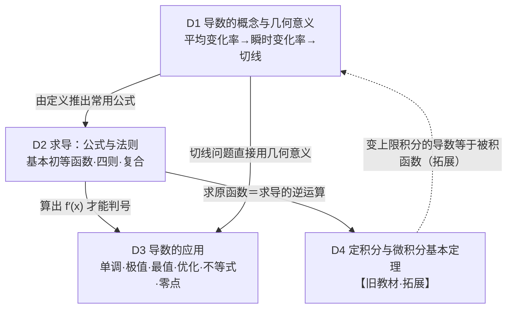

# D 导数与定积分：变化有多快？累积了多少？

> 所属：函数主线（研究“变化”）。约定见 `00-总图与导航.md` 第五节。
> 依据：人教B版选择性必修三 Ch6＋〔速查05〕。

---

## 〇、本模块在大厦中的位置

- **下接**：F 函数（研究对象；单调性、最值的定义）；A 地基（极限思想属“有限与无限”）；B 关系层（导数判号即解不等式 f′(x)>0）。
- **上接**：F（反过来作为研究函数的最强工具）；B（用单调性证明不等式）；M 建模（瞬时速度、边际成本、最优化）；物理（速度、加速度、功）。

**核心问题**：函数变化的**快慢**怎样精确刻画？知道了快慢，怎样反过来判断函数怎样变（增减、极值、最值）？（拓展）知道了每一瞬间的变化率，怎样求总的累积量？

**中心模型：“割线 → 切线”与“微分 ⇄ 积分”**

```
平均变化率 Δy/Δx（割线斜率）──Δx→0 取极限──→ 导数 f′(x₀)（切线斜率、瞬时变化率）
        │                                         │
        │                         求导公式＋四则法则＋复合法则 → 导函数 f′(x)
        │                                         ▼
        │                     f′ 的符号 → 单调性 → 极值 → 最值 → 优化／不等式／零点个数
        ▼
【拓展】分割—近似—求和—取极限 → 定积分 ∫ₐᵇ f(x)dx（面积、路程、功）
        └──── 微积分基本定理：F′=f ⇒ ∫ₐᵇ f(x)dx = F(b) − F(a)（求导与积分互逆）
```

---

## 一、L1 骨架



---

## 二、L2/L3 展开

### D1 导数的概念与几何意义〔B版·选必三·Ch6〕〔速查05〕

- **D1.1 从平均变化率到瞬时变化率**
  - 平均变化率：函数 y=f(x) 从 x₁ 到 x₂（x₁≠x₂，都在定义域内）的平均变化率为 Δy/Δx=[f(x₂)−f(x₁)]/(x₂−x₁)。
    - 几何意义：过 (x₁,f(x₁))、(x₂,f(x₂)) 的**割线斜率**。
    - 物理原型：平均速度 Δs/Δt。
  - 瞬时速度：物体运动 s=s(t)，在时刻 t 的瞬时速度 v=lim_{Δt→0} [s(t+Δt)−s(t)]/Δt（Δt→0 时平均速度的极限）。
  - 切线：曲线 y=f(x) 上点 P 与动点 Q 连割线 PQ，Q 沿曲线无限趋近 P 时，割线的极限位置 PT 叫曲线在 P 处的切线；割线斜率 Δy/Δx 的极限即切线斜率。
- **D1.2 导数的定义**
  - f(x) 在 x=x₀ 处的导数（瞬时变化率）：f′(x₀)=lim_{Δx→0} [f(x₀+Δx)−f(x₀)]/Δx=lim_{Δx→0} Δy/Δx。
  - 等价写法：f′(x₀)=lim_{x→x₀} [f(x)−f(x₀)]/(x−x₀)（令 x=x₀+Δx）。
  - 前提：f 在 x₀ 附近有定义，且上述极限存在（存在才叫“在 x₀ 处可导”）。
  - 定义法求导三步：
    1. 求增量 Δy=f(x₀+Δx)−f(x₀)；
    2. 求平均变化率 Δy/Δx；
    3. 取极限 f′(x₀)=lim_{Δx→0} Δy/Δx。
    - 注意第三步左边是 f′(x₀)（某一点的导数值），不是导函数 f′(x)。
  - 导函数：f 在开区间 (a,b) 内每一点都可导，则每个 x 对应一个确定的导数 f′(x)，得到新函数 f′(x)（也记 y′），叫导函数，简称导数；f′(x)=lim_{Δx→0} [f(x+Δx)−f(x)]/Δx。
  - 易错：**导数值与导函数**——f′(x₀) 是一个数，f′(x) 是一个函数；求某点导数一般先求导函数再代值（f′(x₀) 不是 [f(x₀)]′，后者是常数的导数 0）。
- **D1.3 几何意义与切线方程**
  - f′(x₀) 是曲线 y=f(x) 在点 P(x₀,f(x₀)) 处切线的斜率 k。
  - 切线方程：y−f(x₀)=f′(x₀)(x−x₀)。
  - 两类题：① 已知曲线求切线方程；② 已知切线（斜率、过某点、与某直线平行/垂直）求参数。
  - **“在点 A 处”与“过点 A”**：“在 A 处”A 就是切点；“过 A”A 不一定是切点——须设切点 (x₀,f(x₀))，列 f(x₀) 与 f′(x₀) 满足的方程求 x₀（可能多解）。
  - 可导与切线：在 x₀ 处可导 ⇒ 切线存在（斜率 f′(x₀)）；不可导不一定没有切线（如 y=∛x 在 x=0 处不可导，但有竖直切线 x=0）。
  - 变化快慢：|f′(x₀)| 越大，函数在 x₀ 附近变化越快（图像越陡）；f′(x₀)>0 时附近随 x 增大而增大。
    - 【易错】“斜率越大增长越快”以斜率为正为前提；斜率为负时绝对值越大下降越快。
  - 【新教材补充】物理意义：位移 s(t) 的导数是瞬时速度 v(t)=s′(t)，速度的导数是加速度 a(t)=v′(t)。

### D2 求导：公式与法则〔B版·选必三·Ch6〕

- **D2.1 基本初等函数的导数公式**
  - C′=0（C 为常数）。
  - (x^α)′=αx^(α−1)（α∈R，在函数有定义且可导的范围内）。
    - 【易错】公式不限于正整数或正指数，对任意实数指数都成立，如 (1/x)′=−1/x²，(√x)′=1/(2√x)（x>0）。
  - (sin x)′=cos x；(cos x)′=−sin x。
  - (aˣ)′=aˣ ln a（a>0，a≠1）；(eˣ)′=eˣ。
  - (logₐx)′=1/(x ln a)=(1/x)logₐe（a>0，a≠1，x>0）；(ln x)′=1/x（x>0）。
- **D2.2 运算法则**
  - [f(x)±g(x)]′=f′(x)±g′(x)。
  - [f(x)g(x)]′=f′(x)g(x)+f(x)g′(x)；推论 [Cf(x)]′=Cf′(x)。
    - 【易错】乘积法则中间只有“+”号，不要与商的法则的“−”混淆。
  - [f(x)/g(x)]′=[f′(x)g(x)−f(x)g′(x)]/[g(x)]²（g(x)≠0）；口诀“上导下不导，减去上不导下导，除以下的平方”。
- **D2.3 复合函数的导数**
  - y=f(u)，u=φ(x) 复合成 y=f(φ(x))：y′ₓ=y′ᵤ·u′ₓ，即 dy/dx=(dy/du)·(du/dx)（链式法则）。
  - 【新教材补充】新课标要求：会求形如 f(ax+b) 的简单复合函数的导数：[f(ax+b)]′=a·f′(ax+b)（如 (e^(2x+1))′=2e^(2x+1)，(sin 3x)′=3cos 3x）。
  - 步骤：分清由哪些基本函数复合 → 选中间变量 → 逐层求导，每一步明确“对哪个变量求导” → 把中间变量换回 x；熟练后可省略中间步骤。
  - 中间变量的选取：使每一层都是能直接套公式的**基本初等函数**。
    - 区分：能直接套公式的是**基本初等函数**；初等函数指由基本初等函数经有限次四则运算与复合得到的函数。
- **D2.4 求导技巧（学法指导）**
  - 先化简再求导：分式先化为整式或简单分式；三角式先用公式化为和差形式；根式化为分数指数幂。
  - 含绝对值的函数：先分段去绝对值；分段点处的可导性用导数定义判断（如 |x| 在 0 处不可导）。
  - 【旧教材·拓展】对数求导法：几个因式的积、商、乘方、开方，或幂指函数 y=u(x)^v(x)，两边取对数后用复合函数求导。例：y=xˣ（x>0），ln y=x ln x，两边求导 y′/y=ln x+1 ⇒ y′=xˣ(ln x+1)。
  - 用导数求参数：通常用求导公式求出 f′(x₀)，列方程求参数。
    - 一般用求导公式与法则；定义法只在分段点、抽象函数等公式用不了时使用。
- **D2.5 【旧教材·拓展】近似公式与二阶导数**
  - 近似公式：|Δx| 很小时，f(x₀+Δx)≈f(x₀)+f′(x₀)Δx（用切线代替曲线，“以直代曲”）。
  - 二阶导数判别极值（充分条件）：f′(x₀)=0 且 f″(x₀)<0 ⇒ x₀ 是极大值点；f′(x₀)=0 且 f″(x₀)>0 ⇒ 极小值点；f″(x₀)=0 时此法失效，需回到一阶导数变号判断。
    - 【易错】方向不能反：极大值点处 f″(x₀) 不一定小于 0（如 f(x)=−x⁴ 在 0 处为极大值点，f″(0)=0）；成立的是“f′(x₀)=0 且 f″(x₀)<0 ⇒ 极大值点”。
    - 若驻点 x₀ 左右 f′ 同号且 f″(x₀) 存在，则 f″(x₀)=0。

### D3 导数的应用〔B版·选必三·Ch6〕〔速查05〕

- **D3.1 导数与单调性**
  - 判定：f 在区间 (a,b) 内可导
    - f′(x)>0 ⇒ f 在 (a,b) 上单调递增；f′(x)<0 ⇒ 单调递减。
    - f′(x)≡0（在区间上恒为 0）⇒ f 在该区间上是常数函数。
    - 充分不必要：递增函数的导数可以在个别点为 0（反例 f(x)=x³ 在 R 上递增，f′(0)=0）。准确说法：f′(x)≥0 且使 f′(x)=0 的点只是孤立的点 ⇒ 严格递增。
  - 求单调区间四步：① 求定义域；② 求 f′(x)；③ 解 f′(x)=0 得驻点（及 f′ 不存在的点），把定义域分成若干区间；④ 列表看各区间内 f′ 的符号，“正则增，负则减”。
    - 等价做法：直接解不等式 f′(x)>0（或 <0），与定义域取交集。
  - 已知单调性求参数：f 在区间 I 上递增 ⇒ f′(x)≥0 在 I 上恒成立，求出参数范围后检验：去掉使 f′(x)≡0（f 为常函数）的参数值。
    - 【易错】要去掉的是使 **f′(x) 恒为 0** 的参数值（此时 f 为常函数，不单调），不是使 f(x) 恒为 0 的值。
  - 易错：单调区间是定义域的子区间，忘记先求定义域；多个同向单调区间用“，”或“和”隔开，不用“∪”。
- **D3.2 导数与极值**
  - 定义：若对 x₀ 附近（某个开区间内）的所有点 x≠x₀，都有 f(x)<f(x₀)，则 f(x₀) 是极大值，x₀ 是极大值点；都有 f(x)>f(x₀)，则 f(x₀) 是极小值。
  - 理解
    - 极值点是区间**内部**的点，端点不是极值点。
    - 极值是局部概念：极大值不一定比极小值大。
    - f 在 [a,b] 内有极值 ⇒ f 在 (a,b) 内不单调；在某区间上单调的函数在该区间内没有极值。
    - 交替出现：对连续函数，相邻两个极大值点之间必有极小值点（反之亦然）。
      - 前提：函数连续、极值点为严格极值点。
  - 极值与导数的关系
    - 可导函数在 x₀ 处取极值 ⇒ f′(x₀)=0（必要条件）；反之不成立（f(x)=x³，f′(0)=0 但 0 不是极值点）。
    - 不可导点也可能是极值点（f(x)=|x| 在 0 处取极小值）——**f′ 不存在的点也要讨论**。
  - 求极值步骤：① 求 f′(x)；② 求 f′(x)=0 的实根（及不可导点）；③ 检查根左右 f′ 的符号：左正右负 ⇒ 极大值，左负右正 ⇒ 极小值，左右同号 ⇒ **一定不是**极值点；④ 作结论。
  - 求极值的逆向问题：已知极值（点）求参数 ⇒ 列 f′(x₀)=0 与 f(x₀)=已知值，解出后**必须检验** x₀ 两侧 f′ 是否变号（防止像 x³ 那样的假极值点）。
  - 口诀：正则增，负则减，零求驻点化区间；由正变负极大显，由负变正极小现。示意：画一条波浪形曲线，在各极值点两侧标 f′ 的符号，“+−”为极大，“−+”为极小。
- **D3.3 导数与最值**
  - 存在性：f 在闭区间 [a,b] 上连续 ⇒ 一定有最大值和最小值（开区间上不一定有）。
  - 求 [a,b] 上最值的步骤：求导数 → 求 (a,b) 内的驻点与不可导点 → 判单调、求极值 → 把各极值与端点值 f(a)、f(b) 比较，最大者为最大值，最小者为最小值。
    - 简化：可直接比较驻点、不可导点与端点处的函数值，不必先判断是否为极值。
  - 单峰原则：若 f 在区间内连续，且只有一个极值点，则这个极值就是该区间上的最值（极大值即最大值，极小值即最小值）。
- **D3.4 生活中的优化问题**（【旧教材·拓展】节名；新教材并入“导数的应用”）
  - 一般步骤：分析各量关系 → 建立函数 y=f(x) 并写出**实际定义域** → 求 f′(x)，解 f′(x)=0 → 比较驻点与端点处的函数值 → 回答实际问题。
  - 注意：考虑实际意义（取整数、取正值）；区间内只有一个使 f′(x)=0 的点且该处为极值时，它就是最值（D3.3 单峰原则）。
- **D3.5 导数在研究函数中的综合应用**
  - 证明不等式：要证 f(x)>g(x)（x∈(a,b)），构造 h(x)=f(x)−g(x)
    - h′(x)>0（h 在 (a,b) 上递增）且 h(a)≥0（h 在 a 处连续）⇒ 对 x∈(a,b) 有 h(x)>h(a)≥0。
    - h′(x)<0（递减）且 h(b)≥0 ⇒ h(x)>h(b)≥0。
    - 一般地，转化为 h(x)ₘᵢₙ>0（或用下确界）。
    - 端点条件只需 ≥0（且 h 在端点连续），写成 >0 也可以但偏强。
  - 研究方程根（零点）的个数：用导数画出函数大致图像（单调区间、极值、端点或趋势），看与 x 轴（或水平直线 y=k）的交点个数——数形结合。
  - 求函数的值域：由单调性与极值、端点值得出。
  - 求参数取值范围：已知单调性（D3.1）、已知极值（D3.2）、恒成立与能成立（化为最值，接口 F1.6、B3）。
  - 列表讨论：已知定义域 D，按 f′(x)=0 的根 x₁,x₂,…,xₙ 的大小顺序分段列表，讨论单调区间；含参时按根的大小关系、根是否在 D 内分类讨论。
- **D3.6 易错（总结升华）**
  - f′(x)>0 是 f 递增的充分不必要条件（f′(x)<0 与递减同理）。
  - 极值与单调性：单调函数没有极值；f′(x₀)=0 不能推出极值。
  - 单调区间与定义域：单调区间必在定义域内。
  - 切线问题：混淆“在 A 处”与“过 A”（D1.3）。

### D4 定积分与微积分基本定理【旧教材·拓展】

> 2017 版新课标高中已删除本节；保留作为导数的“逆向”延伸和物理（位移、功）的工具。

- **D4.1 定积分的概念**（f 在 [a,b] 上连续）
  - 四步：
    1. 分割：用分点 a=x₀<x₁<…<xₙ=b 把 [a,b] 分成 n 个小区间（教材取等分，Δx=(b−a)/n）；
    2. 近似代替：在每个小区间 [x_{i−1},x_i] 上任取 ξᵢ，用 f(ξᵢ)Δx 近似这一小段的量（以直代曲、以不变代变）；
    3. 求和：Iₙ=Σᵢ₌₁ⁿ f(ξᵢ)Δx；
    4. 取极限：n→∞（即 Δx→0）时 Iₙ 的极限叫 f 在 [a,b] 上的定积分，记作 ∫ₐᵇ f(x)dx。
    - 说明：“等分”是为便于计算取的特例，一般定义只要求最大小区间长度趋于 0；“f 连续”是前提，分割是第一步。
  - 记号：a 为积分下限，b 为积分上限，f(x) 为被积函数，x 为积分变量。
- **D4.2 几何意义与性质**
  - 几何意义：f(x)≥0 时，∫ₐᵇ f(x)dx 等于由 y=f(x)、x=a、x=b 及 x 轴围成的曲边梯形面积；f(x)<0 的部分积分为负（面积取负）——定积分是“带符号的面积”。
  - 性质：
    - ∫ₐᵇ kf(x)dx=k∫ₐᵇ f(x)dx（k 为常数）；
    - ∫ₐᵇ [f₁(x)±f₂(x)]dx=∫ₐᵇ f₁(x)dx±∫ₐᵇ f₂(x)dx；
    - ∫ₐᵇ f(x)dx=∫ₐᶜ f(x)dx+∫ᶜᵇ f(x)dx（区间可加性；通常写 a<c<b，在函数可积时对任意 c 都成立）；
    - f 为偶函数：∫₋ₐᵃ f(x)dx=2∫₀ᵃ f(x)dx；f 为奇函数：∫₋ₐᵃ f(x)dx=0。
- **D4.3 微积分基本定理（牛顿—莱布尼茨公式）**
  - 若 f 在 [a,b] 上连续，且 F′(x)=f(x)（F 是 f 的一个原函数），则 ∫ₐᵇ f(x)dx=F(x)|ₐᵇ=F(b)−F(a)。
  - 意义：把“求和的极限”化为“求导的逆运算”——求导与积分互逆（桥18）。
  - 变上限积分（大学内容）：Φ(x)=∫ₐˣ f(t)dt，满足 Φ′(x)=f(x)。
  - 计算方法：定义法（求和取极限，繁）；几何意义法（如 ∫₀¹√(1−x²)dx=π/4，四分之一单位圆面积）；公式法（基本定理）。关键是找原函数（逆用 D2.1 的求导公式）。
  - 【旧教材·拓展（大学内容）】换元积分法、分部积分法（高中旧课标也不要求）。
- **D4.4 定积分的简单应用**
  - 平面图形面积：两函数之间——求交点，判上下，套公式；函数与坐标轴及 x=a、x=b 之间——判断在 x 轴上方还是下方，套公式。
    - 曲线在 x 轴上方：S=∫ₐᵇ f(x)dx。
    - 曲线在 x 轴下方：S=−∫ₐᵇ f(x)dx。
    - 两曲线之间（在 [a,b] 上 f₁(x)≥f₂(x)）：S=∫ₐᵇ [f₁(x)−f₂(x)]dx——“上减下”，与两曲线是否在 x 轴上方无关；两曲线在区间内交叉时，以交点分段，每段都用“上减下”。
  - 物理应用
    - 变速直线运动：速度 v(t)，则 [a,b] 时间内的位移 s=∫ₐᵇ v(t)dt；v(t)≥0 时它就是路程，v 有正有负时路程为 ∫ₐᵇ|v(t)|dt。
      - 【易错】这个公式适用于一般**变速**直线运动（不限于匀变速），积分变量是时间 t。
    - 变力做功：物体在与运动方向相同的变力 F(x) 作用下从 x=a 移到 x=b（a<b），功 W=∫ₐᵇ F(x)dx。
- **D4.5 方法·易错（总结升华）**
  - 关键是找到被积函数的原函数（逆用求导公式）；复杂被积函数先化简（拆项、降次）。
  - 分段函数积分：按分段点拆开，每段用对应表达式；注意积分的上、下限位置。
  - 易错：图形在 x 轴下方时定积分为负，求面积要取相反数（或取绝对值）；求面积前先判断曲线在 x 轴上方还是下方、两曲线谁在上。

---

## 三、与其他模块的桥

| 桥 | 本模块节点 | 对方节点 | 关系 |
|---|---|---|---|
| 桥6 | D1.1、D3.1 | F2.1 单调性 | 平均变化率取极限得导数；导数符号判单调 |
| 桥17 | D3.3 最值 | F1.5、B4 | 求最值的三条路径（单调性、基本不等式、导数） |
| 桥18 | D4.3 | D2 | 求导与积分互逆 |
| — | D3.5 证明不等式 | B 关系层 | 构造函数 h=f−g，用单调性与最值证明 |
| — | D3.5 零点个数 | F5 函数与方程 | 用导数作图后数形结合 |
| — | D1.3 切线 | J7 直线与曲线 | 切线斜率 k=f′(x₀)；二次曲线的切线也可用联立 Δ=0 |
| — | D4.2 奇偶性质 | F2.2 | 奇函数在对称区间上积分为 0 |
| — | D3.4 优化 | M 建模 | 最优化模型 |
| — | D1.3 物理意义 | 物理（速度、加速度） | v=s′，a=v′；s=∫v dt |
