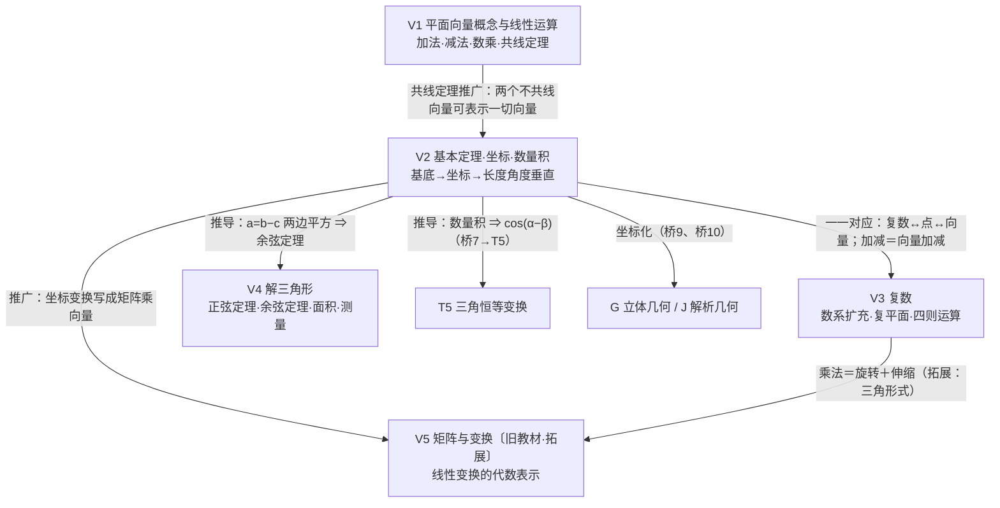

# V 模块 · 向量、复数与解三角形 —— 让“形”参与运算

> 所属主线：几何与代数主线。约定见 `00-总图与导航.md` 第五节。
> 依据：〔B版·必修二·Ch6〕〔B版·必修三·Ch8〕〔B版·必修四·Ch9、Ch10〕＋〔速查04、08、15〕。

## 一、本模块在大厦中的位置

- **下接（依赖）**：A 地基——实数运算律、数系扩充（A1）、集合语言；初中几何——平行四边形、相似、勾股定理【初中衔接】；T 三角——任意角三角函数定义（T2）。
- **上接（支撑）**：G 立体几何（空间向量、法向量，G7/G8）；J 解析几何（方向向量、法向量、坐标法，J1/J2）；T5 三角恒等变换（数量积推出差角余弦）；物理（力、速度、位移的合成与分解）。
- **核心问题**：几何量（长度、角度、平行、垂直）能否像数一样“算”出来？
- **中心模型**：**“有向线段 → 向量 → 坐标”三级化归**。几何对象先抽象为向量（只保留大小和方向），再借基底分解为一对实数（坐标），几何关系就变成代数运算：
  - 平行 ⇔ 共线 ⇔ x₁y₂−x₂y₁=0；垂直 ⇔ 数量积为 0；长度 ⇔ √(a·a)；夹角 ⇔ a·b/(|a||b|)。
  - 复数是“会乘法的向量”：z=a+bi ↔ 点 Z(a,b) ↔ 向量 OZ。
  - 解三角形是向量方法在三角形上的定型结论（余弦定理＝向量等式平方）。

## 二、L1 骨架

## 三、L2/L3 详细脑图

### V1 平面向量的概念与线性运算〔B版·必修二·Ch6〕〔速查08〕

- **V1.1 向量的概念**
  - 定义：既有大小又有方向的量（对比：数量只有大小）。
  - 表示
    - 几何表示：有向线段 AB→（起点 A，终点 B）。
    - 字母表示：→a，或印刷体粗体 **a**。
  - 模：向量的大小即有向线段的长度，记 |AB→|、|a|。
  - 向量与有向线段的关系
    - 向量只由大小和方向决定，与起点位置无关（自由向量）；同向等长的有向线段表示同一向量。
    - 作图时起点可任意选取——这正是向量能处理几何问题的方便之处。
- **V1.2 特殊向量与向量关系**
  - 零向量：长度为 0，方向任意，记 0。
  - 单位向量：长度为 1 个单位；与 a 同向的单位向量 a/|a|（a≠0）。
  - 相等向量：长度相等且方向相同；相等向量平移后可以重合。
  - 相反向量：长度相等、方向相反，记 −a。
  - 平行（共线）向量：方向相同或相反的**非零**向量；**规定零向量与任一向量平行**。【易错】定义里的“非零”不能漏：零向量方向任意，是靠“规定”才与任一向量平行的。
    - 平行向量也叫共线向量：表示它们的有向线段所在直线平行**或重合**。
    - 相等向量一定平行；平行向量不一定相等。
    - 向量平行与直线平行不同：直线平行不含重合，向量平行允许在同一直线上。
  - 易错
    - 忽视零向量：如“a∥b，b∥c ⇒ a∥c”在 b=0 时不成立。
    - 混淆零向量 0 与数 0：0·a=0（向量），a+(−a)=0（向量），a·b 是数。
    - 把平行向量当相等向量。
- **V1.3 向量加法**
  - 三角形法则：首尾相接，和向量从第一个起点指向最后一个终点。要点：一定“首尾相接”。
  - 平行四边形法则：共起点，以两向量为邻边作平行四边形，共起点的对角线为和。
    - 作图步骤：①任取一点；②作两个与已知向量相等、起点重合的向量；③补成平行四边形；④取共起点的对角线。
    - 两法则关系：不共线时结论一致；共线时平行四边形退化，只能用三角形法则。
  - 运算律：交换律 a+b=b+a；结合律 (a+b)+c=a+(b+c)。
  - 推广（多边形法则）：A₁A₂→+A₂A₃→+…+Aₙ₋₁Aₙ→=A₁Aₙ→；首尾相接围成封闭折线时和为 0。
  - 和的模与方向
    - a、b 同向：a+b 与 a 同向，|a+b|=|a|+|b|。
    - a、b 反向且 |a|<|b|：a+b 与 b 同向，|a+b|=|b|−|a|。
    - a、b 不共线：a+b 与两者方向都不同，|a+b|<|a|+|b|。
    - ★三角不等式：||a|−|b||≤|a+b|≤|a|+|b|；右边取等 ⇔ a、b 同向或有零向量；左边取等 ⇔ a、b 反向或有零向量。【易错】左端要写 ||a|−|b||（带外层绝对值），只写 |b|−|a| 在 |a|>|b| 时得到负数，信息不全。同式对 a−b 也成立：||a|−|b||≤|a±b|≤|a|+|b|。
- **V1.4 向量减法**
  - 定义：a−b=a+(−b)；减法是加法的逆运算，差仍是向量。
  - 几何意义：a、b 共起点时，a−b 从 b 的终点指向 a 的终点。
  - ★“终点减起点”：对任意点 O，AB→=OB→−OA→（解题中最常用）。
  - 平行四边形 ABCD 中，AB→=a，AD→=b，则 AC→=a+b，DB→=a−b，BD→=b−a。
- **V1.5 数乘向量**
  - 定义：λa 是向量，|λa|=|λ||a|；λ>0 与 a 同向，λ<0 与 a 反向，λ=0 或 a=0 时 λa=0。
  - 几何意义：|λ|>1 伸长，|λ|<1 缩短；λ<0 同时反向。
  - 运算律：λ(μa)=(λμ)a；(λ+μ)a=λa+μa；λ(a+b)=λa+λb。
  - 注意：实数与向量可以相乘，不能相加减。
  - 线性运算：加、减、数乘统称向量的线性运算。
- **V1.6 共线定理及其应用**
  - ★共线定理：a≠0 时，b 与 a 共线 ⇔ 存在唯一实数 λ，使 b=λa。
    - 条件 a≠0 必要：a=b=0 时 λ 任意，不唯一（但仍共线）。
    - 用法：找 λ；找到且唯一则共线，找不到则不共线。
  - 三点共线：A、B、C 共线 ⇔ AB→ 与 AC→ 共线。
  - 直线的向量参数式：O 为任意点，M 在直线 AB 上 ⇔ OM→=tOA→+(1−t)OB→（t∈R，A≠B）。
  - 中点公式：M 为 AB 中点 ⇔ OM→=½(OA→+OB→)。
  - 常用恒等式：AB→+BC→=AC→；OA→−OB→=BA→。
- **V1.7 方法与思想**
  - 类比数的运算理解向量运算，同时注意区别（向量没有除法，数量积不满足结合律）。
  - 用向量解平面几何的“三步曲”：①用向量表示几何元素（几何→向量）；②向量运算研究平行、垂直、距离、夹角；③把结果翻译回几何关系。

### V2 平面向量基本定理、坐标与数量积〔B版·必修二·Ch6、必修三·Ch8〕〔速查08〕

- **V2.1 平面向量基本定理**
  - ★定理：e₁、e₂ 是同一平面内两个不共线向量，则平面内任一向量 a 都存在**唯一**一对实数 λ₁、λ₂，使 a=λ₁e₁+λ₂e₂；{e₁,e₂} 叫一组基底。
    - 几何本质：以 a 为对角线、沿 e₁、e₂ 方向作平行四边形分解。
    - 不共线 ⇒ e₁、e₂ 都非零。
    - 基底不唯一，只要不共线即可；在给定基底下表示唯一。
  - 推论（三点共线的向量判定）：O 为任意点，A、B 不重合，则 A、B、C 共线 ⇔ OC→=αOA→+βOB→ 且 α+β=1（即 V1.6 参数式）。
- **V2.2 向量的坐标表示**
  - 正交分解：取 x、y 轴上的单位向量 i、j 为基底，a=xi+yj，则记 a=(x,y)。
    - 【易错】只有当 i、j 分别是 x、y 轴正方向的单位向量时，a=xi+yj 才说明 a 的坐标是 (x,y)；基底换成别的向量，系数就不是坐标。
  - OA→ 的坐标＝点 A 的坐标；AB→=(x₂−x₁, y₂−y₁)（终点减起点）。
  - 向量坐标只与起点、终点的**相对位置**有关；相等向量坐标相同，但它们的起点、终点坐标可以不同。
  - 易错：混淆向量坐标与点的坐标。
- **V2.3 坐标运算**（a=(x₁,y₁)，b=(x₂,y₂)）
  - a±b=(x₁,y₁)±(x₂,y₂)=(x₁±x₂, y₁±y₂)（横坐标与横坐标、纵坐标与纵坐标分别运算）。
  - λa=(λx₁, λy₁)。
  - ★平行：a∥b ⇔ x₁y₂−x₂y₁=0（这种乘积式不需要 b≠0 的分母条件，比“x₁/x₂=y₁/y₂”更不易误用）。
  - 方法：求与 a 共线的向量，设为 λa 用待定系数法；已知共线求参数，用坐标式最简捷。
- **V2.4 数量积**
  - 夹角：非零向量 a、b，作 OA→=a，OB→=b，∠AOB=θ∈[0,π] 为夹角；θ=π/2 时 a⊥b。
    - 易错：找夹角必须共起点（如三角形 ABC 中 AB→ 与 BC→ 的夹角是 π−B，不是 B）。
  - ★定义：a·b=|a||b|cosθ；规定 0 与任何向量的数量积为 0。结果是**数量**，符号由 cosθ 决定；书写时中间的点不能省略。
  - 投影
    - 【新教材补充】投影向量：a 在 b 上的投影向量＝|a|cosθ·e＝(a·b/|b|²)b（e 为与 b 同向的单位向量）。
    - 旧教材说法【旧教材·拓展】：数 |a|cosθ 叫 a 在 b 方向上的投影（数量投影，可正可负可为 0）。
    - 几何意义：a·b 等于 |b| 与 a 在 b 方向上的数量投影之积（也可说成 |a| 与 b 在 a 方向上数量投影之积，两种说法对称等价）。
  - 性质（a、b 非零，e 为与 b 同向的单位向量）
    - e·a=a·e=|a|cosθ。
    - ★a⊥b ⇔ a·b=0。
    - 同向时 a·b=|a||b|；反向时 a·b=−|a||b|；a·a=|a|²，|a|=√(a·a)。
    - cosθ=a·b/(|a||b|)。
    - |a·b|≤|a||b|，取等 ⇔ a、b 共线（柯西不等式的向量形式，桥到 B6）。
  - 运算律：a·b=b·a；(λa)·b=λ(a·b)=a·(λb)；(a+b)·c=a·c+b·c。注意：(a·b)c≠a(b·c)（不满足结合律），也不能约分（a·b=a·c 推不出 b=c）。
  - 常用公式：(a±b)²=a²±2a·b+b²；(a+b)·(a−b)=a²−b²。【易错】中间项写 2a·b，数量积的点不能省略。
- **V2.5 数量积的坐标形式**
  - a·b=x₁x₂+y₁y₂。
  - |a|=√(x²+y²)；两点距离 |AB|=√((x₁−x₂)²+(y₁−y₂)²)。
  - cosθ=(x₁x₂+y₁y₂)/(√(x₁²+y₁²)·√(x₂²+y₂²))。
  - ★a⊥b ⇔ x₁x₂+y₁y₂=0。
  - 对照记忆：平行看“交叉相减”x₁y₂−x₂y₁=0，垂直看“对应相乘相加”x₁x₂+y₁y₂=0。
- **V2.6 数量积能解决的三类问题**：长度（|a|=√(a²)）、角度（cosθ 公式）、垂直（a·b=0）。
- **V2.7 应用举例**
  - 平面几何：平移、全等、相似、长度、距离、夹角。
  - 解析几何：直线的方向向量与斜率（方向向量 (1,k)）、法向量 (A,B)（桥10→J2）。
  - 物理：力、速度、加速度、位移的合成与分解；功 W=F·s 就是数量积。
- **V2.8 【新教材补充】数量积推出差角余弦（桥7→T5）**
  - 单位圆上 OA→=(cosα, sinα)，OB→=(cosβ, sinβ)，夹角为 α−β（或其适当调整），由 OA→·OB→ 的定义式与坐标式相等得 cos(α−β)=cosαcosβ+sinαsinβ。这是人教B版必修三 Ch8 的路线：先有数量积，再推三角恒等变换。
- **V2.9 思想**
  - 向量是数形结合的载体：几何运算（图形上）与坐标运算（代数上）是同一对象的两种算法。
  - 有序实数对 (x,y) 既可表示点，也可表示向量——向量因此与解析几何紧密相连（平行、垂直、夹角、距离）。
  - 易错汇总：向量平行与线段平行混淆；向量坐标与点坐标混淆；找错夹角。
  - 高考视角：a·b=|a||b|cos⟨a,b⟩；平行 a=λb；垂直 a·b=0；坐标 a±b=(x₁±x₂,y₁±y₂)，a·b=x₁x₂+y₁y₂。

### V3 复数〔B版·必修四·Ch10〕〔速查15〕

- **V3.1 数系扩充（桥接 A1）**
  - N →(负数) Z →(分数) Q →(无理数) R →(虚数) C。
  - 引入动机：在实数范围内 x²+1=0 无解；规定虚数单位 i，使 i²=−1，并且 i 与实数能按原有运算律进行四则运算。
- **V3.2 复数的概念**
  - 代数形式：z=a+bi（a,b∈R），实部 Re z=a，虚部 Im z=b（虚部是实数 b，不是 bi）。
  - 分类
    - b=0：实数。
    - b≠0：虚数；其中 a=0 且 b≠0：纯虚数（两个条件缺一不可）。
  - ★复数相等：a+bi=c+di（a,b,c,d∈R）⇔ a=c 且 b=d。前提“a,b,c,d 是实数”不能丢——这是“化复数问题为实数问题”的依据。
  - 两个复数只要不全是实数，就不能比较大小（复数失去了实数的顺序结构）。
  - 易混点：虚数与纯虚数；复数与实数、虚数；实轴虚轴与 x、y 轴；复数运算与实数运算法则。
- **V3.3 复数的几何意义（桥11）**
  - 复平面：x 轴为实轴，y 轴为虚轴；实轴上的点表示实数，虚轴上除原点外的点表示纯虚数，原点表示实数 0。
  - ★一一对应：z=a+bi ↔ 点 Z(a,b) ↔ 向量 OZ→=(a,b)。
    - 易错：Z 的坐标是 (a,b) 不是 (a,bi)；虚轴单位长度是 1 不是 i。
  - 模：|z|=√(a²+b²)＝点 Z 到原点的距离；|z₁−z₂|＝两点间距离。
  - 加法按向量平行四边形（三角形）法则，减法按向量三角形法则：z₁−z₂ 对应 Z₂Z₁→。
- **V3.4 四则运算**
  - 加减：(a+bi)±(c+di)=(a±c)+(b±d)i。
  - 乘法：(a+bi)(c+di)=(ac−bd)+(ad+bc)i（按多项式展开，i² 换成 −1）。
    - 易错：把 i² 当成 1。
  - 除法：(a+bi)/(c+di)=[(a+bi)(c−di)]/(c²+d²)=(ac+bd)/(c²+d²)+[(bc−ad)/(c²+d²)]i（c+di≠0）；方法是分母实数化（乘共轭）。
  - 方法：熟练运用运算法则；复数相等问题先分离实部与虚部。
- **V3.5 共轭复数**
  - 定义：实部相等、虚部互为相反数；z=a+bi 的共轭 z̄=a−bi；实数的共轭是它本身。
  - 性质
    - (z̄)̄=z。
    - z 为实数 ⇔ z=z̄。
    - ★z 为纯虚数 ⇔ z̄=−z（即 z+z̄=0）且 z≠0。【易错】z≠0 不能漏：z=0 也满足 z+z̄=0，但 0 不是纯虚数。
    - z·z̄=|z|²=|z̄|²=a²+b²。
    - ★z̄=1/z ⇔ |z|=1（z≠0）。【易错】是共轭 z̄ 等于 1/z，不是 z 本身：z=1/z ⇔ z²=1 ⇔ z=±1，与 |z|=1 不等价（如 z=i 满足 |z|=1，但 1/i=−i≠i）。
    - 和、积的共轭等于共轭的和、积：(z₁±z₂)̄=z̄₁±z̄₂，(z₁z₂)̄=z̄₁z̄₂，(zⁿ)̄=(z̄)ⁿ；可推广到 n 个。
- **V3.6 模的性质**
  - |z|=|z̄|=|−z|=√(z·z̄)。
  - |z₁z₂|=|z₁||z₂|；|zⁿ|=|z|ⁿ；|z₁/z₂|=|z₁|/|z₂|（z₂≠0）。
  - 三角不等式：||z₁|−|z₂||≤|z₁±z₂|≤|z₁|+|z₂|。
    - |z₁+z₂|=|z₁|+|z₂| ⇔ z₁、z₂ 对应向量同向或其一为 0（非零时 z₁=kz₂，k>0）；||z₁|−|z₂||=|z₁+z₂| ⇔ 反向或其一为 0（非零时 z₁=kz₂，k<0）。
  - 【旧教材·拓展】平行四边形恒等式：|z₁+z₂|²+|z₁−z₂|²=2(|z₁|²+|z₂|²)（两条对角线平方和等于四边平方和）。
- **V3.7 i 与特殊复数的运算规律**
  - i 的幂周期为 4：i⁴ⁿ=1，i⁴ⁿ⁺¹=i，i⁴ⁿ⁺²=−1，i⁴ⁿ⁺³=−i；连续四个幂之和 iⁿ+iⁿ⁺¹+iⁿ⁺²+iⁿ⁺³=0（n∈Z）。
  - (1±i)²=±2i；(1+i)/(1−i)=i；(1−i)/(1+i)=−i。
  - 【旧教材·拓展】ω=−½±(√3/2)i 是 x³=1 的两个虚根：ω³=1，ω²=ω̄，ω̄²=ω，1+ω+ω²=0，ωⁿ+ωⁿ⁺¹+ωⁿ⁺²=0（n∈N*）。
- **V3.8 实系数方程与复数**
  - 实系数一元二次方程 Δ<0 时有一对共轭虚根 x=[−b±i√(−Δ)]/(2a)，韦达定理仍成立。
  - 系数含虚数时不能用判别式判断根的情况（判别式依赖实数的大小顺序）。
- **V3.9 【旧教材·拓展】复数的三角形式**〔速查15〕
  - z=r(cosθ+i sinθ)，r=|z|，θ 为辐角；乘法：模相乘、辐角相加（几何上是旋转＋伸缩）；乘 i 即逆时针旋转 90°。
  - 棣莫弗定理：[r(cosθ+i sinθ)]ⁿ=rⁿ(cos nθ+i sin nθ)。
- **V3.10 方法与思想**
  - 化复为实：设 z=a+bi，利用复数相等列实数方程组。
  - 化代数为几何：|z−z₀|=r 是圆，|z−z₁|=|z−z₂| 是中垂线等。
  - 高考视角：实部、虚部、纯虚数、共轭；模、相等、四则运算；复平面上点 (a,b) 所在象限。

### V4 解三角形〔B版·必修四·Ch9〕〔速查04〕

- **V4.1 基础约定**：△ABC 中 A+B+C=π；大边对大角（a>b ⇔ A>B ⇔ sinA>sinB）；任意两边之和大于第三边。这些是常被忽视的隐含条件。
- **V4.2 正弦定理**
  - ★a/sinA=b/sinB=c/sinC=2R（R 为外接圆**半径**）。
  - 变形（边角互化）：a=2RsinA，sinA=a/(2R)；a:b:c=sinA:sinB:sinC。
  - 能解：①已知两角和一边；②已知两边和其中一边的对角（可能多解）。
- **V4.3 余弦定理**
  - ★a²=b²+c²−2bc·cosA（另两式轮换）；变形 cosA=(b²+c²−a²)/(2bc)。
  - 【新教材补充】向量证明（桥8）：a=BC→=AC→−AB→，两边平方得 a²=b²+c²−2bc·cosA。勾股定理是 A=90° 的特例。
  - 能解：③已知三边求角；④已知两边及夹角求第三边。有解时解唯一。
- **V4.4 射影定理**【旧教材·拓展】：a=b·cosC+c·cosB（另两式轮换）——边等于另两边在它上面的投影之和。
- **V4.5 面积公式**
  - ★S=½ab·sinC=½bc·sinA=½ca·sinB。
  - 其他：S=½·底·高=abc/(4R)=2R²sinA·sinB·sinC=√(p(p−a)(p−b)(p−c))（海伦公式）=pr，其中 p=½(a+b+c)，r 为内切圆半径。
- **V4.6 解的个数（已知 a、b、A，求 B）**
  - A 为锐角：a<b·sinA 无解；a=b·sinA 一解（直角三角形）；b·sinA<a<b 两解；a≥b 一解。
  - A 为直角或钝角：a>b 一解；a≤b 无解。
  - 【易错】只比较 b·sinA 与 a 不够：b·sinA<a 时还要再与 b 比较（a≥b 只有一解）；A 为钝角或直角时也不是总有一解，a≤b 无解。
  - 几何解释：以 C 为圆心、a 为半径画弧，与角 A 的另一边交点个数。
- **V4.7 三角形形状判定**
  - 方法一 化边为角：用 a=2RsinA 等，再三角恒等变换得角的关系（如 sin2A=sin2B ⇒ A=B 或 A+B=π/2，两种都要保留）。
  - 方法二 化角为边：用 cosA=(b²+c²−a²)/(2bc)、sinA=a/(2R)，代数变形得边的关系。
  - 用余弦定理判角型（设 c 为**最大边**）：a²+b²=c² 直角；a²+b²<c² 钝角；a²+b²>c² 锐角。【易错】必须先确定 c 是最大边：只说明某一个角是锐角，不能断定锐角三角形。
  - 思路：先找三角形中有无特殊边、角。
- **V4.8 实际测量应用**
  - 一般思路：①理解题意分清已知所求；②画出（或理解）图形；③把已知量和未知量集中到相关三角形中，用正、余弦定理；④按实际意义和精确度作答。
  - 量都在一个三角形中：直接用正、余弦定理。
  - 涉及两个及以上三角形：先解条件足够的三角形，再逐步求其他；必要时设未知量，在几个三角形中列方程组。
  - 术语：仰角、俯角、方向角、方位角、坡度（坡角的正切）。
  - 距离问题
    - B 可到达、A 不可到达：在 B 一侧取基线 BC，测 BC、∠ABC=α、∠ACB=β，用正弦定理（已知两角一边）求 AB。
    - A、B 都不可到达：取基线 CD，测 CD 及 ∠ACD、∠ADC，在 △ACD 中求 AC；测 ∠BCD、∠BDC，在 △BCD 中求 BC；再测 ∠ACB，在 △ABC 中用余弦定理求 AB。
    - 若 B 不在 A、C、D 所在平面（测高或空间情形），需要测仰角，转化到竖直平面内的直角三角形。
- **V4.9 思想与综合**
  - 解斜三角形体现数学建模：实际问题 → 三角形模型 → 推理演算求解 → 还原到实际。
  - 向量与三角综合：把角看成两向量夹角、线段长看成向量模；常结合平行、垂直、长度、夹角考查。
  - 易错：忽视三角形的隐含条件（内角和、边角范围）；不注意角的范围导致增解或漏解。
  - 高考视角：等式处理——纯角式用恒等变换（sin²A+cos²A=1 等）；边角混合式：各项或分子分母各项都含边的齐次式可“边化角”；边多且含余弦时“角化边”；用多的量表示少的量，用所求量表示其他量。

### V5 矩阵与变换【旧教材·拓展】（选修4-2）

- **V5.1 矩阵的概念**
  - s×n 个数排成 s 行 n 列的数表称为矩阵。
  - 零矩阵：元素全为 0；二阶单位矩阵 E₂=[[1,0],[0,1]]。
- **V5.2 矩阵的加法**：同型矩阵对应元素相加；满足交换律、结合律。
- **V5.3 矩阵的乘法**
  - 定义：C=AB，cᵢⱼ=Σₖ aᵢₖbₖⱼ（A 的第 i 行与 B 的第 j 列对应元素乘积之和）；要求 A 的列数等于 B 的行数。
  - 行矩阵乘列矩阵：[a₁₁ a₁₂][b₁₁, b₂₁]ᵀ=[a₁₁b₁₁+a₁₂b₂₁]。
  - 二阶矩阵乘列向量：[[a₁₁,a₁₂],[a₂₁,a₂₂]][x₀,y₀]ᵀ=[a₁₁x₀+a₁₂y₀, a₂₁x₀+a₂₂y₀]ᵀ。
  - 二阶矩阵相乘：[[a,b],[c,d]][[e,f],[g,h]]=[[ae+bg, af+bh],[ce+dg, cf+dh]]。
  - 性质：结合律 A(BC)=(AB)C；分配律 A(B+C)=AB+AC，(B+C)A=BA+CA；数乘结合律 k(AB)=(kA)B=A(kB)；EA=AE=A；一般 AB≠BA。
  - 乘方：Mⁿ=M·M·…·M（n 个）。
- **V5.4 逆矩阵**
  - 定义：二阶矩阵 A 若存在二阶矩阵 B 使 AB=BA=E₂，则 A 可逆，B=A⁻¹。
  - ★可逆条件：A=[[a,b],[c,d]] 可逆 ⇔ det A=ad−bc≠0（行列式为 0 的矩阵不可逆）。
  - 求法
    - 待定系数法：设 B，由 AB=E 列方程组。
    - 公式法：A⁻¹=(1/(ad−bc))·[[d,−b],[−c,a]]。
    - 几何法：逆矩阵对应“撤销”原变换的变换（如旋转 φ 的逆是旋转 −φ）。
    - ★(AB)⁻¹=B⁻¹A⁻¹（顺序颠倒）；易错：写成 A⁻¹B⁻¹。
- **V5.5 用矩阵解二元一次方程组**
  - {ax+by=e, cx+dy=f} 写成 [[a,b],[c,d]][x,y]ᵀ=[e,f]ᵀ；系数矩阵可逆时有唯一解 [x,y]ᵀ=[[a,b],[c,d]]⁻¹[e,f]ᵀ。
- **V5.6 常见的平面变换**（P(x,y)→P′(x′,y′)）
  - 一般线性变换：x′=ax+by，y′=cx+dy，即 [x′,y′]ᵀ=[[a,b],[c,d]][x,y]ᵀ。
  - 恒等变换：E₂。
  - 旋转变换（绕原点逆时针转 φ）：[[cosφ, −sinφ],[sinφ, cosφ]]。
  - 反射变换：关于 x 轴 [[1,0],[0,−1]]；关于 y 轴 [[−1,0],[0,1]]；关于 y=x [[0,1],[1,0]]；关于原点 [[−1,0],[0,−1]]。
  - 伸缩变换（k、k₁、k₂>0）：横坐标变为 k 倍 [[k,0],[0,1]]；纵坐标变为 k 倍 [[1,0],[0,k]]；同时 [[k₁,0],[0,k₂]]。
  - 投影变换：向 x 轴正投影 [[1,0],[0,0]]；向 y 轴正投影 [[0,0],[0,1]]。投影变换是映射但不是一一映射（不可逆，行列式为 0）。
  - 切变变换：平行于 x 轴 [[1,k],[0,1]]（点沿 x 方向平移 ky）；平行于 y 轴 [[1,0],[k,1]]（点沿 y 方向平移 kx）。
    - 性质：保持面积不变（行列式为 1）；距离和夹角可变。【易错】平行于 x 轴的切变，x 轴上的点是不动点；平行于 y 轴的切变，不动点在 y 轴上。
  - 伸缩变换下直线仍变为直线，线段仍变为线段。
- **V5.7 变换的复合与矩阵乘法**
  - AB 对应的复合变换：**先** B **后** A；连续施行 n 次 A 记为 Aⁿ。
  - 两个变换一般不能交换顺序，只有特殊情况可以。
  - 可逆的二阶线性变换都可分解为伸缩、反射、旋转、切变的复合（分解不唯一）；伸缩、反射、切变称初等变换。【易错】这一结论只针对线性变换（可逆二阶矩阵对应的变换），平移不在其中。
- **V5.8 特征值与特征向量**
  - 定义：A=[[a,b],[c,d]]，若存在数 λ 和非零向量 α 使 Aα=λα，则 λ 为特征值，α 为属于 λ 的特征向量（几何意义：α 方向在变换下不变，只被伸缩 λ 倍）。
  - 特征多项式：f(λ)=|λ−a, −b; −c, λ−d|=λ²−(a+d)λ+(ad−bc)。
  - 求解步骤：①解 f(λ)=0 得 λ₁、λ₂；②将 λ 代入 {(λ−a)x−by=0, −cx+(λ−d)y=0}；③取 x=1 或 y=1 写出一个非零解作为特征向量。
  - 计算 Mⁿβ：①求特征值 λ₁、λ₂ 与特征向量 α₁、α₂；②把 β 表示为 β=mα₁+nα₂；③Mβ=mλ₁α₁+nλ₂α₂；④Mⁿβ=mλ₁ⁿα₁+nλ₂ⁿα₂。

## 四、与其他模块的桥

| 桥 | 方向 | 内容 |
|---|---|---|
| 桥7 | V2 → T5 | 单位圆上两向量的数量积推出 cos(α−β)，再推出全部和差倍角公式 |
| 桥8 | V2 → V4 | 向量等式平方得余弦定理；数量积表示夹角 |
| 桥9 | V2 → G7/G8 | 平面向量基本定理推广为空间向量基本定理；方向向量、法向量 |
| 桥10 | V2 → J1/J2 | 直线方向向量 (1,k)、(B,−A)，法向量 (A,B)；点到直线距离可由投影推出 |
| 桥11 | V2 ⇄ V3 | 复数 ↔ 点 ↔ 向量；复数加减＝向量加减；\|z\|＝向量长度 |
| — | V2.4 → B6 | \|a·b\|≤\|a\|\|b\| 即二维柯西不等式 |
| — | V5 → T4 | 伸缩、平移变换与 y=Asin(ωx+φ) 图像变换同源 |
| — | V5 → J9 | 坐标伸缩变换 x′=λx、y′=μy |
