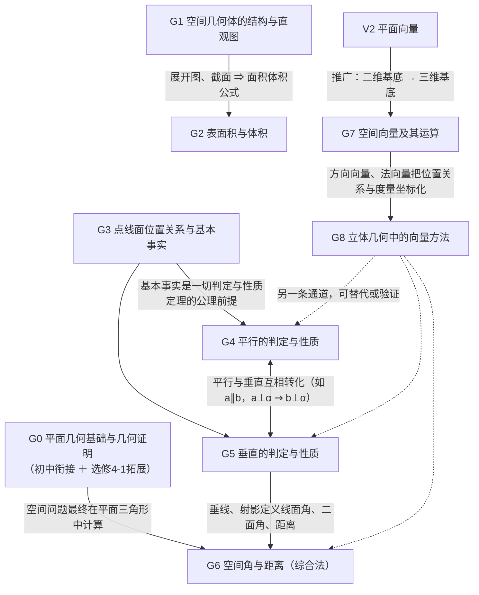

# G 模块 · 立体几何 —— 空间图形的推理与度量

> 所属主线：几何与代数主线。约定见 `00-总图与导航.md` 第五节。
> 依据：〔B版·必修四·Ch11〕〔B版·选必一·Ch1〕＋〔速查09〕。

## 一、本模块在大厦中的位置

- **下接（依赖）**：平面几何（全等、相似、勾股、圆的性质）【初中衔接】；A 地基——集合语言（点∈线⊂面）、逻辑推理（判定与性质互为逆向，反证法）；V 向量——平面向量基本定理与数量积（V1、V2）。
- **上接（支撑）**：J 解析几何（坐标法思想在空间的推广）；M 建模（建筑、晶体、包装容积等度量问题）；物理（力的空间分解、场）。
- **核心问题**：看不全、摸不着的空间图形，怎样**推理**它们的位置关系，怎样**计算**它们的大小？
- **中心模型**：**“一条主链 ＋ 两条通道”**。
  - 主链（降维）：空间问题 → 平面问题。位置关系靠“线线 ⇄ 线面 ⇄ 面面”的转化，度量靠作截面、展开、投影，最后都落到平面三角形里计算。
  - 通道一（综合法）：从基本事实出发，用判定定理与性质定理逻辑推理——“见已知想性质，见求证想判定”。
  - 通道二（向量法/坐标法）：建系 → 方向向量、法向量 → 数量积运算 → 翻译回几何（“形→数→形”）。

## 二、L1 骨架

## 三、L2/L3 详细脑图

### G0 平面几何基础与几何证明【初中衔接】＋【旧教材·拓展（选修4-1）】

- **G0.1 相似三角形**
  - 判定：①两角对应相等（AA）；②两边对应成比例且夹角相等（SAS）；③三边对应成比例（SSS）。
    - 推论：平行于三角形一边的直线与另两边（或延长线）相交，截得的三角形与原三角形相似。
  - 性质：对应线段（高、中线、角平分线、周长）之比等于相似比；面积比等于相似比的平方（体积比等于相似比的立方——立体几何中截面、相似锥体常用）。
- **G0.2 直角三角形射影定理**：Rt△ABC，∠C=90°，CD⊥AB 于 D，则 CD²=AD·DB，AC²=AD·AB，BC²=BD·BA。
- **G0.3 平行线分线段**
  - 平行线等分线段定理：一组平行线在一条直线上截得的线段相等，则在其他直线上截得的线段也相等。
    - 推论：三角形中位线平行于第三边且等于其一半；过三角形一边中点且平行于另一边的直线必过第三边中点；过梯形一腰中点且平行于底的直线必过另一腰中点。
  - 平行线分线段成比例定理：AB∥CD∥EF 截 l₁、l₂ 于 A、C、E 与 B、D、F，则 AC/CE=BD/DF（对应线段成比例）；也可写成跨直线的比 AC/BD=CE/DF=AE/BF，两种写法等价。
    - 推论：平行于三角形一边的直线截其他两边（或延长线），所得对应线段成比例。
    - 结论1：该直线截得的三角形三边与原三角形三边成比例（即相似）。
    - 结论2（角平分线定理）：三角形内角平分线分对边所成两线段之比，等于这个角的两邻边之比。
    - 结论3（逆定理）：一条直线截三角形两边（或延长线）所得对应线段成比例，则它平行于第三边。
- **G0.4 圆**
  - 圆周角定理：一条弧所对的圆周角等于它所对圆心角的一半。
    - 推论1：同弧或等弧所对圆周角相等；同圆或等圆中，相等的圆周角所对弧相等。
    - 推论2：半圆（直径）所对圆周角是直角；90° 的圆周角所对弦是直径。
  - 圆心角定理：圆心角的度数等于它所对弧的度数。
  - 弦切角定理：弦切角等于它所夹弧所对的圆周角。
  - 圆内接四边形
    - ★四点共圆 ⇔ 对角互补：∠A+∠C=π（或 ∠B+∠D=π）。【易错】互补的是相对的两个角，不是相邻的两个角。
    - 四点共圆 ⇔ 一个外角等于它的内对角。
  - 切线：判定——过半径外端且垂直于半径的直线是切线；性质——切线垂直于过切点的半径。
  - 与圆有关的比例线段
    - 相交弦定理：弦 AB、CD 交于圆内 P，PA·PB=PC·PD。
    - 切线长定理：从圆外一点 P 引两条切线，切线长相等 PE=PF。
    - 割线定理：从圆外一点 P 引两条割线 PAB、PCD，PA·PB=PC·PD。
    - 切割线定理：PE²=PA·PB。
- **G0.5 方法**
  - 证等积式、比例式
    - 直接法：找线段所在三角形证相似；或找四点所在四边形证共圆，再用相交弦、切割线定理。
    - 间接法（中间比）：要证 a/b=c/d，先证 a/b=e/f 与 c/d=e/f（或分别等于两个可证相等的比）。
  - 证四点共圆：四点到同一点距离相等；四边形对角互补或外角等于内对角；线段同侧所张两角相等；相交弦定理、割线定理的逆用。
  - 常用组合：对角互补或线段积相等 ⇒ 四点共圆；弦切角定理或切割线定理 ⇒ 三角形相似；直径＋垂线 ⇒ 射影定理。
  - 易错：由比例式判定相似时对应关系弄错；同一条弦所对圆周角有两个（互补），漏分类。

### G1 空间几何体的结构与直观图〔B版·必修四·Ch11〕

- **G1.1 多面体**
  - 定义：由若干个平面多边形围成的几何体；面、棱（两面公共边）、顶点（棱与棱公共点）、对角线（不在同一面上两顶点的连线）。
  - 分类
    - 凸多面体：把任一面伸展成平面，其余各面都在它同侧；否则为凹多面体。
    - 按面数：至少 4 个面，称四面体、五面体……
  - 棱柱：两底面平行全等，侧棱平行且相等；直棱柱（侧棱垂直底面）、正棱柱（底面正多边形的直棱柱）。
  - 棱锥：一个面是多边形，其余各面是有公共顶点的三角形；正棱锥（底面正多边形且顶点在底面的射影是底面中心）。
  - 棱台：用平行于底面的平面截棱锥，截面与底面之间的部分；侧棱延长交于一点。
  - 【旧教材·拓展】简单多面体：表面经连续变形可变为球面的多面体；欧拉公式 V+F−E=2（顶点数＋面数−棱数）。例：正方体 8+6−12=2。
  - 【旧教材·拓展】正多面体：各面是全等正多边形、各顶点所连棱数相同的凸多面体；只有五种——正四面体、正六面体（正方体）、正八面体、正十二面体、正二十面体；所有棱相等、二面角相等，中心到各顶点距离相等、到各面距离相等。
- **G1.2 旋转体**
  - 圆柱（矩形绕一边旋转）、圆锥（直角三角形绕直角边旋转）、圆台（直角梯形绕垂直于底的腰旋转，或平行截圆锥）、球（半圆绕直径旋转）。
  - 轴截面：过旋转轴的截面，分别是矩形、等腰三角形、等腰梯形、圆（大圆）。
- **G1.3 投影**【旧教材·拓展】
  - 投影：光线照射物体在屏幕上留下影子；光线叫投影线，屏幕叫投影面。
  - 中心投影：投影线交于一点（点光源）；直观性强、接近视觉效果，常用于画效果图；影子大小取决于光源、物体、投影面的相对位置。【易错】中心投影的影子不一定比原物体大：一般情形下可大可小，只有物体在光源与屏幕之间且平行于屏幕时，离光源越近影子越大。
  - 平行投影：投影线互相平行；三要素为投影方向、投影面、被投影物体。
    - 正投影（投影方向垂直于投影面）与斜投影。
    - 性质：直线（线段）的平行投影是直线（线段）或点；平行直线的平行投影平行、重合，或为直线与点、两个点；**平行于投影面**的线段，投影与它平行且等长；平行于投影面的平面图形，投影与它全等；同一直线或平行直线上两线段的投影之比等于原线段之比。
    - 【易错】平行投影不一定与被投影图形全等：只有图形所在平面平行于投影面时，投影才与它全等。
  - 画立体几何图形一般用平行投影（斜二测画法），画实际效果图一般用中心投影。
- **G1.4 三视图**【旧教材·拓展（新课标已删，初中保留主视图、左视图、俯视图）】
  - 正视图（从前向后）、侧视图（从左向右）、俯视图（从上向下）的正投影。
  - 规则：长对正（正视与俯视）、高平齐（正视与侧视）、宽相等（俯视与侧视）。
    - 长＝左右尺寸，宽＝前后尺寸，高＝上下尺寸。
  - 位置：俯视图在正视图下方，侧视图在正视图右方；看不见的轮廓线画虚线。
  - 常见几何体：圆柱（矩形、矩形、圆）；圆锥（三角形、三角形、带圆心的圆）；圆台（等腰梯形、等腰梯形、两个同心圆）；球（三个圆）。
  - 应用：由三视图的形状与尺寸还原几何体的点线面关系与线段长。
  - 易错：分不清观察方向；放置位置不同三视图不同；看不出组合体由哪些基本体组成；不遵守三条规则。
- **G1.5 直观图（斜二测画法）**
  - 原则：富有立体感；正确表达各元素的位置与数量关系；虚实分明。方法有斜二测画法、正等测画法（后者【旧教材·拓展】）。
  - ★斜二测规则
    - 原几何图形中取互相垂直的 x、y 轴，z 轴垂直于 xOy；直观图中 ∠x′O′y′=45°（或 135°），∠x′O′z′=90°。
    - 平行于坐标轴的线段，直观图中仍平行于对应轴。
    - 平行于 x 轴、z 轴的线段长度不变；平行于 y 轴的线段长度减半。
    - 擦去辅助线，被遮挡部分画虚线。
    - 【新教材补充】推论：平面图形的直观图面积 S′=(√2/4)S（由 y 方向减半且与 x′ 轴成 45° 得 ½·sin45°=√2/4）。
  - 画立体图步骤：画轴 → 画底面 → 画侧棱（或高）→ 成图，擦去辅助线。
- **G1.6 截面与思想**
  - 常见截面：旋转体的轴截面；球过球心的截面（大圆）；平行于底面的截面；过棱柱、棱锥、棱台两条侧棱的截面。
  - 作用：空间问题平面化，把性质、画法、证明、计算融为一体。

### G2 表面积与体积〔B版·必修四·Ch11〕

- **G2.1 展开图与侧面积**
  - 直棱柱：侧面展开为矩形，S侧=ch（c 为底面周长，h 为高）。
  - 正棱锥：侧面展开为若干全等等腰三角形，S侧=½ch′（h′ 为斜高）。
  - 正棱台：侧面展开为若干全等等腰梯形，S侧=½(c+c′)h′（c、c′ 为上下底周长）。
  - 圆柱：展开为矩形（一边 2πr，一边为母线 l），S侧=2πrl，S表=2πr(r+l)。
  - 圆锥：展开为扇形（弧长 2πr，半径 l），S侧=πrl，S表=πr(r+l)。
  - 圆台：展开为扇环，S侧=π(r+r′)l，S表=π(r²+r′²+rl+r′l)。
  - 统一视角：令 r′=r 得圆柱公式，令 r′=0 得圆锥公式（棱台同理）。
  - 表面积＝侧面积＋底面积：柱 S侧+2S底；锥 S侧+S底；台 S侧+S上+S下。
- **G2.2 体积**
  - ★柱体 V=Sh（圆柱 πr²h）。
  - ★锥体 V=⅓Sh（圆锥 ⅓πr²h）。
  - ★台体 V=⅓h(S+√(SS′)+S′)（圆台 ⅓πh(r²+rr′+r′²)）。【易错】台体体积的系数 ⅓ 不能漏。
  - 统一视角：台体公式中 S′=S 得柱体，S′=0 得锥体。
  - 祖暅原理【新教材补充】：夹在两平行平面间的两个几何体，被任一平行于这两平面的平面所截，截面积总相等，则体积相等（“幂势既同，则积不容异”）。
- **G2.3 球**
  - ★S球=4πR²；V球=(4/3)πR³。【易错】面积是 R 的二次式、体积是 R 的三次式（量纲检验），不要混写成 S=(4/3)πR³ 或 4πR。
  - 球的截面：截面圆半径 r=√(R²−d²)（d 为球心到截面距离）。
- **G2.4 求体积的方法**
  - 分割求和：不规则体分成规则体。
  - 补形：不熟悉的补成熟悉的。
    - 正四面体补成正方体（正四面体棱长为正方体面对角线）。
    - 对棱相等的三棱锥补成长方体。
    - 三条侧棱两两垂直的三棱锥补成长方体或正方体（外接球直径＝长方体体对角线）。
    - 三棱锥补成三棱柱或平行六面体；三棱柱补成平行六面体；台体补成锥体。
  - 等积法（等积变换）：换一个便于求高的底面；三棱锥任一面都可作底（也是求点面距离的方法，见 G6.4）。
- **G2.5 与球的组合（内切、外接）**
  - 步骤：分析图形，明确切点、接点位置；确定相关元素的数量关系；作合适的截面（常过球心与关键棱）；把特殊点、线、面关系放到截面中解三角形。
  - 常用：长方体外接球直径＝体对角线 √(a²+b²+c²)；正方体内切球半径 a/2，棱切球半径 √2a/2，外接球半径 √3a/2。
- **G2.6 表面上的最短距离**
  - 方法：把表面展开成平面，转化为平面内两点间线段最短。
  - 易错：画不出所在平面；不会用展开图；“最短”要比较各种展开方式所得距离取最小值。
  - 求多面体表面积的关键：找特征图形——正棱柱中的矩形、正棱台中的直角梯形、正棱锥中的直角三角形（由高、斜高、边心距、侧棱构成），它们联系高、斜高与边长。
- **G2.7 思想**：作截面化立体为平面；分割与补形化不规则为规则。
- 高考视角：几何体表面积与体积公式——球、柱、锥。

### G3 点、直线、平面的位置关系与基本事实〔B版·必修四·Ch11〕

- **G3.1 平面**
  - 原始概念，只描述不定义：平的、无厚度、无限延展；一个平面把空间分成两部分。
  - 表示：希腊字母 α、β、γ；或平行四边形对角顶点字母（如平面 AC）；画法：通常画平行四边形。
  - 符号语言：点在线上 A∈l，线在面内 l⊂α，面面交线 α∩β=l。
- **G3.2 基本事实**（旧教材称“公理”，新教材改称“基本事实”）
  - 【公理1｜直线在面内】若直线上两点在平面内，则直线在平面内：A∈l，B∈l，A∈α，B∈α ⇒ l⊂α。
    - 作用：判定直线在平面内；判定点在平面内（点在直线上、直线在平面内）。
  - 【公理2｜三点定面】过不在一条直线上的三点，有且只有一个平面。
    - 推论1：过一条直线和直线外一点，有且只有一个平面。
    - 推论2：过两条相交直线，有且只有一个平面。
    - 推论3：过两条平行直线，有且只有一个平面。
    - 作用：确定平面；证明点、线共面。
  - 【公理3｜两面交线】两个不重合的平面有一个公共点，则它们有且只有一条过该点的公共直线：A∈α，A∈β ⇒ α∩β=l，A∈l。
    - 作用：判定两平面相交；证明点在线上（两面公共点必在交线上）；画交线的依据。
  - 【公理4｜平行传递】平行于同一条直线的两条直线互相平行：a∥b，b∥c ⇒ a∥c（不受直线条数限制，是平面平行关系向空间的过渡）。
  - 【新教材补充】人教B版必修四§11.2（已核对原文）：基本事实1＝过不共线三点有且只有一个平面（旧公理2），基本事实2＝直线上两点在平面内则直线在平面内（旧公理1），基本事实3＝两不重合平面有公共点则有且只有一条过该点的公共直线（旧公理3）；推论1–3同上。平行于同一直线的两直线平行在B版§11.3称“空间平行线的传递性”（旧公理4），并由它推出等角定理。人教A版把平行传递编为基本事实4，按内容记忆即可。
- **G3.3 证明的四类基本问题**
  - 三点共线：证这些点都是两个平面的公共点，必在交线上（公理3）。
  - 三线共点：先证两条线交于一点，再证该点在第三条线上（常把第三条线看成过前两条线的两平面的交线；公理1＋公理3）。
  - 点共面：先用三个不共线点确定平面，再证其余点在面内（公理2）。
  - 线共面：先用两条相交或平行直线确定平面，再证其余直线在面内；或确定若干平面后证明这些平面重合（公理2及推论）。
- **G3.4 直线与直线**
  - 共面：相交（一个公共点）、平行（无公共点）。
  - 异面：不同在**任何**一个平面内（既不平行也不相交）。
    - 画法：用辅助平面衬托。
    - 易错：“分别在两个平面内的直线”不一定异面。
    - 判定：①定义法；②判定定理——平面外一点与平面内一点的连线，与平面内不过该点的直线异面（新教材不作正式定理）；③反证法——假设两直线共面，推出矛盾（“不共面即异面”只是定义的改写，不是反证）。
  - ★等角定理：空间中如果两个角的两边分别对应平行，那么这两个角相等或互补。
    - 细化：两组对应边方向都相同或都相反时相等；一组同向、一组反向时互补。【易错】两组对应边都反向时，两角仍相等，不是互补。
    - 推论：两条相交直线与另两条相交直线分别平行，则它们所成的锐角（或直角）相等。
    - 意义：保证角经平移大小不变，为异面直线所成角、二面角平面角的定义提供依据（定义的唯一性）。
- **G3.5 直线与平面**
  - 按公共点：在平面内（无数个公共点）、相交（一个公共点）、平行（无公共点）。
  - 按是否在面内：在面内；不在面内（平行、相交）。
  - 线面垂直是线面相交的特例。
- **G3.6 平面与平面**：平行（无公共点）、相交（有一条公共直线）。
  - 画法：平行平面画成对应边平行的平行四边形；相交平面要画出交线，遮挡部分画虚线。
- **G3.7 思想**：转化——立体问题化为平面问题；两个三角形满足全等条件时，不论是否共面都全等；掌握文字、符号、图形三种语言的互译。

### G4 平行的判定与性质〔B版·必修四·Ch11〕

- **G4.1 线线平行**
  - 定义：共面且无公共点。
  - 平行传递（公理4）。
  - 线面平行的性质定理（最重要的来源）。
  - 面面平行的性质定理。
  - 线面垂直的性质：a⊥α，b⊥α ⇒ a∥b。
  - 平面几何定理：中位线、平行四边形对边、平行线分线段成比例的逆定理。
- **G4.2 线面平行**
  - ★判定定理：l⊄α，a⊂α，l∥a ⇒ l∥α（“线线平行 ⇒ 线面平行”）。
    - 书写必须写全“平面外一条直线”与“平面内一条直线”平行。
  - ★性质定理：l∥α，l⊂β，α∩β=a ⇒ l∥a（“线面平行 ⇒ 线线平行”）。
  - 其他判定：定义（无公共点，常用反证法）；面面平行的性质（α∥β，a⊂α ⇒ a∥β）；向量法（方向向量⊥法向量，且直线不在面内，见 G8）。
- **G4.3 面面平行**
  - ★判定定理：一个平面内两条**相交**直线都平行于另一平面，则两平面平行：a、b⊂α，a∩b=A，a∥β，b∥β ⇒ α∥β。
  - 其他结论（新教材不列为正式判定定理）：垂直于同一直线的两平面平行（l⊥α，l⊥β ⇒ α∥β）；平行于同一平面的两平面平行（α∥γ，β∥γ ⇒ α∥β）；两结论都隐含 α、β 不重合。
  - ★性质定理：α∥β，α∩γ=a，β∩γ=b ⇒ a∥b（两平行平面被第三平面所截，交线平行）。
  - 性质：α∥β，a⊂α ⇒ a∥β。
  - 【易错】由面面平行推线线平行，必须有第三个平面同时截两平行平面，所得两交线才平行；两平行平面内的任意两条直线可能异面。
- **G4.4 转化网络**
  - 线线平行 →（线面判定）线面平行 →（面面判定）面面平行；面面平行 →（面面性质）线线平行；线面平行 →（线面性质）线线平行。
  - 空间平行关系可以相互转化，判定与性质常交替使用。
- **G4.5 方法**
  - “见已知想性质，见求证想判定”；辅助线、辅助面是沟通已知与未知的手段。
  - 构造平行：已知中点作中位线或过中点作平行线；利用正方体、长方体等模型中现成的平行；构造判定定理所需的条件；过直线作平面与已知平面相交，得交线平行。
  - 线线平行三种证法：定义（共面且无公共点）；平行公理（同平行于第三条直线）；线面平行性质（最常用）。
- **G4.6 易错**：用线面平行判定时忽视“直线在平面外”；证线面平行时没交代“一线在面外、一线在面内”；证面面平行时忽视两直线“相交”。

### G5 垂直的判定与性质〔B版·必修四·Ch11〕

- **G5.1 线面垂直**
  - 定义：直线与平面内**任意**一条直线都垂直（“任何一条”与“所有”同义）。反过来用：线面垂直 ⇒ 垂直于面内任意直线。
  - ★判定定理：l 与平面内两条**相交**直线都垂直 ⇒ l⊥α（a、b⊂α，a∩b=A，l⊥a，l⊥b ⇒ l⊥α）。
    - 关键词“两条相交直线”不能换成“两条平行直线”或“两条直线”。
  - 性质定理：a⊥α，b⊥α ⇒ a∥b。
  - 其他判定：a∥b，a⊥α ⇒ b⊥α；面面垂直的性质（见 G5.2）；一直线垂直于两平行平面之一，必垂直于另一个；两相交平面都垂直于第三个平面，则交线垂直于第三个平面；向量法（方向向量∥法向量）。
  - 两个唯一性：过一点有且只有一条直线与已知平面垂直；过一点有且只有一个平面与已知直线垂直。
- **G5.2 面面垂直**
  - 定义：两平面所成二面角为直二面角。
  - ★判定定理：一个平面过另一个平面的垂线，则两平面垂直：a⊥β，a⊂α ⇒ α⊥β。
  - 结论：α⊥β，β∥γ ⇒ α⊥γ（推论，非课本判定定理）。
  - ★性质定理：α⊥β，α∩β=l，a⊂α，a⊥l ⇒ a⊥β（面面垂直 ⇒ 线面垂直；作垂线的依据）。
  - 性质：α∩β=l，α⊥γ，β⊥γ ⇒ l⊥γ。
  - 性质：三个平面两两垂直，则三条交线两两垂直（α∩β=a，α∩γ=b，β∩γ=c）。
- **G5.3 转化网络**：线线垂直 ⇄ 线面垂直 ⇄ 面面垂直；平行与垂直互相转化（如 a∥b，a⊥α ⇒ b⊥α）。
- **G5.4 方法与思想**
  - 立体几何计算的一般步骤：作（找）→ 证 → 算。
  - 除了用定理推出垂直，也可以“算”：用勾股定理逆定理、数量积为 0 定量证直角。
  - 必要时添加辅助平面，构造判定定理的条件。
  - 判断概念类问题：牢记定理条件，借助长方体等空间模型，用反例排除。

### G6 空间角与距离（综合法）

- **G6.1 异面直线所成的角**
  - 定义：过空间任一点 O 作 a′∥a，b′∥b，a′、b′ 所成的锐角或直角；范围 (0, π/2]（两直线所成角的一般范围为 [0, π/2]，平行时为 0）。
  - 求法：平移线段法——利用图中已有平行线；过特殊点（端点、中点）作平行线；补形后平移；最后在三角形中计算（余弦取绝对值）。
- **G6.2 直线与平面所成的角**
  - 定义：斜线与它在平面上的射影所成的锐角；垂线与平面成直角；直线在面内或与面平行成 0 角；范围 [0, π/2]。
  - 求法：作出斜线的射影，找到线面角，放到直角三角形中解。
  - 【旧教材·拓展】三余弦定理：PA⊥α 于 A，PB 为斜线，BC⊂α 过斜足 B，设 ∠PBA=θ₁（线面角），∠ABC=θ₂，∠PBC=θ，则 cosθ=cosθ₁·cosθ₂。推论：斜线与平面内直线所成角中，线面角最小（最小角定理）。
  - 【旧教材·拓展】过角的顶点作该角所在平面的斜线，若斜线与角两边夹角相等，则斜线的射影是这个角的平分线所在直线。
- **G6.3 二面角**
  - 半平面：平面内一条直线把平面分成的两部分。二面角：从一条直线出发的两个半平面组成的图形，记 α-l-β。
  - 平面角：在棱 l 上任取一点 O，在两个半平面内分别作垂直于 l 的射线 OA、OB，∠AOB 为二面角的平面角；范围 [0, π]。
  - 平面角的性质：棱垂直于平面角所在平面；平面角所在平面与两个半平面都垂直；从平面角一边上任一点（异于顶点）向另一个面作垂线，垂足落在平面角另一边（或其反向延长线）上。
  - 求法
    - 定义法：“一作（找）、二证、三计算”（常用垂线法：由面上一点作另一面的垂线，再向棱作垂线）。
    - 【旧教材·拓展】面积射影法：cosα=S′/S（S 为一个面内图形面积，S′ 为它在另一个面内的射影面积）；只适用于锐二面角，钝二面角取补角或加负号。
    - 【旧教材·拓展】异面直线上两点距离公式：AE⊂α，A′F⊂β，AE⊥AA′，A′F⊥AA′（AA′ 在棱上），AE=m，A′F=n，AA′=d，二面角为 θ，则 EF²=m²+n²+d²−2mn·cosθ，已知 EF 可解出 θ。（向量推导：EF→=EA→+AA′→+A′F→，两两数量积中 AA′ 与另两向量垂直，EA→·A′F→=−mn·cosθ。）
- **G6.4 空间距离**
  - 定义（【易错】点面距离与线面距离不要混淆：线面距离以“线面平行”为前提，再转化为点面距离）：
    - 点到平面的距离：过该点作平面的垂线，点到垂足的线段长。
    - 直线和平面的距离：直线与平面平行时，直线上任一点到平面的距离。
    - 两平行平面的距离：公垂线段的长（一个平面上任一点到另一平面的距离）。
    - 【旧教材·拓展】异面直线的距离：公垂线段的长。
  - 点面距离求法
    - 直接作垂线：利用面面垂直的性质，若已知点在已知平面的某个垂面内，则点到两平面交线的距离就是点面距离。
    - 等体积法：把点面距离看作三棱锥的高。
    - 转化法：借平行线把点移到更方便的位置（线面平行时，线上各点到面距离相等）。
  - 线面距离：转化为点面距离；或作辅助垂直平面化为点线距离。
  - 平行平面距离：转化为线面、点面距离。
  - 【旧教材·拓展】异面直线距离求法：定义法（找公垂线）；转化为线面、面面距离；等体积法；最值法（建立两端点分别在两线上的线段长的函数，求最小值）；射影法（两异面直线在某平面内的射影为一点和一条直线时，点到直线距离即所求）；公式法（G6.3 两点距离公式）。

### G7 空间向量及其运算〔B版·选必一·Ch1〕〔速查09〕

- **G7.1 空间向量的概念**：空间中具有大小和方向的量；同向等长的有向线段表示同一向量。平面向量的概念、加减法、数乘全部推广到空间。
- **G7.2 线性运算**
  - 加法：三角形法则、平行四边形法则；多边形法则（首尾相接）：MN→=MA→+AB→+BC→+CD→+DN→；首尾相接围成封闭图形时和为 0。
  - 减法：三角形法则。
  - 数乘：λa。
  - 运算律：a+b=b+a；(a+b)+c=a+(b+c)；λ(a+b)=λa+λb。
  - 三角不等式：||a|−|b||≤|a+b|≤|a|+|b|。
- **G7.3 数量积**
  - 夹角：⟨a,b⟩∈[0,π]；⟨a,b⟩=π/2 时 a⊥b。
  - 定义：a·b=|a||b|cos⟨a,b⟩。
  - 运算律：a·b=b·a；(λa)·b=λ(a·b)；a·(b+c)=a·b+a·c（分配律中 a 要与每一项相乘）。
  - 性质：a·a=|a|²；a⊥b ⇔ a·b=0（a、b 非零，或约定零向量与任何向量垂直）；cos⟨a,b⟩=a·b/(|a||b|)；|a·b|≤|a||b|。
  - 几何意义：a·b 等于 |b| 与 a 在 b 方向上数量投影的乘积（新教材用投影向量表述）。
- **G7.4 共线、共面与基本定理**
  - 共线向量：所在直线平行或重合。
    - 共线定理：b≠0 时，a∥b ⇔ 存在唯一 λ∈R 使 a=λb。
  - 共面向量：平行于同一平面的向量。
    - ★共面定理：a、b 不共线时，p 与 a、b 共面 ⇔ 存在唯一有序实数对 (x,y) 使 p=xa+yb（这是充要条件，两个方向都成立）。
  - ★空间向量基本定理：a、b、c 不共面，则对任一向量 p，存在唯一有序实数组 (x,y,z) 使 p=xa+yb+zc；{a,b,c} 为一个基底。
    - 与平面向量基本定理相比只多一维：分解时沿三个方向。
  - ★四点共面推论：O、A、B、C 不共面（即 A、B、C 不共线），对任意点 P 有唯一 (x,y,z) 使 OP→=xOA→+yOB→+zOC→；P、A、B、C 四点共面 ⇔ x+y+z=1（充要条件）。
- **G7.5 空间直角坐标系与坐标运算**
  - 空间直角坐标系 O-xyz（右手系）；点 P 的坐标 (x,y,z)。
  - 两点距离：|PM|=√((x₁−x₂)²+(y₁−y₂)²+(z₁−z₂)²)（是向量模长公式的推广）。
  - 【新教材补充】中点坐标 ((x₁+x₂)/2, (y₁+y₂)/2, (z₁+z₂)/2)；点 (x,y,z) 关于坐标平面、坐标轴、原点的对称点（改变相应坐标的符号）。
  - 坐标运算（a=(x₁,y₁,z₁)，b=(x₂,y₂,z₂)）
    - a±b=(x₁±x₂, y₁±y₂, z₁±z₂)；λa=(λx₁, λy₁, λz₁)。
    - a·b=x₁x₂+y₁y₂+z₁z₂；|a|=√(x₁²+y₁²+z₁²)。
    - cos⟨a,b⟩=(x₁x₂+y₁y₂+z₁z₂)/(√(x₁²+y₁²+z₁²)·√(x₂²+y₂²+z₂²))。
    - 平行：b≠0 时 a∥b ⇔ x₁=λx₂，y₁=λy₂，z₁=λz₂。
    - 垂直：a⊥b ⇔ x₁x₂+y₁y₂+z₁z₂=0。
- **G7.6 数量积的应用**：求点的坐标与位置；证线线垂直（方向向量数量积为 0）；证线面垂直（方向向量∥法向量）；求异面直线所成角（方向向量夹角的余弦取绝对值）。
- **G7.7 两种方法**
  - 基向量法：选恰当的基底，把相关向量用基底表示后运算，并以图形为指导分解向量。
  - 坐标法：建立空间直角坐标系，用坐标运算。
  - 易错：空间角化为向量夹角时要注意范围变化；建系是否恰当决定计算量。
  - 用坐标证线线平行：①证两方向向量共线；②证一条直线上有一点不在另一条直线上（排除重合）。

### G8 立体几何中的向量方法〔B版·选必一·Ch1〕〔速查09〕

- **G8.1 方向向量与法向量**
  - 直线的方向向量：与直线平行的非零向量。
  - 平面的法向量：直线 l⊥α，l 的方向向量 n（**非零**）称为 α 的法向量。
  - ★求法向量：①设 n=(x,y,z)；②找平面内两个不共线向量 a、b；③列方程组 n·a=0，n·b=0；④解出一组非零解（令某一坐标为便于计算的值）。
- **G8.2 向量法判定位置关系**（l₁、l₂ 方向向量 a、b；α、β 法向量 n₁、n₂；l 方向向量 u）
  - 线线平行：a∥b（且两直线不重合）。
  - 线面平行：u⊥n₁，即 u·n₁=0（且 l⊄α）。
  - 面面平行：n₁∥n₂（且两平面不重合）。
  - 线线垂直：a·b=0。
  - 线面垂直：u∥n₁。
  - 面面垂直：n₁⊥n₂，即 n₁·n₂=0。
- **G8.3 向量法求空间角**
  - 异面直线所成角 θ∈(0,π/2]：cosθ=|cos⟨a,b⟩|=|a·b|/(|a||b|)；方向向量夹角为钝角时取补角。
  - 线面角 θ∈[0,π/2]：sinθ=|cos⟨u,n⟩|=|u·n|/(|u||n|)（方向向量与法向量所成锐角的余角）。
  - 二面角 θ∈[0,π]：|cosθ|=|cos⟨n₁,n₂⟩|=|n₁·n₂|/(|n₁||n₂|)；再根据图形判断锐角还是钝角（或判断两法向量是“同指向内外”还是“一内一外”）。
  - 易错：把向量夹角（范围 [0,π]）直接当作异面直线所成角（范围 (0,π/2]）；求二面角不判断锐钝。
- **G8.4 向量法求距离**
  - 两点距离：向量的模，或两点距离公式。
  - ★点到平面的距离：d=|PA→·n|/|n|（A 为平面内任一点，n 为法向量）；步骤：求法向量 → 取从该点出发到平面内一点的斜线段向量 → 数量积绝对值除以法向量的模。
  - 线面距离、面面距离：转化为点面距离。
  - 【新教材补充】点到直线的距离：A 在直线上，u 为直线的单位方向向量，则 d=√(|AP→|²−(AP→·u)²)。
  - 【旧教材·拓展】异面直线距离：d=|AB→·n|/|n|（A、B 分别为两直线上任意点，n 与两直线都垂直）；步骤：求同时垂直于两直线的 n → 两线上各取一点得 AB→ → 代公式。
  - 统一视角：各种距离可化为点点、点线、点面距离；点点、点线距离归结为向量的模，点面距离用法向量投影。
- **G8.5 坐标法解题三步曲**
  - ①建系：建立合适的空间直角坐标系，用坐标表示各点（建系依据：两两垂直的三条直线，常在长方体、直棱柱、侧棱垂直底面的锥体中找）。
  - ②运算：坐标运算研究点线面关系。
  - ③翻译：把结果译回几何意义。
  - 本质：“化归—运算—翻译”，按“形—数—形”进行两次等价转化，是数形结合与等价转化思想的运用。
- 高考视角：二面角相关——选点建系、求法向量、判断两角关系（法向量夹角与二面角相等或互补）；线面关系“比划”（借助实物或模型判断位置关系）。

## 四、与其他模块的桥

| 桥 | 方向 | 内容 |
|---|---|---|
| 桥9 | V2 → G7/G8 | 平面向量基本定理推广为空间向量基本定理；方向向量、法向量使平行垂直、角、距离全部坐标化 |
| — | G0 → V4 | 平面三角形计算（正弦、余弦定理）是空间度量的最终落点 |
| — | G7.5 ⇄ J | 空间直角坐标系是平面直角坐标系的推广；坐标法思想同源 |
| — | G1/G2 → M | 容积、材料、最短路径等建模问题 |
| — | G6.2 → B | 最小角定理、最值法求距离是函数与不等式工具在空间中的应用 |
| — | A5 → G3 | 公理化方法：基本事实（不证明）→ 定理（演绎证明），与 A5 演绎推理同构 |
