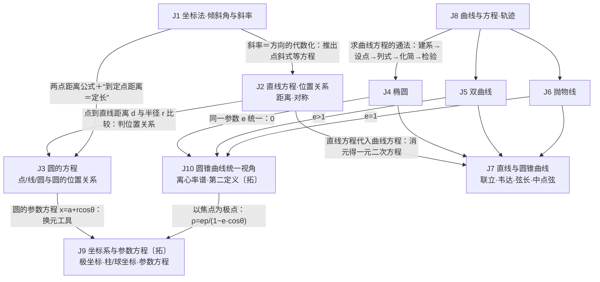

# 模块 J · 解析几何：怎样用方程研究曲线？

> 所属主线：几何与代数主线（见 `00-总图与导航.md`）。
> 依据：人教B版选择性必修一 Ch2「平面解析几何」＋速查 10、11、12、15。
> 约定：标签与编号见总图第五节。【易错】提示常见误解与正确结论；【旧教材·拓展】保留不删；【新教材补充】为现行教材的补充内容。

---

## 〇、本模块在大厦中的位置

- **下接（地基与工具）**
  - A 地基：实数与数轴（一维坐标）、集合（曲线＝点集）、逻辑（“曲线的方程”是双向的充要关系）。
  - B 关系层：一元二次方程的判别式 Δ、韦达定理（根与系数关系）、不等式求范围与最值。
  - F 函数：一次函数图像是直线、二次函数图像是抛物线（桥12）；函数求最值。
  - T 三角：倾斜角与斜率 k＝tanα、参数方程中的 cosθ、sinθ（桥13）。
  - V 向量：点的坐标＝位置向量；方向向量、法向量、数量积判垂直（桥10）。
- **上接（应用）**
  - G 立体几何：空间直角坐标系与空间向量坐标法（G7、G8）。
  - D 导数：曲线切线（与圆锥曲线切线互证）。
  - M 建模：行星椭圆轨道、抛物面天线、双曲线定位等。
- **核心问题**：几何图形（点、直线、曲线）的位置与形状，能否用**数和方程**精确表示，从而把“看图推理”变成“列式计算”？
- **中心模型：坐标法的双向翻译**
  - 几何条件 —(建系、设点、列式)→ 方程 f(x,y)=0 —(代数运算：联立、消元、韦达、判别式)→ 代数结论 —(翻译回去)→ 几何结论。
  - 曲线 C 与方程 f(x,y)=0 的对应必须是**双向**的：曲线上的点都满足方程（不漏），满足方程的点都在曲线上（不杂）。

---

## 一、L1 骨架

> 读法：J1→J2→J3 是“直线与圆”（课本选必一前半）；J8 是求一切曲线方程的通法，产出 J4–J6 三种圆锥曲线；J10 用离心率把三者统一；J7 是直线与圆锥曲线的综合运算；J9 是换一种坐标、换一种参数去描述同一曲线（旧教材选修4-4）。

---

## 二、L2/L3 展开

### J1 坐标法与直线的倾斜角、斜率　〔B版·选必一·Ch2 §2.1–2.2〕〔速查10〕

- **J1.1 坐标法思想**【新教材补充】
  - 数轴上：A(x₁)、B(x₂) 的距离 |AB|=|x₂−x₁|，中点坐标 (x₁+x₂)/2。
  - 平面上：两点距离 |P₁P₂|=√((x₁−x₂)²+(y₁−y₂)²)（由勾股定理推出）；中点 M((x₁+x₂)/2, (y₁+y₂)/2)。
  - 坐标法三步：建系把几何元素坐标化 → 代数运算 → 把结果翻译成几何结论（与 V2 向量坐标法同源）。
- **J1.2 直线方程的含义**
  - 方程的解为坐标的点都在直线上，且直线上点的坐标都是方程的解 ⇒ 方程叫直线的方程，直线叫方程的直线（是 J8“曲线与方程”的特例）。
- **J1.3 倾斜角**
  - 定义：直线与 x 轴相交时，x 轴绕交点**逆时针**旋转到与直线重合所转的**最小正角**；直线与 x 轴平行或重合时规定倾斜角为 0。
  - 范围：α∈[0, π)。每条直线都有倾斜角。
- **J1.4 斜率**
  - 定义：α≠π/2 时，k=tanα；α=π/2（竖直线）时斜率**不存在**。
  - 两点式斜率：k=(y₂−y₁)/(x₂−x₁)，条件 x₁≠x₂（两点不在同一竖直线上）。
  - 倾斜角与斜率的关系（k=tanα 在 [0,π) 上的图像是断开的两段）：
    - α∈[0, π/2)：k≥0，k 随 α 增大而增大。【易错】α=0 时 k=0，所以这一段是 k≥0，不是 k>0。
    - α=π/2：k 不存在。
    - α∈(π/2, π)：k<0，k 随 α 增大而增大。
  - 区别：倾斜角从几何角度、斜率从代数角度刻画直线方向；有倾斜角不一定有斜率。
  - 方向向量：斜率为 k 的直线的一个方向向量是 (1, k)；一般地方向向量 (u₁,u₂)（u₁≠0）对应 k=u₂/u₁。【新教材补充】
- **方法**
  - 斜率公式的应用：① 证三点共线；② 构造斜率：(y−b)/(x−a) 看成点 (x,y) 与定点 (a,b) 连线的斜率，求其范围或最值（与 J3 最值问题同源）。
  - 判断三点 A、B、C 共线的四种办法：
    - 写出直线 AC 的方程，检验 B 是否满足；
    - k_AB=k_BC（两斜率都存在时）；
    - |AB|+|BC|=|AC|（这一条只适用于 B 位于 A、C 之间；一般应为三段中最长的一段等于另两段之和）；
    - 向量 AB 与 BC 共线（旧说法“B 是有向线段 AC 的定比分点”【旧教材·拓展】）。
  - 数形结合：理解斜率的几何意义后借助图形判断范围，可加快解题。
- **易错**
  - 斜率不存在的竖直线容易漏掉，设直线方程时要讨论斜率是否存在。
  - 坐标中含字母时容易漏掉分类讨论。

### J2 直线的方程、位置关系、距离与对称　〔B版·选必一·Ch2 §2.2〕〔速查10〕

- **J2.1 直线方程的五种（＋两种）形式**
    | 名称 | 方程 | 确定条件 | 不能表示的直线 |
    |---|---|---|---|
    | 点斜式 | y−y₀=k(x−x₀) | 过 (x₀,y₀)，斜率 k | 竖直线（垂直于 x 轴） |
    | 斜截式 | y=kx+b | 斜率 k，纵截距 b | 竖直线 |
    | 两点式 | (y−y₁)/(y₂−y₁)=(x−x₁)/(x₂−x₁) | 过两点，x₁≠x₂ 且 y₁≠y₂ | 垂直于坐标轴的直线 |
    | 截距式 | x/a+y/b=1 | 横截距 a、纵截距 b，**ab≠0** | 垂直于坐标轴的直线、过原点的直线 |
    | 一般式 | Ax+By+C=0（A、B 不全为 0） | — | 无（能表示所有直线） |
  - 【易错】截距式要求 ab≠0（a≠0 且 b≠0），不是 a≠b；它既表示不了过原点的直线，也表示不了垂直于 x 轴或 y 轴的直线。
  - 两点式的整式形式 (y−y₁)(x₂−x₁)=(x−x₁)(y₂−y₁) 对任意两个不同点都适用。
  - 参数式【旧教材·拓展】：x=x₀+t·cosα，y=y₀+t·sinα（α 为倾斜角，|t| 为点到 P₀ 的距离）→ 详见 J9.4。
  - 一般式的向量含义：Ax+By+C=0 的一个方向向量为 (B, −A)，一个法向量为 (A, B)。
  - 求直线方程的流程：选适当的形式设方程 → 由条件列方程组求待定系数 → 写结论，一般化为一般式。
- **J2.2 两条直线的位置关系**
  - 斜截式判断（l₁: y=k₁x+b₁，l₂: y=k₂x+b₂）：
    - 平行 ⇔ k₁=k₂ 且 b₁≠b₂；重合 ⇔ k₁=k₂ 且 b₁=b₂；相交 ⇔ k₁≠k₂；垂直 ⇔ k₁k₂=−1。
    - 两条都是竖直线时斜率都不存在：互相平行（或重合）；一条斜率为 0、另一条斜率不存在时互相垂直。
  - 一般式判断（l₁: A₁x+B₁y+C₁=0，l₂: A₂x+B₂y+C₂=0）：
    - 相交 ⇔ A₁B₂−A₂B₁≠0（方程组有唯一解）。
    - 垂直 ⇔ A₁A₂+B₁B₂=0（两法向量垂直）。
    - 平行 ⇔ A₁B₂−A₂B₁=0，且 A₁C₂−A₂C₁、B₁C₂−B₂C₁ 不全为 0（方程组无解）。
    - 重合 ⇔ A₁B₂−A₂B₁=0，且 A₁C₂−A₂C₁=0，且 B₁C₂−B₂C₁=0（系数对应成比例：A₁=λA₂，B₁=λB₂，C₁=λC₂，λ≠0）（方程组有无数解）。
    - 比值写法：A₂B₂C₂≠0 时，平行 ⇔ A₁/A₂=B₁/B₂≠C₁/C₂；重合 ⇔ A₁/A₂=B₁/B₂=C₁/C₂；相交 ⇔ A₁/A₂≠B₁/B₂（A₂B₂≠0）。
    - 【易错】只用“A₁B₂=A₂B₁ 且 A₁C₂=A₂C₁”判重合不够：y=1 与 y=2（A₁=A₂=0）满足这两式却是平行，必须再加 B₁C₂=B₂C₁。同理判平行若只写“A₁C₂≠A₂C₁”会漏掉两条水平平行线，应为“A₁C₂≠A₂C₁ 或 B₁C₂≠B₂C₁”。
  - 交点：两直线方程组成的方程组的唯一实数解就是交点坐标。
- **J2.3 夹角与到角**
  - 夹角（两直线所成的较小的角）范围 [0, π/2]；垂直时为 π/2。
    - 向量形式【新教材补充】：方向向量 u₁、u₂，cosθ=|u₁·u₂|/(|u₁||u₂|)。
    - 斜率形式【旧教材·拓展】：k₁k₂≠−1 时，tanθ=|(k₂−k₁)/(1+k₁k₂)|。
  - 到角【旧教材·拓展】：l₁ 绕交点**逆时针**旋转到与 l₂ 重合的最小正角，范围 (0, π)；tanθ=(k₂−k₁)/(1+k₁k₂)（k₁k₂≠−1）；l₁到l₂的角 θ₁ 与 l₂到l₁的角 θ₂ 满足 θ₁+θ₂=π。
    - 区别：到角有方向（逆时针），夹角无方向。【易错】不要说“l₁ 到 l₂ 的夹角”，那是把到角与夹角两个概念混用。
- **J2.4 距离公式**
  - 两点距离：见 J1.1。
  - 点到直线距离：d=|Ax₀+By₀+C|/√(A²+B²)。
  - 两平行线距离：l₁: Ax+By+C₁=0，l₂: Ax+By+C₂=0（C₁≠C₂，两式 x、y 系数须化成相同）：d=|C₁−C₂|/√(A²+B²)；斜截式 y=kx+b₁、y=kx+b₂：d=|b₁−b₂|/√(1+k²)。
  - 特殊情形：P(x₀,y₀) 到 x 轴距离 |y₀|，到 y 轴距离 |x₀|，到直线 y=b 距离 |y₀−b|，到直线 x=a 距离 |x₀−a|。
  - 定比分点公式【旧教材·拓展】：P 分有向线段 P₁P₂ 所成的比为 λ（λ≠−1）时，x=(x₁+λx₂)/(1+λ)，y=(y₁+λy₂)/(1+λ)；λ=1 即中点公式。
- **J2.5 直线系**
  - 定义：具有某一共同性质的直线的集合。
  - 过定点 (x₀,y₀)：y−y₀=k(x−x₀) 再加上 x=x₀；或 A(x−x₀)+B(y−y₀)=0（A²+B²≠0）一次包含全部。
  - 平行于 Ax+By+C=0：Ax+By+C₁=0（C₁≠C）；过点 (x₀,y₀) 时直接写 A(x−x₀)+B(y−y₀)=0。
  - 垂直于 Ax+By+C=0：Bx−Ay+C₁=0；过点 (x₀,y₀) 时写 B(x−x₀)−A(y−y₀)=0。
  - 过两直线 l₁、l₂ 交点：(A₁x+B₁y+C₁)+λ(A₂x+B₂y+C₂)=0（λ∈R），这一族**不含 l₂**；写成 (A₂x+B₂y+C₂)+λ(A₁x+B₁y+C₁)=0 时则不含 l₁。
  - 证明直线过定点：把参数分离出来，化成“过两直线交点的直线系”或“过定点的直线系”形式，令参数的系数和其余部分分别为 0。
- **J2.6 对称问题**
  - 点关于点：P(x₁,y₁) 关于 M(x₀,y₀) 的对称点 (2x₀−x₁, 2y₀−y₁)。
  - 直线关于点：转化为点关于点。Ax+By+C=0 关于 P(x₀,y₀) 对称的直线为 A(2x₀−x)+B(2y₀−y)+C=0，即 Ax+By−(2Ax₀+2By₀+C)=0。
  - 点关于直线：设对称点 Q(x,y)，列两个条件：① PQ⊥l（斜率之积为 −1，或 PQ 与法向量平行）；② PQ 中点在 l 上。联立求解。
  - 常用对称表（点 (a,b)、曲线 f(x,y)=0）：
      | 对称轴（中心） | 点 (a,b) 的对称点 | 曲线 f(x,y)=0 的对称曲线 |
      |---|---|---|
      | x 轴 | (a, −b) | f(x, −y)=0 |
      | y 轴 | (−a, b) | f(−x, y)=0 |
      | 原点 | (−a, −b) | f(−x, −y)=0 |
      | y=x | (b, a) | f(y, x)=0 |
      | y=−x | (−b, −a) | f(−y, −x)=0 |
      | x+y+c=0 | (−b−c, −a−c) | f(−y−c, −x−c)=0 |
      | x=m | (2m−a, b) | f(2m−x, y)=0 |
      | y=n | (a, 2n−b) | f(x, 2n−y)=0 |
  - 直线 a 关于直线 l 的对称直线 b：
    - 方法一：在 a 上取一点求其关于 l 的对称点，再与 a、l 的交点用两点式写出 b；
    - 方法二：a 到 l 的角等于 l 到 b 的角（到角公式【旧教材·拓展】）；
    - 方法三：l 上的点到 a、b 的距离相等（l 是 a、b 夹角的平分线），用点到直线距离公式。
  - 对称的实质：中心对称——对称中心是两对称点的中点；轴对称——对称轴垂直平分两对称点的连线。
- **方法**
  - 根据条件恰当选方程形式，并补上该形式表示不了的直线。
  - 位置关系应用：垂直分“一条斜率为 0、另一条不存在”与“斜率都存在且乘积为 −1”两种；平行分“斜率都存在且相等（且不重合）”与“斜率都不存在（且不重合）”两种。
- **易错**
  - 选用某种方程形式后忘记它表示不了的直线（截距式漏过原点的直线最常见）。
  - 两截距相等或成倍数关系时漏掉过原点的直线（此时两截距都为 0）。
  - 忽视斜率不存在或两直线重合的情形。
  - 用平行线距离公式前没有把两式的 x、y 系数化成相同。
  - 点到直线距离公式涉及绝对值、垂直、最小值，容易漏解或算错；求出的答案要检验是否符合实际。

### J3 圆的方程与位置关系　〔B版·选必一·Ch2 §2.3〕〔速查10〕

- **J3.1 圆的定义与标准方程**
  - 定义：平面内到定点（圆心）距离等于定长（半径）的点的集合（轨迹）。
  - 标准方程：圆心 (a,b)、半径 r（r>0）：(x−a)²+(y−b)²=r²；圆心在原点：x²+y²=r²。
  - 求法：直接代入法、待定系数法、几何性质法。
- **J3.2 一般方程**
  - x²+y²+Dx+Ey+F=0，配方得 (x+D/2)²+(y+E/2)²=(D²+E²−4F)/4：
    - D²+E²−4F>0：表示圆，圆心 (−D/2, −E/2)，半径 r=½√(D²+E²−4F)。
    - D²+E²−4F=0：表示一个点 (−D/2, −E/2)。
    - D²+E²−4F<0：不表示任何图形。
  - 【易错】半径是 ½√(D²+E²−4F)，不要漏掉 ½。
  - 形式特点：x²、y² 系数相等且不为 0，没有 xy 项的二元二次方程；适合代数运算。
  - 标准方程与一般方程都含 3 个参数（a,b,r 或 D,E,F），需要 3 个独立条件才能确定。
- **J3.3 圆的参数方程**【旧教材·拓展】
  - 圆心 (a,b)、半径 r：x=a+r·cosθ，y=b+r·sinθ（θ 为参数）；圆心在原点时 x=r·cosθ，y=r·sinθ。
  - 消参：用 sin²θ+cos²θ=1；消参前后 x、y 的取值范围不能扩大也不能缩小。
  - 作用：把圆上动点用一个角表示，减少变量，借正弦函数的有界性求最值（桥13）。
- **J3.4 点与圆**
  - 点 M(m,n) 与圆 (x−a)²+(y−b)²=r²：(m−a)²+(n−b)²=r² ⇔ 在圆上；<r² ⇔ 在圆内；>r² ⇔ 在圆外。
- **J3.5 直线与圆**
  - 几何法（d 为圆心到直线距离）：d<r ⇔ 相交；d=r ⇔ 相切；d>r ⇔ 相离。（首选，计算量小）
  - 代数法：联立消元得一元二次方程，Δ>0 ⇔ 相交；Δ=0 ⇔ 相切；Δ<0 ⇔ 相离。
  - 弦长：几何法 |AB|=2√(r²−d²)；代数法 |AB|=√(1+k²)·|x₁−x₂|（斜率存在时）。
  - 切线方程
    - 过圆上一点 (x₁,y₁)：
      - x²+y²=r²：x₁x+y₁y=r²；
      - (x−a)²+(y−b)²=r²：(x₁−a)(x−a)+(y₁−b)(y−b)=r²；
      - x²+y²+Dx+Ey+F=0：x₁x+y₁y+D·(x₁+x)/2+E·(y₁+y)/2+F=0。
    - 过圆外一点 P₀(x₀,y₀)（必有两条）：
      - 代数法：设切点 (x₁,y₁)，联立“切点在圆上”与“切线过 P₀”：(x₁−a)²+(y₁−b)²=r²，(x₁−a)(x₀−a)+(y₁−b)(y₀−b)=r²。
      - 几何法：设 y−y₀=k(x−x₀)，令圆心到直线距离等于半径：|k(a−x₀)−b+y₀|/√(k²+1)=r，解出 k。【易错】若只解出一个 k，说明另一条切线是竖直线 x=x₀，必须单独检验斜率不存在的情形。
    - 求切线也可用代数法：联立后令 Δ=0。
  - 切线长：从圆 x²+y²+Dx+Ey+F=0 外一点 P(x₁,y₁) 引切线，切线长 =√(x₁²+y₁²+Dx₁+Ey₁+F)（由勾股定理：切线长²＝|P圆心|²−r²）。
- **J3.6 圆与圆**
  - 设两圆半径 R、r，圆心距 d：
      | 位置关系 | 条件 | 公切线条数 |
      |---|---|---|
      | 外离 | d>R+r | 4 |
      | 外切 | d=R+r | 3 |
      | 相交 | \|R−r\|<d<R+r | 2 |
      | 内切 | d=\|R−r\|（R≠r） | 1 |
      | 内含 | 0≤d<\|R−r\| | 0 |
  - 【说明】两圆半径大小不定时，内切、内含的条件一律用 |R−r|；同心圆是内含的特例（d=0）。
  - 几何法直观但不能求出交点坐标；代数法（联立）只能判断交点个数，不能区分外离与内含、外切与内切。
  - 公共弦：两圆相交时，两方程相减得公共弦所在直线 (D₁−D₂)x+(E₁−E₂)y+F₁−F₂=0；公共弦长用几何法（半径、半弦长、弦心距构成直角三角形）更简便，也可联立求交点再用距离公式。
  - 两圆相切时，切点与两圆心三点共线。
- **J3.7 圆系方程**
  - 定义：具有某一共同性质的圆的集合。
  - 过两圆 C₁、C₂ 交点：x²+y²+D₁x+E₁y+F₁+λ(x²+y²+D₂x+E₂y+F₂)=0（λ≠−1），这一族不含 C₂；λ=−1 时得到公共弦所在直线。
  - 过圆 C 与直线 l 交点：x²+y²+Dx+Ey+F+λ(Ax+By+C)=0（λ∈R）。
  - 好处：避免先求交点坐标；易错点是求 λ 时漏条件或忘了它不含 C₂。
- **J3.8 直径式**
  - 以 A(x₁,y₁)、B(x₂,y₂) 为直径端点的圆：(x−x₁)(x−x₂)+(y−y₁)(y−y₂)=0（由 PA⊥PB 即向量数量积为 0 推出）。
  - 【易错】直径式右边是 0，不是 r²。
- **J3.9 圆的几何性质（减少计算）**
  - 圆心在过切点且垂直于切线的直线上；圆心在任一条弦的垂直平分线上；切线垂直于过切点的半径。
- **J3.10 与圆有关的最值**
  - u=(y−b)/(x−a)：转化为动点与定点连线斜率的最值（相切时取到）。
  - t=ax+by：转化为直线 ax+by=t 的截距的最值（相切时取到）。
  - (x−a)²+(y−b)²：转化为动点到定点距离平方的最值（过圆心的直线上取到，等于 (|定点到圆心|±r)²）。
  - 参数法：设动点 (a+r·cosθ, b+r·sinθ)，化为三角函数用有界性求最值（J3.3）。
- **J3.11 与圆有关的轨迹**：直接法、定义法、几何法、代入法（相关点法），此外有交轨法、参数法（详见 J8）。
- **J3.12 空间直角坐标系（接口）**：空间两点距离 d=√((x₁−x₂)²+(y₁−y₂)²+(z₁−z₂)²)。旧教材放在本章末，新教材移入空间向量 → 同见 G7。
- **方法**
  - 求圆的方程的基本思路：能找到圆心和半径就直接写标准方程；否则用待定系数法，按条件选标准方程（与圆心、半径有关）或一般方程（已知三点）。
  - 定义法：结合两点距离公式列方程组；几何法：用圆的性质先求圆心、半径；圆系法：过交点的圆。
  - 判断直线与圆、圆与圆的位置关系，优先用几何法（距离比较）。
- **易错**
  - 用一般方程时忽视 D²+E²−4F>0 的条件。
  - 求过定点的切线前不先判断点在圆上还是圆外。
  - 过圆外一点的切线漏掉斜率不存在的那一条。
  - 忽视圆的几何性质，用“繁”方法而放弃“简”方法。

### J4 椭圆　〔B版·选必一·Ch2 §2.5〕〔速查11〕

- **J4.1 定义**
  - 第一定义：平面内到两定点 F₁、F₂ 距离之和为常数 2a 的点的轨迹，且 **2a>|F₁F₂|**。
    - 2a=|F₁F₂| 时轨迹是线段 F₁F₂；2a<|F₁F₂| 时轨迹不存在。
    - 应用：求标准方程；焦点三角形中用 |PF₁|+|PF₂|=2a。
  - 第二定义【旧教材·拓展】：到定点 F 的距离与到定直线 l（F∉l）的距离之比为常数 e（0<e<1）的点的轨迹。
    - 定点（焦点）必须不在定直线（准线）上，比值必须小于 1；满足条件的轨迹一定是椭圆，但方程不一定是标准形式。
    - 离心率两种表示：e=c/a=|PF|/d（d 为 P 到与 F 相应准线的距离）。
- **J4.2 标准方程**（“标准”指中心在原点、对称轴为坐标轴）
  - 焦点在 x 轴：x²/a²+y²/b²=1（**a>b>0**）；焦点在 y 轴：y²/a²+x²/b²=1（a>b>0）。
  - 【易错】条件必须写 a>b>0：只写 a>0、b>0 不能保证焦点在 x 轴上，c²=a²−b²>0 也不一定成立。
  - 焦点位置不确定：设 Ax²+By²=1（A>0，B>0，A≠B），可同时包含两种情况。
  - 求标准方程三步：**定位**（焦点在哪条轴：x² 的分母大则焦点在 x 轴，y² 的分母大则在 y 轴）→ **定型**（选方程形式）→ **定量**（求 a、b；a、b 决定形状大小，a 最大，a²=b²+c²）。
- **J4.3 几何性质**（以 x²/a²+y²/b²=1，a>b>0 为例；焦点在 y 轴时 x、y 互换）
  - 范围：|x|≤a，|y|≤b。
  - 对称性：关于 x 轴、y 轴、原点对称。
  - 顶点：(±a,0)、(0,±b)；长轴长 2a，短轴长 2b。
  - 焦点：(±c,0)，焦距 2c，c²=a²−b²。
  - 离心率：e=c/a=√(1−b²/a²)，0<e<1；e 越接近 0 越圆，越接近 1 越扁。
  - 准线【旧教材·拓展】：x=±a²/c；焦准距 a²/c−c=b²/c。
  - 通径（过焦点垂直于长轴的弦）：2b²/a（也等于 2ep，p 为焦准距 b²/c）。
  - 焦半径【旧教材·拓展】：P(x₀,y₀) 在椭圆上，|PF₁|=a+ex₀，|PF₂|=a−ex₀（F₁ 为左焦点）；焦点在 y 轴时 |PF₁|=a+ey₀，|PF₂|=a−ey₀（F₁ 为下焦点）。焦半径范围 [a−c, a+c]。
  - 参数方程【旧教材·拓展】：x²/a²+y²/b²=1 ⇒ x=a·cosθ，y=b·sinθ；y²/a²+x²/b²=1 ⇒ x=b·cosθ，y=a·sinθ（θ 为参数）。椭圆参数方程是三角换元的基础。
  - 辅助圆【旧教材·拓展】：x²+y²=a²（大圆）、x²+y²=b²（小圆）。
- **J4.4 常用结论**
  - 椭圆上到中心最近的点是短轴端点（距离 b），最远的是长轴端点（距离 a）。
  - 到焦点最近、最远的点都是长轴端点（距离 a−c、a+c）。
  - 中心 O、焦点 F、短轴端点 D 构成直角三角形：|OD|=b，|OF|=c，|DF|=a，e=cos∠OFD。
  - 焦点三角形（P 在椭圆上，r₁=|PF₁|，r₂=|PF₂|，∠F₁PF₂=θ）：
    - cosθ=(r₁²+r₂²−4c²)/(2r₁r₂)=2b²/(r₁r₂)−1；
    - 面积 S=½r₁r₂sinθ=b²·tan(θ/2)=c·|y_P|。
  - 弦长：|P₁P₂|=√(1+k²)·|x₁−x₂|=√(1+1/k²)·|y₁−y₂|（前式要求斜率存在，后式还要求 k≠0）。
  - 切线【拓展·常用结论】：过椭圆上点 (x₀,y₀) 的切线 x₀x/a²+y₀y/b²=1。
  - 光学性质【新教材补充·阅读】：从一个焦点发出的光线经椭圆反射后经过另一个焦点。
- **方法**
  - 求离心率：找 a、b、c 之间的另一个等量关系，消去 b，得到关于 e 的方程。
  - 求离心率范围：找 a、b、c 之间的不等关系（常借助焦半径范围、点在椭圆内外、Δ 等）。
  - 焦半径问题：涉及椭圆上点到焦点的距离时，可用定义（|PF₁|+|PF₂|=2a）或焦半径公式。
- **易错**
  - 求标准方程时漏掉“定位”一步，焦点位置不确定却只设一种方程。
  - 忽视 2a>|F₁F₂| 的条件。

### J5 双曲线　〔B版·选必一·Ch2 §2.6〕〔速查11〕

- **J5.1 定义**
  - 第一定义：平面内到两定点 F₁、F₂ 距离之差的**绝对值**为常数 2a 的点的轨迹，且 **0<2a<|F₁F₂|**。
    - 常数等于 |F₁F₂|：轨迹是以 F₁、F₂ 为端点、方向背离的两条射线；
    - 常数为 0：轨迹是线段 F₁F₂ 的垂直平分线；
    - 常数大于 |F₁F₂|：轨迹不存在；
    - 去掉绝对值：轨迹只是双曲线的一支。
    - P 在右支（靠近 F₂）：|PF₁|−|PF₂|=2a；P 在左支：|PF₁|−|PF₂|=−2a（**a>0**）。a 恒为正，左支时是差等于 −2a，不是 a 变成负数。
    - 【易错】双曲线是距离之**差的绝对值** ||MF₁|−|MF₂||=2a（0<2a<|F₁F₂|）；写成距离之和就成了椭圆。
  - 第二定义【旧教材·拓展】：到定点 F 与到定直线 l（F∉l）距离之比为常数 e（e>1）的点的轨迹。
    - 若 P 到 F₁、F₂ 相应准线的距离为 d₁、d₂，则 |PF₁|/d₁=|PF₂|/d₂=e；焦点与准线必须对应。
    - 满足条件的轨迹是双曲线，方程不一定是标准形式。
- **J5.2 标准方程**
  - 焦点在 x 轴：x²/a²−y²/b²=1（a>0，b>0）；焦点在 y 轴：y²/a²−x²/b²=1（a>0，b>0）。（a、b 大小不限）
  - 待定系数的设法：
    - 已知渐近线 x/a±y/b=0（即 y=±(b/a)x）：设 x²/a²−y²/b²=λ（λ≠0），λ>0 时焦点在 x 轴，λ<0 时在 y 轴。
    - 已知过两点：设 Ax²+By²=1（AB<0）。
    - 与 x²/a²−y²/b²=1 共焦点：设 x²/(a²−λ)−y²/(b²+λ)=1，**−b²<λ<a²**。【易错】只写 λ<a²、λ≠−b² 不够：λ<−b² 时方程化为 x²/(a²−λ)+y²/(−b²−λ)=1，表示与之共焦点的椭圆。
  - 直接由定义确定 a、b、c 求方程。
- **J5.3 几何性质**（以 x²/a²−y²/b²=1 为例）
  - 范围：|x|≥a，y∈R。
  - 对称性：关于 x 轴、y 轴、原点对称。
  - 顶点：(±a,0)；实轴长 2a，虚轴长 2b（虚轴端点 (0,±b) 不在曲线上）。
  - 焦点：(±c,0)，焦距 2c，c²=a²+b²。
  - 离心率：e=c/a=√(1+b²/a²)，e>1；e 越大，开口越大。
  - 渐近线：焦点在 x 轴 y=±(b/a)x；焦点在 y 轴 y=±(a/b)x。渐近线斜率的绝对值 b/a=√(e²−1)。
  - 准线【旧教材·拓展】：x=±a²/c（焦点在 y 轴时 y=±a²/c）。
  - 通径：2b²/a。
  - 焦半径【旧教材·拓展】：P(x₀,y₀) 在 x²/a²−y²/b²=1 上，F₁、F₂ 为左、右焦点：右支 |PF₁|=ex₀+a，|PF₂|=ex₀−a；左支 |PF₁|=−(ex₀+a)，|PF₂|=−(ex₀−a)。推导依据是第二定义，不必死记。
  - 参数方程【旧教材·拓展】：x=a·secθ，y=b·tanθ（θ 为参数）；注意 y 的系数是 b，不是 a。
  - 辅助圆【旧教材·拓展】：x²+y²=a²、x²+y²=b²。
  - 结构记忆：
    - 六点：两焦点、两顶点、两虚轴端点。
    - 六线：两条对称轴、两条渐近线、两条准线。
    - 两形：① 中心 O、顶点 A(a,0)、虚轴端点 B(0,b) 构成的直角三角形，三边恰为 a、b、c（|AB|=√(a²+b²)=c）；② 焦点三角形。【易错】双曲线没有“短轴”；照搬椭圆的“短轴端点＋中心＋焦点”在双曲线中得不到 a、b、c 的简洁关系，应取中心、顶点、虚轴端点。
- **J5.4 特殊双曲线**
  - 等轴双曲线：实轴与虚轴等长（a=b）；方程 x²−y²=a² 或 y²−x²=a²；两条渐近线 y=±x 互相垂直；离心率 √2。
  - 共轭双曲线【旧教材·拓展】：以原双曲线的实轴为虚轴、虚轴为实轴；x²/a²−y²/b²=1 与 x²/a²−y²/b²=−1 互为共轭。
    - 有相同的渐近线；四个焦点共圆（焦距相同，都是 2√(a²+b²)），有相同的“基本矩形”；
    - 离心率满足 1/e₁²+1/e₂²=1（e₁=c/a，e₂=c/b，(a²+b²)/c²=1）。
- **J5.5 常用结论**
  - 分别在两支上的两点间最小距离为 2a（两顶点之间）。
  - 焦点三角形面积【新教材补充·常用结论】：S=b²/tan(θ/2)（θ=∠F₁PF₂）。
  - 切线【拓展·常用结论】：过双曲线上点 (x₀,y₀) 的切线 x₀x/a²−y₀y/b²=1。
  - 光学性质【新教材补充·阅读】：从一个焦点发出的光线经双曲线反射后，反射光线的反向延长线经过另一个焦点。
- **方法（常见问题）**
  - 离心率：求值找 a、b、c 的等量关系；求范围找不等关系，有时要用放缩。
  - 直线与双曲线只有一个交点：直线与双曲线相切，或直线平行于渐近线（详见 J7.2）。
  - 交点弦、中点弦：点差法（设而不求）；判别式与根与系数关系。
- **易错**
  - 忽视定义中的“绝对值”与“0<2a<|F₁F₂|”的范围。
  - 忘记讨论焦点位置（两种标准方程）。
  - 把椭圆的 c²=a²−b² 套到双曲线上（双曲线 c²=a²+b²）。

### J6 抛物线　〔B版·选必一·Ch2 §2.7〕〔速查11〕

- **J6.1 定义**
  - 平面内到定点 F 与到定直线 l 距离相等的点的轨迹，**F∉l**；F 叫焦点，l 叫准线。
  - F∈l 时，轨迹是过 F 且垂直于 l 的一条直线。
  - “一动三定”：动点 P，定点 F（焦点），定直线 l（准线），定值 e=1。
  - 定义本身就是性质：抛物线上任一点到焦点的距离（焦半径）等于它到准线的距离，可把焦半径转化为与对称轴平行的线段长。
- **J6.2 四种标准方程与性质**（p>0，p 为焦点到准线的距离）
    | 标准方程 | 开口 | 焦点 | 准线 | 范围 | 对称轴 | 焦半径 |P F| |
    |---|---|---|---|---|---|---|
    | y²=2px | 向右 | (p/2, 0) | x=−p/2 | x≥0 | x 轴 | x₀+p/2 |
    | y²=−2px | 向左 | (−p/2, 0) | x=p/2 | x≤0 | x 轴 | −x₀+p/2 |
    | x²=2py | 向上 | (0, p/2) | y=−p/2 | y≥0 | y 轴 | y₀+p/2 |
    | x²=−2py | 向下 | (0, −p/2) | y=p/2 | y≤0 | y 轴 | −y₀+p/2 |
  - 共同性质：顶点 (0,0)；离心率 e=1；通径（过焦点垂直于对称轴的弦）长 2p。
  - p 的几何意义：焦点到准线的距离；p 越大开口越大。
  - 与椭圆、双曲线比较：只有一个焦点、一个顶点、一条对称轴、一条准线，没有对称中心（称“无心圆锥曲线”，椭圆和双曲线称“有心圆锥曲线”，此为课外提法）。
  - 参数方程【旧教材·拓展】：y²=2px ⇒ x=2pt²，y=2pt（t 为参数）。
- **J6.3 与二次函数的桥**（桥12，同见 F 模块二次函数）
  - y=ax²+bx+c（a≠0）由 y=ax² 平移得到；对称轴 x=−b/(2a)，顶点 (−b/(2a), (4ac−b²)/(4a))。
  - y=ax² 化为标准方程 x²=(1/a)y：
    - a>0 时开口向上，a<0 时开口向下；
    - **焦点恒为 (0, 1/(4a))**，准线 y=−1/(4a)。
    - 【易错】a<0 时不要把焦点写成 (0, −1/(4a))：1/(4a) 本身已为负，焦点自然在下方；那样写焦点会跑到开口的反方向。
- **J6.4 焦点弦常用结论**【拓展·常用结论】（y²=2px，过焦点的弦 AB，A(x₁,y₁)、B(x₂,y₂)，倾斜角 α）
  - |AB|=x₁+x₂+p=2p/sin²α；x₁x₂=p²/4，y₁y₂=−p²；1/|AF|+1/|BF|=2/p；通径是最短的焦点弦。
  - 切线：过抛物线 y²=2px 上点 (x₀,y₀) 的切线 y₀y=p(x+x₀)。
  - 光学性质【新教材补充·阅读】：从焦点发出的光线经抛物线反射后平行于对称轴（探照灯、卫星天线）。
- **方法**
  - 求标准方程用待定系数法：设出合适的标准方程 → 由条件列关于 p 的方程 → 求 p 写出方程。
  - 已知对称轴在某坐标轴的某半轴上：直接选对应的那一种标准方程。
  - 只知对称轴在坐标轴上、不知开口方向：可设 y²=mx 或 x²=ny（m、n≠0），避免分四类讨论。
  - 直线与抛物线的中点弦：点差法（设而不求）、判别式与根与系数关系；交点弦也可用点差法。
- **易错**
  - 对定义理解不正确（忽视 F∉l，或把焦半径与到准线距离的转化用错方向）。
  - 直线与抛物线只有一个公共点时，直线可能**平行于对称轴**（此时是相交，不是相切），也可能相切。

### J10 圆锥曲线统一视角（J4–J6 的汇合）　〔速查11〕

- **J10.1 三种曲线对比表**
    | 项目 | 椭圆 | 双曲线 | 抛物线 |
    |---|---|---|---|
    | 第一定义 | \|MF₁\|+\|MF₂\|=2a，2a>\|F₁F₂\| | \|\|MF₁\|−\|MF₂\|\|=2a，0<2a<\|F₁F₂\| | \|PF\|=d（P 到准线的距离），F∉l |
    | 第二定义〔拓〕 | \|MF\|/d=e，0<e<1 | \|MF\|/d=e，e>1 | \|PF\|/d=1 |
    | 标准方程 | x²/a²+y²/b²=1（a>b>0） | x²/a²−y²/b²=1（a>0，b>0） | y²=2px（p>0） |
    | a、b、c 关系 | c²=a²−b² | c²=a²+b² | — |
    | 范围 | \|x\|≤a，\|y\|≤b | \|x\|≥a | x≥0 |
    | 顶点 | (±a,0)、(0,±b) | (±a,0) | (0,0) |
    | 焦点 | (±c,0) | (±c,0) | (p/2,0) |
    | 轴 | 长轴 2a、短轴 2b | 实轴 2a、虚轴 2b | — |
    | 离心率 | e=c/a∈(0,1) | e=c/a∈(1,+∞) | e=1 |
    | 准线〔拓〕 | x=±a²/c | x=±a²/c | x=−p/2 |
    | 渐近线 | — | y=±(b/a)x | — |
    | 对称性 | 两轴＋中心 | 两轴＋中心 | 仅 x 轴 |
    | 焦半径〔拓〕 | a±ex₀ | 右支 ex₀±a，左支 −(ex₀±a) | x₀+p/2 |
    | 通径 | 2b²/a | 2b²/a | 2p |
    | 参数方程〔拓〕 | x=a·cosφ，y=b·sinφ | x=a·secθ，y=b·tanθ | x=2pt²，y=2pt |
    | 光学性质 | 焦点→另一焦点 | 焦点→反向延长过另一焦点 | 焦点→平行于轴 |
- **J10.2 离心率谱：一个参数统一三种曲线**
  - e=0：圆（看作椭圆的极限情形，c=0，两焦点重合）。
  - 0<e<1：椭圆，e 越大越扁。
  - e=1：抛物线。
  - e>1：双曲线，e 越大开口越大。
  - 统一定义【旧教材·拓展】：到定点 F 与到定直线 l（F∉l）距离之比为常数 e 的点的轨迹；以焦点为极点的统一极坐标方程 ρ=ep/(1−e·cosθ)（p 为焦点到相应准线的距离，此处极轴方向背离该准线）→ 见 J9.2。
- **J10.3 求方程的共同套路**：定位（焦点在哪条轴）→ 定型（选标准方程）→ 定量（待定系数）。
- **J10.4 自身最值**
  - 椭圆上两点的最大距离为 2a（长轴）。
  - 双曲线两支上各取一点，最小距离为 2a。
  - 椭圆焦半径范围 [a−c, a+c]。
  - 抛物线上离准线（也就是离焦点）最近的点是顶点。

### J7 直线与圆锥曲线的位置关系　〔B版·选必一·Ch2 §2.8〕〔速查12〕

- **J7.1 判定的通法：联立消元**
  - 联立直线 Ax+By+C=0 与曲线 f(x,y)=0，消去 y（或 x）得 mx²+nx+t=0（这里用 m、n、t 表示系数，避免与椭圆的 a、b 混淆）。
  - **先看二次项系数 m**：
    - m≠0：用 Δ=n²−4mt 判断——Δ>0 两个交点（相交）；Δ=0 一个交点（相切）；Δ<0 无交点（相离）。
    - m=0：方程是一次的，只有一个解，此时直线与曲线**相交**于一点，不是相切：双曲线时直线平行于渐近线；抛物线时直线平行于（或重合于）对称轴。
  - 曲线交点与方程组：两曲线有几个交点 ⇔ 方程组有几组实数解。
  - “相切”是“只有一个公共点”的充分不必要条件（对双曲线、抛物线而言；对椭圆二者等价）。
  - 也可借助几何法（如与渐近线斜率比较、与对称轴比较）；有时用点差法简化计算。
- **J7.2 三种曲线的情况**
  - 直线与椭圆：Δ>0 相交（两点），Δ=0 相切（一点），Δ<0 相离。
  - 直线与双曲线 x²/a²−y²/b²=1（设直线斜率 k）：
    - |k|=b/a（平行于渐近线）：m=0，只有一个交点（相交）；
    - |k|<b/a 且 Δ>0：与两支各交于一点；
    - |k|>b/a 且 Δ>0：与同一支交于两点；Δ=0 相切，Δ<0 相离。
    - 【易错】若用倾斜角比较（θ 为直线倾斜角，α 为渐近线倾斜角）：直线比渐近线平缓（θ<α）时才与两支各交一点，例如 x²−y²=1 的渐近线倾斜角 45°，x 轴（θ=0）与两支各交一点；这个方向容易记反，而且只对倾斜角为锐角的一侧成立，一般用 |k| 与 b/a 比较更稳妥。
  - 直线与抛物线：直线平行于（或重合于）对称轴时只有一个交点（相交）；否则 Δ>0 两个交点，Δ=0 相切，Δ<0 相离。
    - 【易错】只有一个交点的条件是直线平行于抛物线的**对称轴**；只有对称轴为 x 轴的 y²=±2px 才是“平行于 x 轴”。
- **J7.3 弦长**
  - 设交点 A(x₁,y₁)、B(x₂,y₂)，由韦达定理得 x₁+x₂、x₁x₂：
    - |AB|=√(1+k²)·|x₁−x₂|=√(1+k²)·√((x₁+x₂)²−4x₁x₂)=√(1+k²)·√Δ/|m|。
    - 消去 x 时：|AB|=√(1+1/k²)·|y₁−y₂|（k≠0）。
  - 【易错】分母要取二次项系数的绝对值，否则二次项系数为负时得到负的长度。
  - 过焦点的弦可用焦半径公式（J4.3、J6.4）。
- **J7.4 中点弦**
  - 点差法：把 A、B 坐标代入曲线方程，两式相减，得斜率 k_AB 与弦中点 (x₀,y₀) 的关系（要求 y₀≠0）：
    - 椭圆 x²/a²+y²/b²=1：k_AB=−b²x₀/(a²y₀)；
    - 双曲线 x²/a²−y²/b²=1：k_AB=b²x₀/(a²y₀)；
    - 抛物线 y²=2px：k_AB=p/y₀。
  - 根与系数关系法：代入 → 消元 → 求 x₁+x₂、x₁x₂ → 检验 Δ>0。
  - 典型问题：已知曲线内一点 P，求以 P 为中点的弦所在直线；求弦的中点（轨迹）；线段的垂直平分线；对称问题（曲线上两点关于某直线对称，求参数范围）。
- **J7.5 向量条件、面积**
  - 题中的向量关系（垂直、共线、数量积）先改写成坐标式，再用根与系数关系整体代入。
  - 面积：常用“½×弦长×点到直线距离”，或按坐标轴分割，表示成参数的函数再求最值。
- **J7.6 定点、定值**
  - 特殊到一般：先用特殊位置（如斜率不存在、斜率为 0）求出定点或定值，再证明它与参数无关。
  - 直接推理：设参数 → 计算 → 消去变量 → 得到定值或定点。
- **J7.7 最值与范围**
  - 代数法：化为二次函数、三角换元、判别式、基本不等式（含导数）求最值；求范围要把所有限制条件（Δ>0、点在曲线内等）列全。
  - 几何法：利用向量、对称、曲线的定义与几何性质。
  - 注意区分代数法与几何法各自适用的情形。
- **J7.8 开放性与存在性问题**
  - 探究条件：先假设条件成立，验证结论是否成立；成立则存在，否则不存在。
  - 探究结论：先求出结论的表达式，再对表达式讨论，常涉及参数讨论。
  - 存在性：用“假设—验证（反证）”法；步骤：假设存在 → 待定系数列式 → 求解 → 检验；对象常是点或弦。
- **方法**
  - 设而不求、整体代换：“解方程组”与“点差法”都体现这一思路。
  - 能用解方程组解决的问题，多数也可用点差法，计算量小；但点差法较粗糙，不能自动保证直线与曲线相交，轨迹问题中不能精确给出变量范围。
- **易错**
  - 点差法、弦长公式用错（如漏掉 √(1+k²)、分母不取绝对值）。
  - 只有一个公共点时，忘了分类讨论和数形结合（遗漏平行于渐近线或对称轴的直线）。
  - 点差法求出中点弦所在直线后不回代检验 Δ>0（双曲线中尤其容易出现不存在的弦）。
  - 联立后忘记讨论二次项系数是否为 0；设直线时忘了斜率不存在的情形。

### J8 曲线与方程·轨迹　〔B版·选必一·Ch2 §2.4〕

- **J8.1 曲线的方程与方程的曲线**
  - 两个条件同时成立：① 曲线上点的坐标都是方程的解；② 以方程的解为坐标的点都在曲线上。此时方程叫曲线的方程，曲线叫方程的曲线。
  - 检查两个条件：
    - **完备性**（不漏）：曲线上的点的坐标都是方程的解（即条件 ①）。
    - **纯粹性**（不杂）：以方程的解为坐标的点都在曲线上（即条件 ②）。
    - 【说明】人教B版选必一§2.4 只列出条件 (1)“曲线上点的坐标都是方程的解”与条件 (2)“以方程的解为坐标的点都在曲线上”，两者缺一不可，没有给它们命名。“纯粹性/完备性”是教辅用语，各家对应方式不统一（也有资料把 (1) 叫纯粹性、(2) 叫完备性）；本文按“不漏/不杂”的含义命名。记住两条条件的内容即可，不必纠结名称。
  - 曲线的交点与方程组：方程组有几组实数解，两曲线就有几个交点；无实数解则无交点。
- **J8.2 求曲线方程的基本步骤**
  - 建系设点：建立适当的直角坐标系，设 M(x,y) 为曲线上任意一点；
  - 列式：写出满足条件 P 的点 M 的集合 {M | P(M)}；
  - 代换：用坐标表示条件 P(M)，得方程 f(x,y)=0；
  - 化简：化为最简形式；
  - 查漏除杂（证明）：说明化简后方程的解与曲线上的点一一对应，删去多余点、补上遗漏点（一般可省略证明，但要检查）。
- **J8.3 如何建系**
  - 只有一个定点：以该定点为原点。
  - 两个定点：以两定点连线的中点为原点，两定点所在直线为坐标轴。
  - 两条互相垂直的直线：以它们为坐标轴。
  - 一个定点和一条定直线：以定点到定直线的垂线段的中点为原点，这条垂线为 x 轴。
  - 一个定角：以顶点为原点，角平分线为 x 轴。
- **J8.4 求轨迹方程的常用方法**
  - 直接法：直接把几何条件翻译成坐标等式。
  - 定义法：动点满足的几何条件恰好符合圆、椭圆、双曲线、抛物线的定义时，先定曲线类型，再用待定系数法求方程。
  - 待定系数法：已知曲线类型时设方程求系数（最基本的方法）。
  - 代入法（相关点法）：动点 P(x,y) 随曲线 f(x,y)=0 上的动点 Q(x₀,y₀) 而动，先用 x、y 表示 x₀、y₀，再代入 f(x₀,y₀)=0 化简。【易错】代入的是 Q 满足的 f(x₀,y₀)=0（把 x₀、y₀ 换成用 x、y 表示的式子），不是直接代入 f(x,y)=0。
  - 代换法（点差法、设而不求）：求弦中点轨迹时，用中点坐标和斜率的代换求方程（同 J7.4）。
  - 交轨法：动点是两条动曲线的交点时，联立两动曲线方程，消去参数；实际上属于参数法，但不必先求出动点坐标再消参。
  - 参数法：动点坐标间的关系不易直接找到时，选一个与动点密切相关的量（角、斜率、比值等）作参数，求出参数方程再消参；要先分析动点的形成过程；涉及直线与二次曲线的交点时重视设而不求；消参后要检验，确定变量范围。
- **方法（工具）**
  - 平面几何的作用：条件不明确时帮助列式；简化条件式；便于转化化归。
  - 向量工具：向量是数与形转化的纽带，要熟练使用。
- **易错**
  - 数形结合不够，查漏补缺不到位；消参时没有保持范围等价；推理不严密，方程变形不等价；列式时改变了题意或漏掉多种情况；没有抓住隐含条件。
  - 不能按题目特点选择合适方法（轨迹问题的成败在于方法领悟与经验积累）。
  - 混淆“轨迹”与“轨迹方程”：求轨迹方程只需写出方程；求轨迹还要说明方程表示什么曲线（形状、位置、范围）。

### J9 坐标系与参数方程【旧教材·拓展（选修4-4）】　〔速查15〕

- **J9.1 坐标系**
  - 建立坐标系必须满足：每个点有确定的坐标与之对应；反过来，由坐标能确定点的位置。
  - 坐标系的作用：刻画点的位置及其变化的参照；确定动点的轨迹或范围；用代数方法解决几何问题（数形结合）。
  - 直线坐标系（数轴）：直线上的点与实数一一对应。
  - 平面直角坐标系：平面上任意一点 P 由唯一的有序实数对 (x,y) 确定。
  - 伸缩变换 φ：x′=λx（λ>0），y′=μy（μ>0）。
    - 每个点随坐标伸缩而移动，整个图像发生伸缩。
    - 不动点：原点始终不动；只有 μ=1（纵坐标不伸缩）时，y 轴上的点才都是不动点。【易错】不能笼统说“图像与 y 轴的交点是不动点”，它仅在 μ=1 时成立。
  - 柱坐标系：点 P(ρ,θ,z)，ρ≥0，0≤θ<2π，z∈R；x=ρ·cosθ，y=ρ·sinθ，z=z。
  - 球坐标系：点 P(r,φ,θ)，r≥0，0≤φ≤π（φ 为 OP 与 z 轴正向的夹角），0≤θ<2π；x=r·sinφ·cosθ，y=r·sinφ·sinθ，z=r·cosφ。θ 叫方位角，π/2−φ 叫高低角。
  - 【易错】柱坐标与球坐标容易混：柱坐标保留 z、用 (ρ,θ) 描述水平位置；球坐标用 r 和两个角。θ 取 0≤θ<2π，若取到 2π 坐标就不唯一。
- **J9.2 极坐标系**
  - 四要素：极点 O → 极轴 Ox → 长度单位 → 角度单位与正方向（通常逆时针为正）。
  - 点 M 的极坐标 (ρ,θ)：ρ=|OM|，θ 为从极轴到 OM 的角。
  - 多值性：非极点的点有无数个极坐标（θ 相差 2kπ）；极点 ρ=0、θ 任意；所以点与极坐标不是一一对应（限定 ρ>0、0≤θ<2π 时非极点的点才唯一）。
  - 极坐标与直角坐标互化：
    - 前提：极点与原点重合，极轴与 x 轴正半轴重合，两种坐标系长度单位相同。
    - x=ρ·cosθ，y=ρ·sinθ；ρ²=x²+y²，tanθ=y/x（x≠0），θ 所在象限由点的位置确定。
    - 两坐标系原点不同时，要先平移再互化。
  - 简单图形的极坐标方程：
    - 直线：过极点、倾斜角为 α：θ=α 和 θ=π+α（或 θ=α，ρ∈R）；不过极点、倾斜角为 α、极点到直线距离为 d：ρ·sin(α−θ)=±d（符号取决于直线在极点的哪一侧）；过定点 (ρ₀,θ₀)、倾斜角为 α：ρ·sin(α−θ)=ρ₀·sin(α−θ₀)。
    - 圆：圆心 (ρ₀,θ₀)、半径 r 的一般方程 ρ²−2ρ₀ρ·cos(θ−θ₀)+ρ₀²−r²=0；以极点为圆心：ρ=r。
    - **圆过极点**（圆心到极点的距离等于 r）时：圆心 (r,θ₀)：ρ=2r·cos(θ−θ₀)；圆心在极轴正方向（x 轴正半轴）：ρ=2r·cosθ；在 x 轴负半轴：ρ=−2r·cosθ；在 y 轴正半轴：ρ=2r·sinθ；在 y 轴负半轴：ρ=−2r·sinθ。
    - 【易错】这五个简式都只适用于圆过极点的情形，套用前先确认。
    - 圆锥曲线统一极坐标方程（以焦点为极点）：ρ=ep/(1−e·cosθ)，e<1 椭圆、e=1 抛物线、e>1 双曲线。
- **J9.3 参数方程的概念**
  - 曲线上任一点的坐标 x、y 都是某个变量 t 的函数：x=f(t)，y=g(t)；并且对 t 的每个允许值，所确定的点都在曲线上。t 叫参数（两坐标一般是不同的函数）。
  - 参数方程化普通方程（消参）：代入消参、加减消参、平方和（差）消参、整体消参、三角恒等式消参；消参后注意 x、y 的范围保持等价。
  - 作用：使有些问题（最值、轨迹、距离）得到简捷解法。
- **J9.4 常见曲线的参数方程**
  - 直线：过 P₀(x₀,y₀)、倾斜角 θ：x=x₀+t·cosθ，y=y₀+t·sinθ（t 为参数，|t| 为点到 P₀ 的距离，t 的符号表示方向）。
    - 一般形式 x=x₀+at，y=y₀+bt：直线上点 Q 对应参数 t 时，|P₀Q|=√(a²+b²)·|t|。
  - 圆：x²+y²=r²：x=r·cosθ，y=r·sinθ；(x−x₀)²+(y−y₀)²=r²：x=x₀+r·cosθ，y=y₀+r·sinθ。
  - 椭圆 x²/a²+y²/b²=1：x=a·cosθ，y=b·sinθ。
  - 双曲线 x²/a²−y²/b²=1：x=a·secθ，y=b·tanθ。
  - 抛物线 y²=2px：x=2pt²，y=2pt。
  - 圆的渐开线（基圆半径 r，以基圆圆心为原点、一条直径所在直线为 x 轴）：x=r(cosφ+φ·sinφ)，y=r(sinφ−φ·cosφ)（φ 为参数）。
    - 化为直角坐标方程：由 x²+y²=r²(1+φ²) 得 φ=√(x²+y²−r²)/r，于是 x·cos(√(x²+y²−r²)/r)+y·sin(√(x²+y²−r²)/r)=r。
    - 【易错】两项三角函数的角都是 √(x²+y²−r²)/r，第二项容易漏掉 1/r。
  - 圆的摆线（圆半径 r，定直线为 x 轴，取动点的某一位置为原点）：x=r(φ−sinφ)，y=r(1−cosφ)。化成直角坐标方程会含反三角函数，不便讨论，一般直接用参数方程研究。
- **J9.5 易错**
  - 点的极坐标多值，非极点的点有无数个极坐标。
  - 极坐标与直角坐标互化时忽视取值范围；两坐标系原点不同时没有先平移。

---

## 三、与其他模块的桥

| 桥 | 本模块节点 | 对方模块 | 关系 |
|---|---|---|---|
| 桥10 | J1、J2 | V2 向量坐标 | 点坐标＝位置向量；方向向量 (1,k)、(B,−A)，法向量 (A,B)；垂直 ⇔ 数量积为 0；直径式圆方程由 PA·PB=0 推出 |
| 桥12 | J6.3 | F 二次函数 | y=ax²+bx+c 的图像是抛物线；y=ax² ⇔ x²=(1/a)y，焦点 (0,1/(4a)) |
| 桥13 | J1.4、J3.3、J9 | T 三角函数 | k=tanα；参数方程 x=a+r·cosθ；用有界性求最值 |
| — | J7.1 | B 关系层 | 联立后的一元二次方程：二次项系数、Δ、韦达定理 |
| — | J3.10、J7.7 | B、F、D | 最值：二次函数、基本不等式、导数 |
| — | J3.12 | G7 空间向量 | 空间直角坐标系、空间两点距离 |
| — | J8 | A 集合与逻辑 | 曲线＝满足条件的点集；“曲线的方程”是双向条件（完备性＋纯粹性） |
| — | J4–J6 | M 建模 | 行星椭圆轨道（开普勒）、抛物面反射、双曲线定位 |
| — | J9.2 | V3 复数 | 极坐标 (ρ,θ) 与复数三角形式 r(cosθ+i·sinθ) 同构 |
