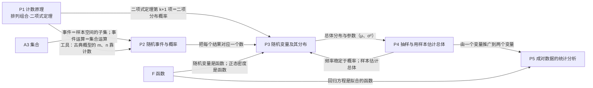

# P 概率与统计主线：计数 · 概率 · 统计

> 总图位置：见 `00-总图与导航.md`。约定（编号、标签、关系符号）同 00 文件第五节。
> 依据：人教B版选必二 Ch3、Ch4，必修二 Ch5；速查13、速查14。

---

## 〇、本模块在大厦中的位置

- **下接（地基）**：A3 集合（事件就是样本空间的子集，事件运算就是集合运算）；A1 数与运算（阶乘、组合数的代数变形）；A5 推理（归纳、数学归纳法证明组合恒等式）。
- **横连**：F 函数（随机变量是“样本点 → 实数”的函数；正态密度是函数；回归方程是拟合出来的函数）；S 数列（二项式定理用于数列不等式放缩）；B 不等式（概率、方差的范围与最值）。
- **上接（屋顶）**：M1 建模（抽样调查、质量控制、风险决策、回归预测）。

**核心问题**：结果不确定时，规律在哪里？怎样用数字描述“可能性”，又怎样用数据反推总体？

**中心模型**：两条方向相反、在“分布”处汇合的路——

```
  概率（由模型推数据）：  计数 → 样本空间与事件 → 概率 → 随机变量 → 分布（期望、方差）
                                                                   ⇅  （分布是两条路的交汇点）
  统计（由数据推模型）：  抽样 → 样本数据 → 频率分布、数字特征 → 估计总体分布与参数 → 相关、回归、检验
```

概率回答“已知规律，结果会怎样”；统计回答“看到结果，规律可能是什么”。频率稳定于概率（大量重复试验）是连接两者的桥。

---

## 一、L1 骨架



---

## 二、L2 / L3 展开

### P1 计数原理 · 排列组合 · 二项式定理 〔B版·选必二·Ch3〕〔速查13〕

**本分支的根**：一切计数都由两条原理推出——“分类相加、分步相乘”。排列＝分步乘法的特例；组合＝排列除以顺序数；二项式定理＝把 (a+b)ⁿ 展开时“每项从 n 个括号里各取一个字母”的组合计数。

- **P1.1 两个基本计数原理** ★★★
  - 分类加法计数原理：完成一件事有两类方案，第一类有 m 种方法，第二类有 n 种方法，**任选一类中的任一种方法都能单独完成这件事**，则共有 N=m+n 种方法（推广到 k 类：N=m₁+m₂+⋯+mₖ）。
  - 分步乘法计数原理：完成一件事需两个步骤，第一步 m 种、第二步 n 种，**两步都完成这件事才完成**，则共有 N=m·n 种（推广到 k 步：N=m₁m₂⋯mₖ）。
  - 方法
    - 分类：明确完成这件事有哪些办法；各类办法相互独立（任一类都能单独完成）；选好分类标准，做到**不重不漏**。
    - 分步：明确要经过几步；缺任何一步事情都完成不了；步骤完整、逐步去做。
    - 原则：先分类后分步。
  - 易错：分类与分步混淆；分类标准不明确导致重复或遗漏。
  - 应用口诀：“分类相加、分步相乘、有序排列、无序组合”。

- **P1.2 排列与排列数** ★★
  - 排列：从 n 个不同元素中取出 m 个（m≤n），**按一定顺序**排成一列。
  - 排列数 Aₙᵐ：所有这样的排列的个数。
    - Aₙᵐ=n(n−1)(n−2)⋯(n−m+1)（m 个连续正整数之积，由分步乘法原理得到：第 1 位 n 种，第 2 位 n−1 种……）。
    - Aₙᵐ=n!/(n−m)!；规定 0!=1，于是全排列 Aₙⁿ=n!。
  - 注意 m≤n：m=n 时就是全排列，也属于排列。
  - 无限制条件的排列：先判断能否归结为排列问题，再直接用排列数公式。
  - 有限制条件的排列问题类型：①有特殊元素或特殊位置；②某些元素必须相邻；③某些元素不能相邻；④元素有顺序限制（如甲必须在乙前面）。
  - 方法（解题策略）
    - 特殊元素（位置）优先安排。
    - 相邻问题“捆绑法”：把相邻元素看成一个整体参与排列，再排整体内部。
    - 不相邻问题“插空法”：先排其余元素，再把不相邻元素插入空当。
    - 【补充·常用方法】相同元素分组“隔板法”：n 个相同元素分给 m 个对象、每个至少 1 个，相当于在 n−1 个空当中插 m−1 块隔板，共 C_{n−1}^{m−1} 种；允许为 0 时先给每个对象补 1 个，化为 C_{n+m−1}^{m−1} 种。例：10 个相同小球分给 3 人每人至少 1 个，C₉²=36 种。
    - 多元问题分类讨论。
    - 正面困难时用“间接法”（正难则反：总数减去不合要求的）。
    - 顺序固定问题：先全排，再除以固定顺序元素的全排列数（例：n 个元素中 m 个顺序固定，有 Aₙⁿ/Aₘᵐ 种）。【新教材补充·常用方法】
  - 速记：排列“有差别”（顺序不同算不同），如 A₅²=5×4；谁特殊先排谁；常用逆向思维。

- **P1.3 组合与组合数** ★★
  - 组合：从 n 个不同元素中取出 m 个（m≤n）**合成一组**，不计顺序。
  - 组合数 Cₙᵐ：所有这样的组合的个数。
    - Cₙᵐ=Aₙᵐ/Aₘᵐ=n(n−1)⋯(n−m+1)/m!=n!/[m!(n−m)!]（m≤n，m、n∈N；规定 Cₙ⁰=1）。
    - 推导：先取组合再把每组排成一列＝排列，所以 Aₙᵐ=Cₙᵐ·m! ⇒ Cₙᵐ=Aₙᵐ/m!。
  - 组合数性质 ★
    - Cₙᵐ=Cₙⁿ⁻ᵐ（对称性）：取出 m 个与留下 n−m 个一一对应。
    - Cₙᵐ+Cₙᵐ⁻¹=Cₙ₊₁ᵐ（帕斯卡公式）：从 n+1 个元素中取 m 个，按“含某个特定元素”（Cₙᵐ⁻¹）与“不含它”（Cₙᵐ）分两类——分类加法原理的应用。
    - Cₙ⁰=Cₙⁿ=1。
  - 排列与组合的异同
    - 相同：都是从 n 个不同元素中取出 m 个。
    - 不同：排列有序（“排成一列”），组合无序（“合成一组”）。
    - 联系：Aₙᵐ=m!·Cₙᵐ。
    - 判断法：交换两个元素的位置，结果变了就是排列，不变就是组合。
  - 速记：组合“无差别”（只看取了谁），如 C₅²=C₅³=(5×4)/(2×1)=10。
  - 组合问题常见类型
    - “含”与“不含”某元素：含则先取出它，再从其余中取。
    - “至多”“至少”：直接分类，或用间接法。
    - 几何组合问题：注意三点共线、四点共面等几何限制（例：共线的点不能构成三角形）。
    - 从若干集合中选取元素：分类讨论。
  - 方法：组合数性质解题要抓公式结构，灵活变形；复杂问题用转化化归变成熟悉的排列组合模型。

- **P1.4 排列组合综合：分组与分配** ★★
  - 分组问题四种形式（以 6 个不同元素为例）
    - 非均匀不编号分组（如分成 1、2、3 个三组）：C₆¹C₅²C₃³=60。
    - 均匀不编号分组（如平均分成三组每组 2 个）：C₆²C₄²C₂²/A₃³=15（**均匀分组要除以组数的全排列**，因为组与组之间没有区别）。
    - 非均匀编号分组（组有名称）、均匀编号分组：在相应不编号分组的结果上再乘组的排列数（或直接按组依次取）。
  - 分配问题：遵循“**先分组，后分配（排列）**”。
  - 【易错】不平均分组与不平均分配：只有**定向分配**（已指定谁得几个，如甲 1 本、乙 2 本、丙 3 本）时，种数等于不平均分组数（60 种）；若只要求“三人分别得 1、2、3 本”而不指定谁得几本，要再乘 A₃³，为 360 种。平均分组与平均分配也不同：平均分配＝平均分组×A₃³=90 种。
  - 综合原则：先分类后分步；先选后排（先组合后排列）；限制条件多的优先；避免重复和遗漏。
  - 注意：分清分类与分步、分清排列与组合、分清有无限制条件。
  - 解题策略汇总：特殊元素优先、特殊位置优先；合理分类、准确分步；正难则反、等价转化；相邻捆绑；不相邻插空。
  - 易错：不能区分“有序”与“无序”；分组时漏除或多除组数的全排列。

- **P1.5 二项式定理** ★★★
  - 定理：(a+b)ⁿ=Cₙ⁰aⁿ+Cₙ¹aⁿ⁻¹b+⋯+Cₙʳaⁿ⁻ʳbʳ+⋯+Cₙⁿbⁿ（n∈N*）。右边叫二项展开式，Cₙʳ（r=0,1,…,n）叫二项式系数。
    - 推导（计数原理）：(a+b)ⁿ 是 n 个 (a+b) 相乘，展开后每一项是从每个括号中各取 a 或 b 相乘；含 bʳ 的项，就是从 n 个括号中选 r 个取 b，共 Cₙʳ 种，故系数为 Cₙʳ。
  - 通项公式：Tᵣ₊₁=Cₙʳaⁿ⁻ʳbʳ（r=0,1,…,n），注意是**第 r+1 项**。
    - a、b、n、r、Tᵣ₊₁ 五个量，知四求一。
  - 常用变形
    - (a−b)ⁿ=Cₙ⁰aⁿ−Cₙ¹aⁿ⁻¹b+⋯+(−1)ʳCₙʳaⁿ⁻ʳbʳ+⋯+(−1)ⁿCₙⁿbⁿ。
    - 第 r+1 项为 (−1)ʳCₙʳaⁿ⁻ʳbʳ，a 的指数是 n−r。
    - (1+x)ⁿ=Cₙ⁰+Cₙ¹x+Cₙ²x²+⋯+Cₙʳxʳ+⋯+Cₙⁿxⁿ。
    - 首项是常数 Cₙ⁰=1，全部为加号，x 的次数从 0 升到 n。
  - 展开式特点：共 n+1 项；各项次数（a 与 b 的次数和）都是 n；按 a 的降幂、b 的升幂排列；二项式系数依次为 Cₙ⁰,Cₙ¹,…,Cₙⁿ。
  - 易错
    - **二项式系数**（只是 Cₙʳ）与**项的系数**（含 a、b 中的常数和符号）不同。
    - 不能忽视展开式中系数的正负号（尤其是 (a−b)ⁿ）。
    - 二项式系数的最大值与项的系数的最大值混淆。

- **P1.6 二项式系数的性质** ★★
  - 对称性：与首末两端“等距离”的两项的二项式系数相等，Cₙᵐ=Cₙⁿ⁻ᵐ。
  - 增减性：Cₙᵐ/Cₙᵐ⁻¹=(n−m+1)/m，当 m<(n+1)/2 时比值大于 1，二项式系数逐渐**增大**；当 m>(n+1)/2 时比值小于 1，逐渐**减小**。
  - 最大值：n 为偶数时，中间一项 Cₙ^(n/2) 最大；n 为奇数时，中间两项 Cₙ^((n−1)/2)=Cₙ^((n+1)/2) 最大。
  - 系数和：Cₙ⁰+Cₙ¹+⋯+Cₙⁿ=2ⁿ（令 a=b=1）；Cₙ⁰+Cₙ²+⋯=Cₙ¹+Cₙ³+⋯=2ⁿ⁻¹（n≥1，令 a=1、b=−1 得奇偶项和相等）。
  - 杨辉三角：每行两端为 1，中间每个数等于它“肩上”两数之和（即 Cₙᵐ+Cₙᵐ⁻¹=Cₙ₊₁ᵐ）。【新教材补充】

- **P1.7 二项式定理的应用** ★★
  - 求特定项或特定项的系数：写出通项 Tᵣ₊₁，令 x 的指数等于所求，解出 r。
  - 求展开式所有项系数和：**赋值法**，常令字母为 1（奇数项、偶数项系数和再令为 −1，两式相加减）。
  - 整除与求余数
    - 思路：把底数写成除数（或与除数密切相关的数）与某数的和或差，用二项式定理展开；前面各项都含除数因子，只需考虑后面几项。
    - 注意余数的范围（余数非负且小于除数）。
  - 证明不等式：巧妙构造二项式，配合放缩法（例：n≥2 时 2ⁿ=(1+1)ⁿ≥Cₙ⁰+Cₙ¹+Cₙ²=(n²+n+2)/2，见 S 数列放缩技巧）。
  - 组合恒等式证明：构造函数（对展开式赋值、比较系数）或构造同一计数问题的两种算法。
  - 近似计算【旧教材·拓展】：|x| 与 1 相比很小且 n 不大时，(1+x)ⁿ≈1+nx，(1−x)ⁿ≈1−nx；按精度要求决定保留几项，舍去的项不影响所要求的精度即可。

---

### P2 随机事件与概率 〔B版·必修二·Ch5、选必二·Ch4〕〔速查14〕

**本分支的根**：用集合语言描述“可能发生的结果”，再给每个事件配一个 0 到 1 之间的数（概率），这个数满足加法规则；等可能时，概率归结为计数。

- **P2.1 随机试验、样本空间与随机事件** ★★
  - 随机试验：可在相同条件下重复，结果不止一个且试验前不能确定是哪一个。
  - 样本点与样本空间 Ω：试验的每个可能结果叫样本点，全体样本点的集合叫样本空间。【新教材补充】（旧教材称“基本事件”）
  - 事件分类（在一定条件下）
    - 必然事件：一定发生（对应 Ω）。
    - 不可能事件：一定不发生（对应 ∅）。
    - 随机事件：可能发生也可能不发生（Ω 的子集）。
  - 桥：事件＝样本空间的子集 ⇒ 事件关系与运算可以完全类比集合的关系与运算（见 A3）。

- **P2.2 事件的关系与运算** ★★
  - 包含：A⊆B（A 发生则 B 一定发生）。
  - 并（和）事件：A∪B（旧记 A+B），A 与 B 至少一个发生。
  - 交（积）事件：A∩B（旧记 AB），A 与 B 同时发生。
  - 互斥事件：A∩B=∅，不能同时发生。
  - 对立事件：A∩B=∅ 且 A∪B=Ω，不能同时发生且必有一个发生；A 的对立事件记 Ā。
  - 互斥与对立
    - 相同点：都描述两个事件的关系，都不能同时发生。
    - 不同点：对立还要求二者必有一个发生。
    - 关系：对立 ⇒ 互斥；互斥 ⇏ 对立。
  - 常用事件的表示（A、B 两个事件）
    - 至少一个发生：A∪B。
    - 都发生：A∩B。
    - 都不发生：Ā∩B̄（即 ĀB̄，等于 A∪B 的对立事件，类比德·摩根律）。【易错】不要与 AB（都发生）混写，上横线不能漏。
    - 恰有一个发生：AB̄∪ĀB。
    - 至少一个不发生：AB̄∪ĀB∪ĀB̄（＝AB 的对立事件）。

- **P2.3 频率与概率** ★★
  - 频数与频率：相同条件下重复 n 次试验，事件 A 出现 m 次，m 叫频数，fₙ(A)=m/n 叫频率。
  - 概率（统计定义）：随着 n 增大，fₙ(A) 稳定在某个常数附近，这个常数就是 P(A)。
  - 频率与概率的关系
    - 频率是随机的，试验前不能确定；不同的试验序列可得不同频率。
    - 概率是确定的常数，客观存在，与试验次数无关。
    - 频率是概率的近似值；试验次数越多，频率**一般**越接近概率（大数定律的直观说法）。
  - 概率的基本性质：0≤P(A)≤1；P(Ω)=1；P(∅)=0。
  - 概率的意义：用概率意识理解现实（天气预报、中奖、决策中的“可能性”）。
  - 易错：把频率当概率（频率只是估计值）。

- **P2.4 概率的加法公式** ★★★
  - 互斥事件加法公式：A、B 互斥 ⇒ P(A∪B)=P(A)+P(B)。
    - 推广：A₁,A₂,…,Aₙ **两两互斥** ⇒ P(A₁∪A₂∪⋯∪Aₙ)=P(A₁)+P(A₂)+⋯+P(Aₙ)。
  - 对立事件：P(A)+P(Ā)=1，即 P(A)=1−P(Ā)。
    - 【易错】A、B 对立 ⇒ P(A)+P(B)=1，但 P(A)+P(B)=1 **不能反推** A、B 对立（例：掷骰子，A＝{1,2,3}，B＝{3,4,5}，P(A)+P(B)=1，但 A、B 不互斥）。
  - 一般加法公式：P(A∪B)=P(A)+P(B)−P(A∩B)（对任意事件成立，不是古典概型独有）。
  - 求复杂事件概率的两条路（方法）
    - 拆成若干**彼此互斥**事件的和，分别求后相加。
    - 正难则反：先求对立事件的概率，再用 1 减。

- **P2.5 古典概型** ★★★
  - 特征：①有限性——样本点个数有限；②等可能性——每个样本点发生的可能性相等。
  - 旧教材表述：基本事件两两互斥，任何事件都可表示为基本事件的和；具备有限、等可能两特点的概率模型叫古典概型。
  - 公式：P(A)=A 包含的样本点个数 m / 样本空间的样本点总数 n。这既是古典概型的定义，也是计算方法；m、n 常用 P1 计数求得。
  - 解题步骤：①读题，弄清背景；②判断是否为古典概型（有限＋等可能），用字母表示所求事件；③分别求样本点总数 n 与事件 A 包含的个数 m；④代公式，下结论。
  - 抽样方式：有放回抽样与不放回抽样，样本空间不同，概率也不同。
  - 易错
    - 分子、分母的计数标准不一致（一个按有序算，一个按无序算）。
    - 把“非等可能”的结果当成等可能（例：两枚硬币“两正、一正一反、两反”三种结果不等可能）。
    - 混淆有放回与无放回。

- **P2.6 几何概型** 【旧教材·拓展】（2017版课标已删）
  - 定义：每个事件发生的概率只与构成该事件区域的长度（面积或体积）成比例。
  - 特点：样本点个数无限；每个样本点等可能。
  - 公式：P(A)=构成事件 A 的区域的长度（面积或体积）/ 试验全部结果构成的区域的长度（面积或体积）。
  - 三种常见类型
    - 长度型：线段 l 是线段 L 的一部分，向 L 上任投一点，点落在 l 上的可能性与 **l 的长度**成正比、与 l 的位置无关，则 P=l 的长度/L 的长度。
    - 面积型：P=g 的面积/G 的面积。
    - 体积型：P=v 的体积/V 的体积。
    - 【易错】落点可能性是与**事件对应的小区域** l（g、v）的度量成正比，不是与全区域 L（G、V）成正比，这样比值才等于概率。
  - 步骤：判断几何概型 → 求全部结果与事件 A 对应区域的几何度量 → 代公式。
  - 方法：关键是构造随机事件对应的几何图形；必要时设参数、建坐标系，把每个结果对应为坐标系中的一个点，得到度量区域；区域难处理时用对立事件。
  - 与古典概型的异同：都要求等可能；古典概型样本点有限，几何概型样本点无限。

- **P2.7 事件的相互独立性** ★★★
  - 定义：P(AB)=P(A)P(B) ⇔ A 与 B 相互独立（直观含义：一个事件是否发生，不影响另一个事件发生的概率）。
  - 性质：A、B 独立 ⇒ A 与 B̄、Ā 与 B、Ā 与 B̄ 也相互独立。
  - 推广：A₁,A₂,…,Aₙ **相互独立** ⇒ P(A₁A₂⋯Aₙ)=P(A₁)P(A₂)⋯P(Aₙ)。
    - 【易错】连乘要求“相互独立”，“两两独立”不够，两两独立推不出相互独立。反例：掷两枚均匀硬币，A＝第一枚正面，B＝第二枚正面，C＝两枚结果相同，P(A)=P(B)=P(C)=1/2，任两个都独立，但 P(ABC)=1/4≠1/8。
  - 互斥与独立的区别
    - 互斥：不能同时发生（P(AB)=0）。
    - 独立：一个的发生与否不影响另一个的概率（P(AB)=P(A)P(B)）。
    - 【易错】互斥与独立能否同时成立：同时成立要求 P(A)P(B)=0，即至少一个事件概率为 0；当 P(A)>0 且 P(B)>0 时，互斥的事件一定不独立，独立的事件一定不互斥。
  - 两事件概率速查表（A、B 两事件）

    | 所求 | A、B 互斥 | A、B 相互独立 |
    |---|---|---|
    | P(A∪B) | P(A)+P(B) | 1−P(Ā)P(B̄) |
    | P(AB) | 0 | P(A)P(B) |
    | P(ĀB̄) | 1−P(A)−P(B) | P(Ā)P(B̄) |
    | P(AB̄∪ĀB)（恰一个发生） | P(A)+P(B) | P(A)P(B̄)+P(Ā)P(B) |
    | P(AB̄∪ĀB∪ĀB̄)（至少一个不发生） | 1 | 1−P(A)P(B) |

  - 概率题解题步骤：①确定事件性质（等可能／互斥／独立／n 重伯努利试验）；②判断事件运算（至少一个发生→和；同时发生→积）；③选用公式（和用加法、积用乘法）；④计算作答。
  - 易错：混淆“互斥”与“相互独立”；忽视公式的使用条件。

- **P2.8 条件概率与全概率公式** ★★ 【新教材补充】〔B版·选必二·Ch4〕
  - 条件概率：P(A)>0 时，P(B|A)=P(AB)/P(A)，表示 A 已发生的条件下 B 发生的概率。
    - 古典概型中：P(B|A)=n(AB)/n(A)（缩小后的样本空间里计数）。
    - 性质：0≤P(B|A)≤1；若 B、C 互斥，P(B∪C|A)=P(B|A)+P(C|A)；P(B̄|A)=1−P(B|A)。
  - 乘法公式：P(AB)=P(A)P(B|A)（P(A)>0）。
  - 与独立性的联系：P(A)>0 时，A、B 相互独立 ⇔ P(B|A)=P(B)。独立时乘法公式退化为 P(AB)=P(A)P(B)。
  - 全概率公式：A₁,A₂,…,Aₙ 两两互斥、并为 Ω 且 P(Aᵢ)>0 ⇒ P(B)=Σᵢ P(Aᵢ)P(B|Aᵢ)。思想：“分情况（原因）求结果”。
  - 贝叶斯公式（了解）：P(Aᵢ|B)=P(Aᵢ)P(B|Aᵢ) / Σⱼ P(Aⱼ)P(B|Aⱼ)（P(B)>0）。思想：“由结果反推原因”。

---

### P3 随机变量及其分布 〔B版·选必二·Ch4〕〔速查14〕

**本分支的根**：把试验的每个结果对应一个实数（随机变量是“样本点 → 实数”的函数），概率问题就变成研究“取什么值、取各值的概率多大”（分布），再用两个数概括分布：均值（中心在哪）、方差（散得多开）。

- **P3.1 随机变量** ★
  - 定义：随着试验结果变化而变化的变量（表示随机试验结果的变量）。
  - 分类
    - 离散型：所有可能取值可以一一列出。
    - 连续型：可取某个区间内的一切值（如正态分布）。
  - 记号：新教材用 X、Y；旧教材用 ξ、η。
    - {X=k}、{X≥k} 等都表示事件；P(X=k) 是一个 [0,1] 内的实数。
    - Y=aX+b 也是随机变量（随机变量的函数仍是随机变量）。

- **P3.2 离散型随机变量的分布列** ★★
  - 定义：X 的取值 x₁,x₂,…,xₙ 及相应概率 P(X=xᵢ)=pᵢ 列成的表，叫 X 的分布列。

    | X | x₁ | x₂ | ⋯ | xᵢ | ⋯ | xₙ |
    |---|---|---|---|---|---|---|
    | P | p₁ | p₂ | ⋯ | pᵢ | ⋯ | pₙ |

  - 性质：①pᵢ≥0；②p₁+p₂+⋯+pₙ=1。
  - 求分布列的步骤：①判断是否为离散型随机变量；②确定 X 的所有可能取值；③求 X 取每个值的概率（用古典概型、互斥事件、独立事件、n 重伯努利试验等）；④列表；⑤用两条性质检验。
  - 易错：不用两条性质检验所求分布列。

- **P3.3 均值（数学期望）与方差** ★★★
  - 均值：E(X)=x₁p₁+x₂p₂+⋯+xₙpₙ。
    - 意义：概率意义下的加权平均，是算术平均的推广；E(X) 是由分布列唯一确定的常数，描述 X 取值的平均水平。
    - 性质：E(c)=c；E(aX+b)=aE(X)+b；E(X₁+X₂)=E(X₁)+E(X₂)；X₁、X₂ 相互独立时 E(X₁X₂)=E(X₁)E(X₂)【旧教材·拓展】。
  - 方差：D(X)=Σᵢ[xᵢ−E(X)]²pᵢ；标准差 σ(X)=√D(X)。
    - 意义：刻画取值相对均值的离散程度；方差越小，取值越集中、越稳定。
    - 性质：D(c)=0；D(aX+b)=a²D(X)；D(X)=E(X²)−[E(X)]²（由定义展开推出）。
  - 方法：求 E、D 的关键是求出 X 的所有取值及对应概率；服从特殊分布时直接用公式。
  - 随机变量的均值与样本平均数
    - 区别：随机变量的均值是常数；样本平均数随样本不同而变，是随机的。
    - 联系：样本容量增大时，样本平均数越来越接近总体均值。
  - 易错：比较两组方案时，均值相等还要比较方差。
  - 旧记号 E(ξ)=x₁p₁+⋯+xₙpₙ+⋯（写“+⋯”是兼顾取值有无穷多个的情形）；D(ξ) 旧称“均方差”。

- **P3.4 两点分布（0-1分布）** ★
  - X 只取 0、1：P(X=1)=p，P(X=0)=1−p（0<p<1）。
  - E(X)=p，D(X)=p(1−p)。
  - 旧称“二点分布”。

- **P3.5 超几何分布** ★★
  - 模型：N 件产品中有 M 件次品，不放回地任取 n 件，次品数 X 服从超几何分布，记 X~H(N,M,n)。
  - P(X=k)=Cₘᵏ·C_{N−M}^{n−k} / C_Nⁿ（此处 Cₘᵏ 指 C_M^k）。
    - k 的取值：从 max{0, n−(N−M)} 到 min{n, M} 的整数；通常 n≤N−M 时就是 k=0,1,…,m，m=min{n,M}。
    - 【易错】k 从 0（或 n−(N−M)）开始，不要漏掉 k=0。
    - 只要知道 **N、M 和 n**，就能写出分布列。
  - E(X)=nM/N；D(X)=n·(M/N)·(1−M/N)·(N−n)/(N−1)。（已验算：N=10，M=3，n=2 时，E=0.6，D=2×0.3×0.7×8/9≈0.373。）
  - 与二项分布对比：不放回抽取 → 超几何；有放回抽取 → 二项分布；N 很大时两者接近。
  - 方法：在理解模型的基础上用公式，不要死记。

- **P3.6 n 重伯努利试验与二项分布** ★★★
  - n 重伯努利试验（旧称“n 次独立重复试验”）：同样条件下重复 n 次，各次结果相互独立；每次只有两种结果（A 发生或不发生），且 P(A)=p 每次相同。
  - 二项分布：在 n 重伯努利试验中，A 发生的次数 X 满足
    - P(X=k)=Cₙᵏpᵏ(1−p)ⁿ⁻ᵏ，k=0,1,…,n（记 q=1−p）。
    - 记作 X~B(n,p)。
    - 记号规范：“X~B(n,p)”是说明分布的记号，概率公式另写 P(X=k)=Cₙᵏpᵏqⁿ⁻ᵏ，两者不能用等号连写。
  - 字母含义：n——试验次数；p——每次 A 发生的概率；k——A 恰好发生的次数；X——A 发生的次数（随机变量）。
  - 桥：P(X=k) 正是 (q+p)ⁿ 展开式的第 k+1 项（见 P1.5），所以各概率之和 (q+p)ⁿ=1。
  - E(X)=np，D(X)=np(1−p)。
  - 使用条件：每次概率相同；各次相互独立；每次只有两种结果；X 是 A 发生的次数。实际问题中“数量很大”“非常多”常表示可近似看作 n 重伯努利试验。
  - 方法：服从二项分布时，期望、方差直接用公式。

- **P3.7 正态分布** ★★
  - 密度函数（正态曲线）：f(x)=[1/(σ√(2π))]·e^{−(x−μ)²/(2σ²)}，x∈R，σ>0；记 X~N(μ,σ²)。
    - 参数：μ 是总体（分布）的均值，σ 是总体的标准差；E(X)=μ，D(X)=σ²。
    - 【易错】μ、σ 是**总体参数**，不是样本统计量；样本均值、样本标准差只是它们的估计值。
  - 正态曲线的性质
    - 位于 x 轴上方，与 x 轴不相交。
    - 关于直线 x=μ 对称。
    - 在 x=μ 处最高，最大值 1/(σ√(2π))。
    - x<μ 时上升，x>μ 时下降；向两边无限延伸时以 x 轴为渐近线。
    - μ 一定时，σ 越大曲线越“矮胖”（越分散），σ 越小越“瘦高”（越集中）；σ 一定时，曲线随 μ 变化沿 x 轴平移。
    - 曲线与 x 轴之间的面积为 1。
  - 3σ 原则（三个特殊区间的概率）★

    | 区间 | 精确到四位 | 人教B版选必二 Ch4（旧教材同） | 人教A版新教材 |
    |---|---|---|---|
    | P(μ−σ≤X≤μ+σ) | 0.6827 | 0.3413×2＝0.6826≈0.683 | ≈0.6827 |
    | P(μ−2σ≤X≤μ+2σ) | 0.9545 | (0.3413+0.1359)×2＝0.9544≈0.954 | ≈0.9545 |
    | P(μ−3σ≤X≤μ+3σ) | 0.9973 | (0.3413+0.1359+0.0215)×2＝0.9974≈0.997 | ≈0.9973 |

    - 验算：Φ(1)≈0.841345，2Φ(1)−1≈0.68269；Φ(2)≈0.977250 → 0.95450；Φ(3)≈0.998650 → 0.99730。
    - 人教B版（已核对原文）用四位小数的分段面积 0.3413、0.1359、0.0215 相加，得到 0.6826、0.9544、0.9974，再约为 0.683、0.954、0.997；差别来自分段先四舍五入再相加，不是数学错误。考试按所用教材给出的数值作答。
    - 对连续型随机变量 P(X=a)=0，所以区间端点开闭不影响概率。
    - 结论：X 几乎总在 [μ−3σ, μ+3σ] 内取值；落在 (μ−2σ, μ+2σ) 外的概率约 4.55%，落在 (μ−3σ, μ+3σ) 外的不到 0.3%，可视为小概率事件，一次试验中几乎不发生——这是生产质量控制的依据（见 M1）。
  - 求概率的方法
    - 转化到三个特殊区间。
    - 利用对称性：关于 x=μ 对称的区间概率相等，如 P(X<μ−a)=P(X>μ+a)；P(X<μ)=P(X>μ)=0.5。
    - 利用总面积为 1：P(X<a)=1−P(X≥a)。
  - 概率为 0 的事件不一定是不可能事件：连续型 X 取某一点的概率为 0，但 {X=a} 不是不可能事件；所以 P(X<a)=P(X≤a)，这与离散型不同。
  - 标准正态分布与查表 【旧教材·拓展】
    - μ=0、σ=1 时为标准正态分布 N(0,1)，密度 f(x)=[1/√(2π)]e^{−x²/2}。
    - 分布函数记 Φ(x)=P(X≤x)（习惯用大写 Φ，小写 φ 常表示密度）。
    - Φ(−x)=1−Φ(x) 对一切实数 x 成立。
    - X~N(μ,σ²) 时，P(X≤x)=Φ((x−μ)/σ)；P(a<X≤b)=Φ((b−μ)/σ)−Φ((a−μ)/σ)。求一般正态分布的概率，关键在于标准化。
  - 理解：从概率、统计、曲线、函数四个方面把握 μ 和 σ，后两者是为前两者服务的工具。
  - 易错：三个概率值记错；不理解 N(μ,σ²) 中第二个参数是方差 σ² 而不是 σ。

---

### P4 统计：抽样与用样本估计总体 〔B版·必修二·Ch5〕〔速查14〕

**本分支的根**：总体太大或不能全测，只能抽一部分（样本）；抽样要随机才能代表总体；再用样本的分布和数字特征去估计总体。统计的基本思想是“用样本估计总体”。

- **P4.1 总体、个体、样本**
  - 总体：所考查对象的某一数值指标的全体。
  - 个体：总体中的每一个元素。
  - 样本：从总体中抽出的部分个体；样本中个体的数目叫样本容量。

- **P4.2 随机抽样** ★★
  - 简单随机抽样
    - 定义：总体有 N 个个体，逐个不放回地抽取 n 个（n≤N），每次抽取时各个个体被抽到的机会相等。（新教材也讨论有放回简单随机抽样。）
    - 方法：抽签法（抓阄法）；随机数法（新教材用计算器、软件生成随机数）；随机数表法【旧教材·拓展】。
  - 分层抽样
    - 定义：总体由差异明显的几部分组成时，把总体分成几部分（层），按各层所占比例从各层独立抽取（按比例分配）。
    - 各层内部用简单随机抽样。
  - 系统抽样 【旧教材·拓展】（2017版课标已删）
    - 定义：总体容量较大时，把总体均匀分成几部分，按事先确定的规则从每部分抽 1 个。
    - 步骤：编号 → 分段（总体个数/样本容量不是整数时，先随机剔除部分个体）→ 用简单随机抽样确定起始号 → 按规则依次取出样本。
  - 三种抽样的比较

    | 类别 | 共同点 | 各自特点 | 相互联系 | 适用范围 |
    |---|---|---|---|---|
    | 简单随机抽样 | 每个个体被抽到的概率相等 | 从总体中逐个抽取 | — | 总体中个体数较少 |
    | 系统抽样〔拓〕 | 同上 | 分成均衡几部分，按规则在各部分抽取 | 起始部分用简单随机抽样 | 总体中个体数较多 |
    | 分层抽样 | 同上 | 分层，各层按比例抽取 | 各层用简单随机抽样 | 总体由差异明显的几部分组成 |

  - 三种抽样的共同特点：客观性与公平性。

- **P4.3 用样本的分布估计总体分布** ★★
  - 工具：频率分布表、频率分布直方图、频率分布折线图、总体密度曲线、茎叶图。
  - 频率分布直方图
    - 纵轴是**频率/组距**；小长方形面积＝组距×(频率/组距)＝该组频率；所有小长方形面积之和为 1。
    - 作图步骤：①求极差；②决定组距与组数；③分组；④列频率分布表（各组频率＝组频数/样本容量）；⑤画直方图。
    - 易错：误以为小长方形的**高**等于频率（应是面积等于频率）。
  - 频率分布折线图：连接直方图各小长方形上边中点；样本容量增大、组距减小时，折线趋近于总体密度曲线。
  - 茎叶图：保留全部原始数据，便于记录和比较两组数据；**重复的数据要重复记录**，不能遗漏。（新教材弱化，保留作拓展。）
  - 样本容量越大，用样本频率分布估计总体分布越精确。
  - 百分位数 【新教材补充】〔B版·必修二·Ch5〕
    - 定义：p% 分位数是满足“至少 p% 的数据不大于它，且至少 (100−p)% 的数据不小于它”的数，可能不唯一。
    - 人教B版约定的算法（已核对必修二 Ch5 原文）：把数据从小到大排列为 x₁,…,xₙ，计算 i=n×p%；i 不是整数时，取大于 i 的最小整数 i₀，x_{i₀} 为 p% 分位数；i 是整数时，取 (xᵢ+xᵢ₊₁)/2。规定 0 分位数为 x₁（最小值），100% 分位数为 xₙ（最大值）。
    - 中位数＝第 50 百分位数；常用四分位数为第 25、50、75 百分位数。

- **P4.4 用样本的数字特征估计总体** ★★
  - 集中趋势
    - 众数：出现次数**最多**的数据（可以不唯一）。【易错】是“最多”，不是“较多”。
    - 中位数：从小到大排列后处在中间位置的一个数，或中间两个数的平均数。
    - 平均数：x̄=(x₁+x₂+⋯+xₙ)/n。
  - 离散程度
    - 方差：s²=(1/n)Σ(xᵢ−x̄)²；标准差：s=√s²。
    - 方差的单位是原数据单位的平方，标准差与原数据单位相同。
    - 方差（标准差）越大，数据波动越大；越小，波动越小。
  - 用频率分布直方图估计数字特征 【新教材补充】
    - 众数≈最高小长方形底边中点的横坐标。
    - 中位数：左右两侧直方图面积各为 0.5 的那条竖线的横坐标。
    - 平均数≈各小长方形底边中点横坐标×对应频率之和。
  - 分层抽样的总体均值与方差 【新教材补充】
    - 两层：样本量 m、n，均值 x̄、ȳ，方差 s₁²、s₂²，则总样本均值 w̄=(m x̄+n ȳ)/(m+n)；
    - 总方差 s²={m[s₁²+(x̄−w̄)²]+n[s₂²+(ȳ−w̄)²]}/(m+n)。
  - 数据变换的影响：数据都乘 a 再加 b，则平均数变为 a x̄+b，方差变为 a²s²（与 P3.3 中 E、D 的性质同构）。
  - 总体特征数的估计：用样本平均数估计总体平均数；用样本方差 S²=(1/n)Σ(xᵢ−x̄)² 估计总体方差 σ²。

---

### P5 成对数据的统计分析 〔B版·选必二·Ch4〕〔速查14〕

**本分支的根**：研究两个变量之间的关系。确定的关系是函数；不确定但有趋势的关系是相关关系——用散点图看、用相关系数量、用回归方程描述和预测；对两个分类变量，用列联表和独立性检验判断是否有关。

- **P5.1 变量间的相关关系** ★
  - 相关关系与函数关系
    - 函数关系：确定性关系，自变量取定值，因变量唯一确定。
    - 相关关系：非确定性关系，一个变量取定值，另一个变量的取值带有随机性但有一定趋势。
    - 易错：把相关关系等同于函数关系。
  - 散点图：把成对数据画成平面上的点，直观判断有无相关、是否线性。
  - 正相关：一个变量增大，另一个大体也增大；负相关：一个增大，另一个大体减小。
  - 线性相关：散点大致分布在一条直线附近。

- **P5.2 样本相关系数** ★★
  - r=Σ(xᵢ−x̄)(yᵢ−ȳ) / √[Σ(xᵢ−x̄)²·Σ(yᵢ−ȳ)²]=(Σxᵢyᵢ−n x̄ ȳ) / √[(Σxᵢ²−n x̄²)(Σyᵢ²−n ȳ²)]。
  - 性质
    - r>0 正相关，r<0 负相关。
    - |r|≤1；|r| 越接近 1，**线性**相关程度越强；越接近 0，线性相关程度越弱（r=0 只说明没有线性相关，不排除其他关系）。
  - 相关性检验：比较 |r| 与临界值，判断线性相关是否显著。

- **P5.3 一元线性回归** ★★★
  - 最小二乘法：选回归直线，使各样本点到直线的**竖直方向偏差**的平方和 Σ(yᵢ−ŷᵢ)² 最小。
    - 【易错】是竖直方向偏差 yᵢ−(b̂xᵢ+â) 的平方和最小，不是点到直线的垂直距离的平方和。
  - 回归方程：ŷ=b̂x+â（旧教材写 y=a+bx）
    - b̂=Σ(xᵢ−x̄)(yᵢ−ȳ)/Σ(xᵢ−x̄)²=(Σxᵢyᵢ−n x̄ ȳ)/(Σxᵢ²−n x̄²)；
    - â=ȳ−b̂x̄；x̄=(1/n)Σxᵢ，ȳ=(1/n)Σyᵢ。
    - 推论：回归直线一定经过样本中心点 (x̄, ȳ)。
    - b̂ 与 r 同号。
  - 残差与模型评价 【新教材补充】：残差 eᵢ=yᵢ−ŷᵢ；残差图中残差均匀分布在横轴附近的带状区域内，说明模型合适。
  - 回归分析要解决的问题：判断变量间是否有相关关系，有则找出贴近的数学表达式；用回归方程预测变量的取值和变化趋势。
  - 建立回归模型的步骤：①确定研究对象（解释变量 x、响应变量 y）；②画散点图；③确定回归方程类型（线性或非线性）；④用最小二乘法估计参数；⑤得出结果，分析残差，看有无异常。
  - 注意事项
    - 两个变量具有相关关系是回归分析的前提。
    - 回归方程只适用于所研究的样本所在的总体。
    - 回归方程有时间性。
    - 样本取值范围影响适用范围，一般不能超出范围外推。
    - 预报值不是精确值，而是可能取值的平均值。

- **P5.4 非线性回归转化为线性回归** ★
  - 思路：通过变量变换（换元）把非线性关系化成线性关系，再用最小二乘法。
  - 例：y=c·e^{kx} ⇒ ln y=kx+ln c，令 z=ln y 得 z 关于 x 的线性方程；y=a+b/x ⇒ 令 t=1/x。
  - 做法：题中给出经验公式时，直接对变量作相应变换；没有给出时，先画散点图，与已学函数图像比较，选拟合最好的函数类型，再变换。

- **P5.5 独立性检验** ★★
  - 分类变量与 2×2 列联表

    | | B | B̄ | 合计 |
    |---|---|---|---|
    | A | a | b | a+b |
    | Ā | c | d | c+d |
    | 合计 | a+c | b+d | n=a+b+c+d |

  - 统计量：χ²=n(ad−bc)² / [(a+b)(c+d)(a+c)(b+d)]（旧教材记 K²）。
  - 临界值（常用）：α=0.10 → 2.706；α=0.05 → 3.841；α=0.01 → 6.635；α=0.005 → 7.879；α=0.001 → 10.828。
  - 步骤：①提出零假设 H₀：两个分类变量独立（没有关系）；②根据列联表计算 χ²；③与临界值 xα 比较：χ²≥xα 时推断 H₀ 不成立（认为有关），犯错误的概率不超过 α；χ²<xα 时，没有充分证据推断 H₀ 不成立。
  - 新旧表述对照

    | 旧教材 | 新教材 |
    |---|---|
    | K² | χ² |
    | K²>3.841，有 95% 的把握说 A 与 B 有关 | 依据小概率值 α=0.05 的独立性检验，推断 A 与 B 有关，该推断犯错误的概率不超过 0.05 |
    | K²>6.635，有 99% 的把握说 A 与 B 有关 | 依据 α=0.01 的检验推断有关，犯错误的概率不超过 0.01 |
    | K²≤3.841，认为 A 与 B 无关 | 【易错】不能断定“无关”，只能说“没有充分证据推断 A 与 B 有关”（不拒绝 H₀ ≠ 证明 H₀ 成立） |

---

## 三、与其他模块的桥

| 桥 | 本模块节点 | 对方节点 | 关系 |
|---|---|---|---|
| 桥2 | P2.1、P2.2 | A3 集合 | 事件＝样本空间子集；并、交、补＝和、积、对立；“都不发生”的表示类比德·摩根律 |
| 桥14 | P1 → P2.5、P3.6 | — | 计数是古典概型的工具；二项式定理第 k+1 项＝二项分布概率 |
| — | P3.1、P3.7 | F 函数 | 随机变量是“样本点→实数”的函数；正态密度是函数，其对称、单调、最值用函数性质分析 |
| 桥15 | P5.3、P5.4 | F3、F5 | 回归方程是拟合的函数；非线性回归用换元化为一次函数 |
| — | P1.7 | S 数列（放缩技巧） | 2ⁿ=(1+1)ⁿ≥n+1 等放缩来自二项展开 |
| 桥16 | P1.3、P1.7 | A5 推理证明 | 组合恒等式可用数学归纳法或“算两次”证明 |
| — | P3.3、P4.4 | P 内部 | 随机变量的 E、D 性质与样本数据线性变换的规律同构 |
| — | P3.7、P5、P4 | M1 建模 | 质量控制、抽样调查、回归预测、独立性检验都是统计建模 |
| — | P2.8 | M2.7 或然与必然 | 条件概率、全概率体现“分情况”“由果溯因” |

---
