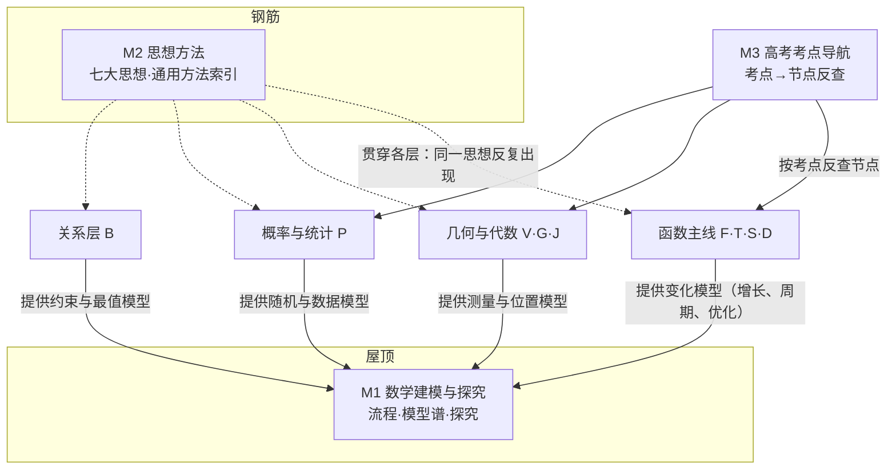

# M 屋顶与钢筋：数学建模与探究 · 思想方法 · 高考导航

> 总图位置：见 `00-总图与导航.md`。约定（编号、标签、关系符号）同 00 文件第五节。
> 依据：课程标准“数学建模活动与数学探究活动”主线；各模块的应用与方法节点；速查00。
> 本模块**只做汇总和指路**：模型、方法的推导细节在各模块节点里，这里写“是什么、在哪里、怎么用”。

---

## 〇、本模块在大厦中的位置

- **屋顶（M1）**：下接三条主线（F/T/S/D 函数、V/G/J 几何与代数、P 概率统计）与关系层 B——数学建模就是把这些工具带回现实世界。
- **钢筋（M2）**：贯穿 A 地基到 M 屋顶的每一层，不单独占一层，而是“同一种思想在不同楼层反复出现”。
- **导航（M3）**：从考试视角回看整座大厦，把高考考点逐条落到节点上。

**核心问题**：数学怎样回到现实世界？不同章节背后反复出现的“想法”是什么？

**中心模型**：建模循环 ＋ 思想网络

```
 现实问题 ──抽象（简化假设、选变量）──→ 数学模型 ──求解（用三条主线的工具）──→ 数学结果
    ↑                                                                          │
    └──── 修正模型 ←── 检验（与实际对照，不合则返回）←── 翻译回实际意义 ←─────────┘

 思想方法（钢筋）：函数与方程｜数形结合｜分类讨论｜转化与化归｜特殊与一般｜有限与无限｜或然与必然
```

---

## 一、L1 骨架



---

## 二、L2 / L3 展开

### M1 数学建模与探究（屋顶）

- **M1.1 建模的一般流程** ★★★
  - 课标流程：在实际情境中**发现问题、提出问题** → **分析问题、建立模型**（确定变量、参数，作合理假设）→ **求解模型** → **检验结果**（是否符合实际）→ **改进模型** → 最终解决实际问题，撰写报告。
  - 各模块应用题的“步骤”都是这个循环的特例
    - 函数应用：审题 → 建模 → 求解 → 还原。→ F5
    - 不等式应用：审题（必要时画示意图）→ 建模（找出常量与变量间的不等关系，完成文字、图形、符号语言的转换）→ 求解。→ B4
    - 解三角形应用：理解题意分清已知与所求 → 作图 → 把量集中到三角形中用正余弦定理 → 按实际意义和精确度作答。→ V4
    - 线性规划：设未知量并用符号表示 → 用线性不等式表示约束条件 → 用线性函数表示目标，求最值。→ B5【旧教材·拓展】
    - 优化问题：分析各量关系写出函数 y=f(x) → 求导、解 f′(x)=0 → 比较端点与驻点函数值。→ D3
    - 回归模型：确定研究对象 → 散点图 → 选回归类型 → 估计参数 → 分析残差。→ P5.3
    - 数列应用：判断是等差还是等比、求的是 aₙ 还是 Sₙ、项数是多少，再代公式。→ S5
  - 关键能力：把文字语言转化为数学语言（符号、图形）；注意自变量的实际取值范围。
  - 易错：模型脱离实际（忘记定义域、结果不合实际）；把相关关系当函数关系。

- **M1.2 模型谱（按“世界”分类，只写模型与指向节点）** ★★

  | 世界 | 模型 | 典型现象 | 数学工具 | 指向节点 |
  |---|---|---|---|---|
  | 变化 | 一次函数（直线上升） | 匀速增长、单利 a(1+pn) | 一次函数 | F3、S5 |
  | 变化 | 二次函数 | 面积、利润、抛射 | 配方、对称轴、区间最值 | F4、B3 |
  | 变化 | 指数函数（指数爆炸） | 复利 a(1+p)ⁿ、人口、产值 a(1+p)ˣ、放射衰变 | 指数函数、等比数列 | F3、F5、S3、S5 |
  | 变化 | 对数函数（增长越来越慢） | 分贝、pH、地震级别 | 对数函数 | F3、F5 |
  | 变化 | 幂函数、分段函数 | 计费、税率 | 幂函数、分段函数 | F1、F3 |
  | 变化 | 分期付款 | 等额还款 x=ap(1+p)ⁿ/[(1+p)ⁿ−1] | 等比数列求和 | S5 |
  | 变化 | 三角函数（周期） | 潮汐、简谐振动、交流电、气温 | y=Asin(ωx+φ)+b 由图像求解析式 | T4、T6 |
  | 变化 | 导数优化 | 用料最省、利润最大、效率最高 | 求导、极值、最值 | D3 |
  | 变化 | 定积分【旧教材·拓展】 | 变速运动路程、变力做功、曲边面积 | 微积分基本定理 | D4 |
  | 形与位 | 解三角形测量 | 不可到达两点的距离、高度、方位角、仰角俯角 | 正弦定理、余弦定理 | V4 |
  | 形与位 | 向量模型 | 力的合成分解、速度、位移 | 向量线性运算、数量积 | V1、V2 |
  | 形与位 | 坐标模型 | 轨迹、行星轨道（椭圆）、抛物面反射 | 曲线与方程、圆锥曲线 | J8、J4–J6 |
  | 关系 | 线性规划【旧教材·拓展】 | 资源一定收益最大、收益一定成本最小 | 可行域、平移目标直线 | B5 |
  | 关系 | 基本不等式模型 | 周长一定面积最大、面积一定周长最小 | 和定积最大、积定和最小 | B4 |
  | 随机 | 古典概型、独立事件 | 抽奖、游戏公平性、系统可靠性 | 计数、乘法公式 | P2 |
  | 随机 | 二项分布、超几何分布 | 有放回／不放回抽检 | 分布列、期望方差 | P3 |
  | 随机 | 期望方差决策 | 方案比较（先比均值，再比方差） | E(X)、D(X) | P3.3 |
  | 随机 | 正态分布·质量控制 | 产品尺寸、考试成绩；超出 μ±3σ 视为异常 | 3σ 原则 | P3.7 |
  | 数据 | 抽样调查 | 民意调查、产品抽检 | 简单随机、分层抽样 | P4.2 |
  | 数据 | 回归预测 | 身高体重、广告费与销售额 | 最小二乘、非线性化线性 | P5.3、P5.4 |
  | 数据 | 独立性检验 | 吸烟与患病、性别与偏好 | 列联表、χ² | P5.5 |

- **M1.3 数学探究** ★
  - 探究路径：观察特例 → 归纳或类比提出猜想 → 演绎证明（或举反例否定）→ 推广。→ A5
  - 典型探究
    - 归纳—猜想—证明：由数列前几项猜通项，再用数学归纳法证明。→ S、A5
    - 类比：平面→空间（三角形↔三棱锥、面积↔体积、圆↔球）；等差↔等比（和↔积、差↔商）；圆锥曲线之间。→ A5
    - 开放性、存在性问题：先假设存在（或成立），推出结果再检验。→ J7
  - 数学文化与探究素材：更相减损术、秦九韶算法、辗转相除法、进位制【旧教材·拓展】→ A6；祖暅原理 → G2；杨辉三角 → P1.6。

---

### M2 思想方法（钢筋）

> 每种思想：含义 → 出现位置（节点编号）→ 典型用法。思想是“为什么这样想”，方法是“具体怎么做”。

- **M2.1 函数与方程思想** ★★★
  - 含义：用运动变化的观点，把数量关系写成函数，用函数的图像与性质研究问题（函数思想）；把问题转化为方程（组），通过解方程或讨论方程解决问题（方程思想）。两者互相转化：y=f(x) 令 y=0 就是方程；方程 f(x)=0 的根就是函数零点，移项成 h(x)=g(x) 后又是两图像交点的横坐标。
  - 出现位置：F5 零点与方程；B3 三个二次；F2 恒成立问题化为最值；S（数列是函数，Sₙ、aₙ 关系列方程）；D3 构造函数证不等式；J7 联立方程、韦达定理；T5 角的代换列方程；P5 回归方程。
  - 典型用法：构造函数解方程与不等式；“知三求二”（等差、等比基本量）；待定系数列方程组；参数范围问题化为函数值域。

- **M2.2 数形结合思想** ★★★
  - 含义：代数问题借助图形直观（以形助数），几何问题借助代数运算精确化（以数解形）。
  - 出现位置：A3 数轴、韦恩图；F2 函数图像（作图、识图、用图）；F5 零点个数＝交点个数；T2、T3 单位圆、三角函数图像；T6 点 (cos x, sin x) 在单位圆上求最值；B3 二次函数图像解不等式；B5 线性规划；V（向量是数形结合的载体）；V3 复平面；G7、G8 坐标法；J 全模块（坐标法）；J3 斜率、截距、距离型最值；P3.7 正态曲线；P4.3 直方图。
  - 典型用法：(y−b)/(x−a) 看作斜率，ax+by 看作截距，(x−a)²+(y−b)² 看作距离平方；方程根的个数看图像交点；集合运算画数轴。
  - 易错：图画得不准导致误判（作图要精确，最优点不明显时把几个可疑点都算出来比较）。

- **M2.3 分类讨论思想** ★★★
  - 含义：对象不能统一处理时，按一个标准分成几类分别解决，再合并结论；要求不重不漏、标准统一。
  - 常见分类起因：概念要求（绝对值、对数底数 a>1 与 0<a<1）；公式条件（等比数列 q=1 与 q≠1；aₙ 与 Sₙ 关系分 n=1 与 n≥2）；参数变化（二次项系数是否为 0；对称轴与区间位置）；图形位置（斜率存在与否、焦点在哪条轴、截距是否为 0）。
  - 出现位置：A3 含参集合问题（按元素互异性）；F1 定义域含参（讨论二次项系数）；F2、F4 二次函数“轴动区间定、轴定区间动”；F3 指对底数含参；B3 含参不等式；B6 绝对值零点分段【旧教材·拓展】；S2、S3、S1；D3 含参单调性；T2 开方取符号；V4 解的个数；J1、J2 斜率是否存在；J4、J5 焦点位置；P1 分类计数。
  - 典型用法：先找“分界点”，再逐段处理，最后合并（“先交后并”）。

- **M2.4 转化与化归思想** ★★★
  - 含义：把未知化为已知、复杂化为简单、陌生化为熟悉、空间化为平面、高次化为低次、一般化为特殊——数学中最普遍的思想。
  - 出现位置：A4 原命题⇔逆否命题、补集思想、反证法（正面难则转化）；F1 抽象函数定义域；F5 方程⇔函数；B3 分式化整式、高次化一次、无理化有理【部分旧教材·拓展】；T5 化异角为同角、切化弦；T4 y=Asin(ωx+φ) 看整体 ωx+φ；S 递推化为等差等比；G4、G5 线线⇄线面⇄面面相互转化；G6、G2 空间问题平面化（截面、展开图）；G8 几何问题→向量运算→翻译回几何；J7 设而不求、整体代换；P2.4 正难则反（对立事件）；P5.4 非线性化线性。
  - 典型用法：换元、构造、等价变形、“见了已知想性质，见了求证想判定”。

- **M2.5 特殊与一般思想** ★★
  - 含义：由特殊情形发现一般规律（归纳、猜想），一般结论再用于特殊情形；特殊值可用来检验、排除、探路。
  - 出现位置：A5 归纳推理、数学归纳法；S1 由前几项写通项；F3 抽象函数与具体函数模型（f(x+y)=f(x)f(y) ↔ y=aˣ 等，选择填空可用特例，解答题必须一般推导）；T4 从 y=sin x 到 y=Asin(ωx+φ)，再推广到 y=Af(ωx+φ)；P1.7 赋值法；J7 定点定值问题“特殊位置求出，一般情形证明”。
  - 典型用法：代特殊值验证或排除选项；先猜后证。

- **M2.6 有限与无限思想** ★★
  - 含义：用有限认识无限（极限、归纳），用无限处理有限（逼近）。
  - 出现位置：A1 数系扩充（无理数）；A5 数学归纳法（有限步保证无限情形）；F5 二分法逼近零点；D1 平均变化率→瞬时变化率（极限）；D4 分割、近似、求和、取极限【旧教材·拓展】；G2 祖暅原理、球体积推导；S 无穷数列；P2.3 频率稳定于概率（大量重复试验）。
  - 典型用法：以直代曲、无限逼近、递推。

- **M2.7 或然与必然思想** ★
  - 含义：随机现象中单次结果不确定（或然），但大量重复时呈现稳定规律（必然）；用概率描述可能性、用统计从数据推断规律。
  - 出现位置：P2.3 频率与概率；P3 分布与期望；P3.7 小概率事件与 3σ 原则；P4 样本估计总体；P5.5 独立性检验（推断有犯错概率）；P2.8 全概率与贝叶斯（由因推果、由果溯因）。
  - 典型用法：决策时既看期望（平均收益）也看方差（风险）；用小概率原理判断异常。

- **M2.8 通用方法索引** ★★

  | 方法 | 含义 | 出现位置（节点） |
  |---|---|---|
  | 待定系数法 | 已知结构，设出系数，由条件列方程求解 | F1（求解析式）、F4（三种式子）、T6（由图像求 A、ω、φ）、J1–J6（求直线、圆、圆锥曲线方程）、J8、S、P5（回归参数） |
  | 换元法 | 引入新变量简化结构，注意新变量范围 | F1（求解析式、值域）、T6（t=sin x±cos x，t∈[−√2,√2]）、B4、B6（三角换元、均值换元）、P5.4（非线性化线性）、J9 参数方程【拓】 |
  | 配方法 | 配成完全平方，暴露最值或非负性 | B2（作差变形）、B4（基本不等式源头 (a−b)²≥0）、F4（二次函数顶点式）、T6（a sin²x+b sin x+c 型）、J3（圆的一般式化标准式） |
  | 作差法、作商法 | 比较大小：看差的符号或商与 1 的大小 | B1、B2（不等式性质与证明）、F2（单调性定义证明）、S1（数列单调性）、D3（构造差函数） |
  | 放缩法 | 适当放大或缩小，使式子可求和或可比较 | S4（裂项放缩）、B6【拓】、P1.7（二项式放缩）、A5（数学归纳法证不等式） |
  | 构造法 | 构造函数、数列、图形或模型 | D3（构造 f(x)−g(x)）、S（构造等差、等比数列求递推通项）、G2（补形）、P1.7（构造二项式、算两次） |
  | 分离参数（变量分离） | 把参数单独放一边，化为求函数最值 | F2（恒成立：a>f(x) 恒成立 ⇔ a>f(x)ₘₐₓ，需最值存在）、D3、J1（直线过定点） |
  | 设而不求、整体代换 | 设出交点坐标不直接求，用韦达定理或点差法整体处理 | J7、J8、J4–J6 |
  | 点差法 | 两点坐标代入作差，得弦斜率与中点关系 | J7、J8 |
  | 正难则反（间接法） | 正面复杂时求反面（补集、对立事件、反证） | A3（补集思想）、A4、A5（反证法）、P1.2（间接法）、P2.4（对立事件） |
  | 数学归纳法 | 奠基＋递推，证与正整数有关的命题 | A5、S（归纳—猜想—证明） |
  | 综合法、分析法、反证法 | 由因导果、执果索因、否定结论导出矛盾 | A5、B6【拓】 |
  | 赋值法（特殊值法） | 令变量取特殊值 | P1.7（系数和）、F1（抽象函数）、F3 |
  | 裂项相消、错位相减、倒序相加、分组求和 | 数列求和四大法 | S4 |
  | 坐标法（建系） | 建立坐标系，把几何问题代数化 | J（全模块）、G8、V2 |
  | 几何法 | 利用图形性质简化计算 | J3（弦心距、切线长）、J4–J6（定义）、G |
  | 等积法 | 换底面求体积或点面距离 | G2、G6 |
  | 补形法、分割法 | 不规则几何体补成或分成规则几何体 | G2 |
  | 判别式法 | 由二次方程有实根得 Δ≥0 | F1（求值域【旧教材·拓展】）、B6、J7 |
  | 定义法 | 直接用定义解题 | F2（单调奇偶）、J4–J6（圆锥曲线定义）、J8（求轨迹）、D1（定义求导） |

---

### M3 高考考点导航

- **M3.1 高考考点导航表**
  - 用法：拿到一个考点，在这里找到节点编号，再进入对应模块查推导、条件和易错。

  | 考点分支 | 子要点 | 大厦节点 | 新课标状态 |
  |---|---|---|---|
  | 集合 | 集合间关系、交并补及符号 | A3 | 保留 |
  | 集合 | 先化简元素：含绝对值、根号、平方的解析式 | A3、F1 | 保留 |
  | 常用逻辑用语 | 充分、必要、充要、既不充分也不必要；用集合包含判断（{x>5}⊆{x>3}，故 x>5 是 x>3 的充分不必要条件） | A4（桥1） | 保留 |
  | 复数 | 实部、虚部、纯虚数、共轭复数、模、相等、四则运算 | V3 | 保留 |
  | 复数 | 复平面：横坐标 a、纵坐标 b，判断复数所在象限 | V3、A1 | 保留 |
  | 函数 | 指数、对数、幂函数的图像 | F3 | 保留 |
  | 函数 | 单调性、奇偶性、周期性 | F2 | 保留 |
  | 导数 | 常见函数导数、复合函数导数；单调性、极值、最值 | D2、D3 | 保留（复合函数只要求 f(ax+b) 型） |
  | 三角函数 | 单位圆与诱导公式、伸缩平移、单调性、最值、最小正周期 | T2–T4、T6 | 保留 |
  | 三角函数 | 和差角、倍角半角、积化和差 | T5 | 保留（积化和差、和差化积在人教B版§8.2.4正文；万能公式【旧教材·拓展】） |
  | 解三角形 | 正弦定理、余弦定理；面积 S=½ab sin C | V4 | 保留 |
  | 解三角形 | 纯角式：用和差、倍角、积化和差、sin²A+cos²A=1 化简 | T5、V4 | 保留 |
  | 解三角形 | 边角式：各项（或分子分母各项）都含边的齐次式 → 边化角；边较多且含余弦 → 角化边；用多的表示少的、用被求量表示其他 | V4 | 保留 |
  | 向量 | a·b=\|a\|\|b\|cos⟨a,b⟩；平行 a=λb（b≠0）；垂直 a·b=0 | V2 | 保留 |
  | 向量 | 坐标表示：a±b=(x₁±x₂, y₁±y₂)，a·b=x₁x₂+y₁y₂ | V2 | 保留 |
  | 不等式 | x+1/x≥2、x+a/x≥2√a（x>0、a>0，x=√a 时取等）；x<0 时 x+a/x≤−2√a | B4 | 保留。【易错】忘记“一正”前提 |
  | 不等式 | 分式形式：分子分母同除以较简单的式子，化为基本不等式或函数最值 | B4、F1 | 保留 |
  | 不等式 | \|x+a\|±\|x+b\|≥m：零点分段去绝对值，先交后并 | B6 | 【旧教材·拓展】（选修4-5） |
  | 数列 | 等差、等比数列的 aₙ、Sₙ | S2、S3 | 保留 |
  | 数列 | 复合数列：裂项相消法、逐步倒推（递推求通项） | S4、S5 | 保留 |
  | 立体几何 | 线面位置关系（平行、垂直判定与性质） | G3–G5 | 保留 |
  | 立体几何 | 三视图、投影 | G1 | 【旧教材·拓展】 |
  | 立体几何 | 几何体表面积和体积（球、柱、锥、台） | G2 | 保留 |
  | 立体几何 | 二面角：选点建系、求法向量、判断锐钝 | G8 | 保留 |
  | 解析几何 | 圆：标准方程、圆心、切线垂直于过切点的半径 | J3 | 保留 |
  | 解析几何 | 椭圆：标准方程、长短轴、焦点、离心率、c²=a²−b²；第二定义 | J4 | 第二定义【旧教材·拓展】，其余保留 |
  | 解析几何 | 双曲线：标准方程、实虚轴、焦点、离心率、c²=a²+b²、渐近线；第二定义 | J5 | 第二定义【旧教材·拓展】，其余保留 |
  | 解析几何 | 抛物线：标准方程、焦点、准线（定义本身即“到焦点距离＝到准线距离”） | J6 | 保留 |
  | 排列组合 | 排列有序（A₅²=5×4），特殊元素优先，逆向思维 | P1.2 | 保留 |
  | 排列组合 | 组合无序（C₅²=C₅³=(5×4)/(2×1)） | P1.3 | 保留 |
  | 二项式定理 | 第 k+1 项公式；求某次项系数、求未知字母 | P1.5、P1.7 | 保留 |
  | 概率统计 | 概率、分布列、数学期望 | P2、P3.2、P3.3 | 保留 |
  | 概率统计 | 分层抽样、频率分布直方图、正态分布 | P4.2、P4.3、P3.7 | 保留 |
  | 概率统计 | 方差、线性回归方程 | P4.4、P5.3 | 保留 |
  | 定积分 | 两曲线围成面积：求交点、判上下、上减下再积分（上下关系变化时分段）；曲线与 x 轴围成（x 轴下方取负） | D4 | 【旧教材·拓展】 |
  | 程序框图 | 循环结构：注意计数变量递增在判断前还是后 | A6 | 【旧教材·拓展】 |
  | 线性规划 | 求最值：平移目标直线、顶点代入比较；含参：直线过定点或旋转 | B5 | 【旧教材·拓展】 |
  | 极坐标与参数方程 | 直线、圆、椭圆、双曲线、抛物线的极坐标方程与参数方程 | J9 | 【旧教材·拓展】（选修4-4） |
  | 新定义（信息）题 | 本身不难，紧扣定义和条件，化归为已知知识 | M2.4、A3 | 保留 |

- **M3.2 考点清单与大厦的关系**
  - 考点清单按章节压缩知识点，适合查漏；大厦按“为什么这样联系”组织，适合理解与迁移。
  - 用法：先在 M3.1 定位节点，再回到模块里看该节点的上下游（由什么推出、推出什么、和哪个模块有桥），不要只背清单。
  - 常见考点易错汇总（详见各节点）：双曲线定义是“距离之差的绝对值”；双曲线参数方程 y=b tanθ【旧教材·拓展】；圆的一般方程半径为 ½√(D²+E²−4F)；台体体积有 ⅓；球表面积 4πR²、体积 (4/3)πR³；aₙ=S₁（n=1），aₙ=Sₙ−Sₙ₋₁（n≥2）；驻点两侧导数同号时一定不是极值点；纯虚数 ⇔ z+z̄=0 且 z≠0；α⊥β、β∥γ ⇒ α⊥γ。

---

## 三、与其他模块的桥

| 本模块节点 | 对方节点 | 关系 |
|---|---|---|
| M1.1、M1.2 | F5、T6、V4、S5、B4、B5、D3、P3–P5 | 模型谱指向各模块的应用节点（只汇总，不重复推导） |
| M1.3 | A5、S、P1.6 | 探究路径以归纳、类比、证明为骨架 |
| M2.1–M2.7 | A–P 全部 | 思想方法贯穿各层，列出出现位置 |
| M2.8 | 各模块“方法”分支 | 通用方法的总索引 |
| M3.1、M3.2 | 全部模块 | 考点 → 节点的反查表 |

---
